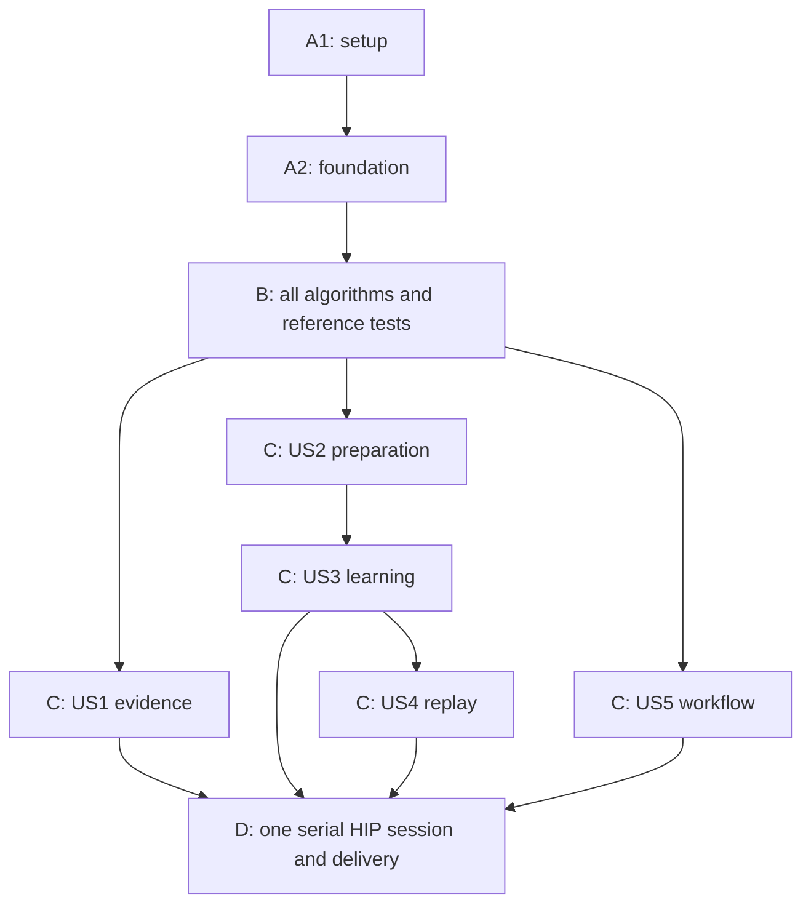

# Tasks: Controlled Generalization Experiments

**Input**: [spec.md](spec.md), [plan.md](plan.md), [research.md](research.md), [data-model.md](data-model.md), [contracts/](contracts/), [quickstart.md](quickstart.md).

**Branch**: `011-controlled-generalization` | **Generated**: 2026-10-30

**Scope**: Generate implementation work only. Checking these tasks requires actual implementation/evidence; none is completed by generating this document. The research campaign E0/P0/P1/P2/P3/P4 is a subsequent operator workflow, not an extra implementation phase or an automatically started experiment.

**Tests**: Explicitly required by specification NFR-001/005 and the constitution. Write independent reference/counterexample tests before the corresponding algorithm, observe the intended failure, then implement. Container/HIP execution occurs only at its declared gate.

## Current status — 2026-10-31

T001–T062 and T069–T070 are complete. The Phase B defects described in the historical
entries below are repaired. T063–T068 remain open for missing environment/operator
evidence and the explicitly excluded HIP execution: T063 needs pinned-container
regressions; T064 needs actual images/build inspection; T065 has a passing synthetic
helper dry run but needs real reduced inputs/preflight; T066 is excluded; T067's
fixture archives pass but the real archive is absent; T068 records NOT RUN.
See [local checks](validation/local-checks.md), [HIP status](validation/hip-acceptance.md)
and [coverage audit](checklists/implementation.md). No research campaign was started.

## Format and organization

Tasks use `- [ ] Tnnn [P?] [USn?] description with exact paths`. Paths are repository-relative; proposed files/directories are created by their owning tasks. `[P]` permits concurrent work only within the documented dependency wave on distinct files. It does not authorize parallel GPU learners or HIP runs.

The task skill's default separate implementation phase per story is adapted to the user's explicit single-algorithm-phase requirement. Setup/foundation map to plan A; **one contiguous phase B contains every complex algorithm and its reference tests**, grouped by story. Phase C contains story-specific routine integration only. Final phase D performs consolidated validation and delivery. An algorithm defect discovered in C/D returns to B and invalidates affected evidence; it cannot become an integration workaround.

## Phase A1 — Setup

**Goal**: Establish prospective contracts and fixture scaffolding without changing historical behavior or implementing algorithms.

- [X] T001 Create the policy package skeleton and public interface stubs in `src/oeis_learn/generalization/__init__.py` and `src/oeis_learn/generalization/interfaces.py`, using the entity/method boundaries in `specs/011-controlled-generalization/data-model.md`; retain existing container dependencies.
- [X] T002 [P] Translate the proposed authority formats into strict schema resources in `src/oeis_learn/generalization/schemas/`, covering preparation, study, cohort, refresh, checkpoint, replay, qualification and evidence versions from `specs/011-controlled-generalization/contracts/artifacts.md`; reject unknown authority fields and incompatible versions in the declared schemas.
- [X] T003 [P] Add mechanically generated fixture inventories and independently computed expected outcomes in `tests/fixtures/generalization/`, covering role isolation, active/inactive control flow, exact grounding, unequal families, censoring, replay and interruption; do not derive expected answers with production algorithms.
- [X] T004 Record the stable algorithm interfaces, independent counterexamples and phase-B handoff/exit criteria in `specs/011-controlled-generalization/contracts/algorithm-handoff.md`, mapping every nontrivial policy to its owner below before stronger-model handoff.

## Phase A2 — Foundational contracts

**Goal**: Make role/mount, CLI and test expectations reviewable before any story algorithm is implemented.

- [X] T005 Define the role-specific file/mount declarations in `src/oeis_learn/generalization/role_contracts.py`: learner has training/replay only, generator/fitter has visible inputs only, selection has selection supervision only, and assessment scores frozen selections; assessment target programs and protected family/stratum labels cannot reach learner/generator.
- [X] T006 [P] Define read-only request/result types and terminal status constants in `src/oeis_learn/generalization/interfaces.py`, including distinct software/scientific statuses, original qualification producer references and separate full-state versus weights-only checkpoint types; do not implement compatibility or state-transition algorithms yet.
- [X] T007 [P] Create contract test cases in `tests/contract/test_generalization_authority.py` and `tests/contract/test_generalization_roles.py` for strict formats and forbidden cross-role payloads, referencing the schemas and mount declarations; write expectations before phase-B validators.
- [X] T008 Add unimplemented prospective command handlers and routing stubs in `src/oeis_learn/pipeline_validation/generalization_cli.py` for the endpoints in `specs/011-controlled-generalization/contracts/cli.md`; handlers must fail explicitly until wired and must not alter existing pilot defaults.

**Exit**: T001–T008 are reviewed. No complex algorithm is hidden in schemas, stubs or fixture generation. All expected outcomes and public interfaces are available for B.

## Phase B — All complex algorithms and reference tests

**Model handoff**: This entire phase is the single stronger-model work unit. Complete T009–T044 before routine integration. Tasks below may have independent test-authoring waves, but remain one phase with one algorithm exit review.

### Shared policies (blocking all story integration)

- [X] T009 [P] Add independent authority, preparation-transition and path/provenance counterexamples in `tests/unit/test_generalization_contracts.py`, including mutable authority, fabricated identities and hidden evaluation payload rejection; establish the failing expectations for T011.
- [X] T010 [P] Add hand-computed token/resource ledger tests in `tests/unit/test_generalization_budgets.py`, covering replay-shortened targets, boundary undershoot, interrupted debits, exhaustion and insufficient checkpoint storage; establish the failing expectations for T012.
- [X] T011 Implement canonical identity, strict format/provenance validation and preparation-to-new-frozen-study transitions in `src/oeis_learn/generalization/contracts.py`; use existing sealing, preserve immutable authority and reject unknown fields, forbidden imported training ancestry and a shortfall producing trainable study output.
- [X] T012 Implement exact cumulative budget and update-boundary accounting in `src/oeis_learn/generalization/budgets.py`: charge actual nonpadding target tokens after replay substitution including encoded EOS, exclude BOS/input/PAD, preserve a pending batch or pre-sampling RNG/cursor, bound cap undershoot by one prospective batch and never replenish resumed budgets.

### US1 — Explain evidence and extend evaluation (P1)

**Goal**: Reconcile fixed-denominator outcomes and distinguish proposal, fitter, conditioning and search contributions without new training.

**Independent test**: A tiny recorded bundle with unequal family sizes, unresolved rows and missing private weights produces exact expected bounds and explicit unavailable status. A shared-bank fixture reuses identical proposals with each target's own visible prefix.

- [X] T013 [P] [US1] Add hand-computed row/macro/paired uncertainty and oracle-union counterexamples in `tests/unit/test_generalization_metrics.py`; require fixed family roster and distinguish completion bounds from statistical confidence.
- [X] T014 [P] [US1] Add proposal-bank/control/cost invariants in `tests/unit/test_generalization_proposals.py`, including recipient-independent generation, charged invalid/duplicate draws and a mixed portfolio sharing one total attempt/time cap.
- [X] T015 [US1] Implement summaries and conservative paired/oracle coverage calculations in `src/oeis_learn/generalization/metrics.py`: for N,S,U use lower=S/N, upper=(S+U)/N and completion=(N-U)/N; average all frozen nonempty families, preserve missing outcomes, and label oracle union as scorer-only coverage.
- [X] T016 [US1] Implement prompt-independent ordered bank construction/reuse and visible-only portfolio policies in `src/oeis_learn/generalization/proposals.py`, freezing model/intervention/seeds, eight charged attempts and 60 seconds per target; record cold and amortized costs separately.
- [X] T017 [US1] Implement parsed proposal signatures, parameter counts, duplicate grouping and first-error/post-fit identity joins in `src/oeis_learn/generalization/diagnostics.py`, preserving failed attempts and unavailable historical fields; target-relative diagnostics run only after frozen assessment selection.
- [X] T018 [US1] Implement offline evidence reconciliation and best/latest checkpoint-roster compatibility policy in `src/oeis_learn/generalization/evidence.py`, rejecting incompatible denominators/source identities and never reconstructing unavailable weights; expose actual exact-fit status/reason and measured queue/service/cleanup fields.

### US2 — Broader frozen benchmark (P1)

**Goal**: Construct a separate challenge with measured coverage and honest shortfalls while preserving historical manifests.

**Independent test**: Deterministic mechanical fixture preparation either satisfies every quota/isolation condition or emits the precise shortfall, with no trainable study or silent fallback.

- [X] T019 [P] [US2] Add deterministic quota/coverage counterexamples in `tests/unit/test_generalization_cohorts.py`, including inactive branches, zero-iteration loops, later stages, values above 64 bits, longer programs and insufficient independent families.
- [X] T020 [P] [US2] Add duplicate/prefix/shift and future-shard leakage counterexamples in `tests/unit/test_generalization_exclusions.py`, covering training, selection and assessment role boundaries and finite-fingerprint limitations.
- [X] T021 [US2] Implement deterministic quota-aware selection and explicit shortfall outcomes in `src/oeis_learn/generalization/cohorts.py`, defaulting to 128 rows per selection/assessment parameter/structural cell, feasible marginal quotas and at least two loop-active plus two branch-active families per structural cell; never redistribute quotas silently.
- [X] T022 [US2] Implement independent execution-coverage observation and frozen stage/length/magnitude/composition summaries in `src/oeis_learn/generalization/coverage.py`; distinguish executed control flow from syntax and disclose distribution differences rather than claim universal compositional isolation.
- [X] T023 [US2] Implement frozen source/group/window exclusion policies in `src/oeis_learn/generalization/exclusions.py`, reusing bounded exact materialization/window checks while isolating structural families and numeric variants according to their holdout types; finite fingerprints must not claim semantic proof.
- [X] T024 [US2] Implement role-projected cohort publication decisions in `src/oeis_learn/generalization/cohorts.py`, emitting opaque visible prompts only to generators and scorer-only target/label manifests; generate new resolved study identity only after all coverage/exclusion commitments pass.

### US3 — Isolated learning interventions and checkpoint selection (P1)

**Goal**: Define reproducible refresh, paired targets, complete resume and preregistered selection/progression.

**Independent test**: A bounded CPU fixture compares static/refreshed inputs and target forms, then interruption/resume yields the same next batches, ledger and checkpoint choices within the declared device contract.

- [X] T025 [P] [US3] Add fixed-support refresh and paired-target safety counterexamples in `tests/unit/test_generalization_refresh_targets.py`, including support expansion via the legacy counter, changed numeric law, loop-carried control dependence, nonlinear repeated multipliers, explicit sharing and more than eight parameters.
- [X] T026 [P] [US3] Add milestone/selection/resume/progression counterexamples in `tests/unit/test_generalization_selection_state.py`, including unequal families, below-95% completion, ties, interrupted pending batches, weights-only restore and assessment influencing an advancement choice.
- [X] T027 [US3] Implement fixed structural descriptors plus independent bounded numeric-variant generation in `src/oeis_learn/generalization/refresh.py` and the opt-in descriptor API in `src/oeis_learn/data/bigint_programs.py`; preserve historical counter semantics and the frozen sampling law, and fail exhaustion without recycling or adding families.
- [X] T028 [US3] Implement exact paired-target grounding and supported-subset/sharing policy in `src/oeis_learn/generalization/targets.py`, reusing codecs and native `crates/oeis_synthesis_core/src/parameters.rs`, `dependence.rs` and `fit.rs`; verify final behavior independently, retain unsupported rows and protect control-sensitive literals without tying equal values accidentally.
- [X] T029 [US3] Implement eligible-checkpoint ordering in `src/oeis_learn/generalization/selection.py`: at least 95% completion on each selection split, greatest structural macro confirmed yield, then parameter macro confirmed yield, then earlier exposure, then stable identity; no eligible checkpoint yields inconclusive/baseline retention, and assessment never ranks candidates.
- [X] T030 [US3] Implement versioned full-state validation and restore transitions in `src/oeis_learn/generalization/state.py`, covering weights, optimizer, scheduler, Python/NumPy/Torch/device RNG, shard cursor/pending batch, replay, checkpoint history/pins and consumed ledger; reject weights-only or incompatible restores.
- [X] T031 [US3] Implement milestone/best/latest/selected pinning and atomic update-boundary commit/prune policy in `src/oeis_learn/generalization/checkpoints.py` and the policy methods of `src/oeis_learn/fresh/bigint_state.py`; preflight required storage and never prune required milestones to conceal a capacity shortfall.
- [X] T032 [US3] Implement frozen comparison/progression and conservative promotion decisions in `src/oeis_learn/generalization/experiments.py`: named E0/P0/P1/P2/P3/P4, three paired seeds for confirmation, mean structural gain at least 5 points, no negative observed seed difference, parameter decline at most 5 points and >=95% completion per primary cell; unresolved bounds that cannot establish the rule yield inconclusive, and adaptive assessment exposure requires fresh confirmation.

### US5 — Qualification, bounded execution and evidence policies (P1)

**Goal**: Establish safe cross-command reuse and complete/partial evidence semantics before orchestration.

**Independent test**: Fake producers/consumers accept only intact compatible original PASS evidence; changing any authoritative source/image/device/contract fact rejects reuse. Every injected failure has a precise terminal status and bounded recovery artifact plan.

- [X] T033 [P] [US5] Add independent qualification/source-closure counterexamples in `tests/unit/test_generalization_qualification.py`, covering changed/unmapped source, image, HIP runtime/device, precision, resources, suite coverage, tampered payload and a REUSED-only producer chain.
- [X] T034 [P] [US5] Add ledger/bundle/preflight failure counterexamples in `tests/unit/test_generalization_recovery.py`, including missing mandatory stages, oversized payloads, insufficient reservations, CPU-only HIP claims, interrupted export and conflicting study identities.
- [X] T035 [US5] Implement qualification-specific identity/coverage matching in `src/oeis_learn/generalization/qualification.py`, with exact current source/build/image/device/runtime/precision/resource/security equality and intact original PASS producers; preserve full study identity separately and require completed feature acceptance before research runs.
- [X] T036 [US5] Implement bounded workflow transition/restart/recovery policy in `src/oeis_learn/generalization/recovery.py`, retaining immutable terminal receipts, fresh output roots, precise repeat reasons and full-state learner-resume requirements; preserve PASS=0, FAIL=1, BLOCKED/PARTIAL/INCONCLUSIVE=3, INTERRUPTED=130.
- [X] T037 [US5] Implement complete/partial bundle reconciliation and redaction policy in `src/oeis_learn/generalization/bundles.py`, verifying payload size/hash, mandatory original qualification evidence, summaries, omissions and distinct software/scientific statuses; exclude private state and sealed truth without silently dropping required results.
- [X] T038 [US5] Implement effective resource/preflight reservation decisions in `src/oeis_learn/generalization/resources.py`, enforcing the contract's 64 GiB study root, 32 GiB checkpoints, 8 GiB shards, 4 GiB raw evidence/logs, 512 MiB sharing cap and <=100-line/1 MiB log tails; reserve acceptance stages at 10/120/10/75/15 minutes plus 10-minute margin within four hours, and never authorize automatic research work with leftover time.

### US4 — Bounded verified replay (P2)

**Goal**: Admit only independently verified shorter training alternatives and sample tasks fairly within explicit limits.

**Independent test**: Known prefix-only failures, forbidden sources, duplicates and fabricated verification are rejected; adding alternatives to one task does not multiply its probability, and empty replay/snapshot restore remain valid.

- [X] T039 [P] [US4] Add full-horizon admission/provenance counterexamples in `tests/unit/test_generalization_replay_admission.py`, including production/reference disagreement, invalid grounding, forbidden selection/assessment/OEIS ancestry and false admitted flags.
- [X] T040 [P] [US4] Add independent task-weight/cap/eviction/restore examples in `tests/unit/test_generalization_replay_sampling.py`, including empty admission and state cursor restoration.
- [X] T041 [US4] Implement training-only exact replay admission policy in `src/oeis_learn/generalization/replay_admission.py`, verifying all 100 training terms against the mechanical oracle and independent execution, strictly shorter frozen-length targets, source/token consistency, original/final source, assignment and origin checkpoint; keep original mechanical targets available.
- [X] T042 [US4] Implement versioned task-first replay/eviction/snapshot policy in `src/oeis_learn/generalization/replay_policy.py`, enforcing at most two alternatives/task, 4,096 globally and 25% replay examples/update, deterministic oldest-admission/identity eviction and explicit source-versus-finite-behavior duplicate scope; do not reinterpret historical replay state.
- [X] T043 [US4] Implement one-round search/distillation and paired-control budget policy in `src/oeis_learn/generalization/replay_round.py`, limiting search to 256 training tasks, eight attempts and 60 seconds/task plus four aggregate hours, then 4M extra target tokens/two learner hours per arm with 1M/2M/4M checkpoints; keep search cost explicit and empty yield terminal without weaker verification.

### Phase-B exit gate

- [X] T044 Run and reconcile all algorithm reference/differential tests from T009–T043, complete the ownership/invariant matrix in `specs/011-controlled-generalization/contracts/algorithm-handoff.md`, and record the stronger-model exit review in `specs/011-controlled-generalization/validation/algorithm-review.md`; every nontrivial policy must be tested and callable through stable interfaces before C starts.

## Phase C — Routine story integration

Only adapters, registration, I/O and end-to-end wiring belong here. All decisions call phase-B policies. Do not design new algorithms while connecting them.

### US1 integration — Independent recorded/retained-weight evaluation

- [X] T045 [US1] Add fixture workflow tests in `tests/integration/test_generalization_evidence.py` for recorded evidence, absent private weights, best/latest identities, matched raw/rescue/control budgets and shared-bank application using phase-B outputs.
- [X] T046 [P] [US1] Wire collect/evaluate operations to existing diagnostics/native generation in `src/oeis_learn/pipeline_validation/generalization_evaluation.py`, loading exact selected checkpoint hashes and separating visible generation, selection supervision and authorized assessment mounts.
- [X] T047 [P] [US1] Wire read-only aggregation/report operations in `src/oeis_learn/pipeline_validation/generalization_reporting.py`, exporting per-attempt/family/seed results, fitting phase telemetry, measured queue/service/cleanup costs and unavailable fields through the phase-B reconciliation policies.

### US2 integration — Prepared benchmark and isolation

- [X] T048 [US2] Add preparation/publication integration cases in `tests/integration/test_generalization_preparation.py`, proving deterministic manifests, active coverage, shortfall termination, forbidden mount access and no trainable study on failure.
- [X] T049 [US2] Connect bounded exact materialization, native/reference admission and immutable shard publication in `src/oeis_learn/pipeline_validation/generalization_preparation.py`; use separate preparation authority and emit resolved `study.json` under operator outputs only.
- [X] T050 [US2] Wire explicit role-specific files/mounts in `src/oeis_learn/pipeline_validation/generalization_roles.py`, keeping assessment continuations/target programs/protected labels out of learner/generator payloads rather than filtering a shared file by convention.

### US3 integration — Learning, checkpointing and named pilots

- [X] T051 [US3] Add bounded paired-training/interruption integration scenarios in `tests/integration/test_generalization_training.py`, checking static/refresh exposure, both target formats, uninterrupted-versus-resumed next batches/state and retained milestone hashes.
- [X] T052 [US3] Wire prospective training arms/seeds to the existing model and native execution adapters in `src/oeis_learn/pipeline_validation/generalization_training.py` and the new-profile route in `src/oeis_learn/fresh/bigint_worker.py`; call refresh/target/token policies and use actual post-substitution targets for charging.
- [X] T053 [US3] Connect atomic state persistence and pinned artifacts to the existing checkpoint store in `src/oeis_learn/fresh/bigint_state.py`, routing prospective resume through T030–T031 while preserving historical state/profile behavior.
- [X] T054 [US3] Add frozen prospective recipe templates under `configs/foundation/pipeline_studies/` for E0, P0, P1-screen/confirm, P2, P3 and P4, reflecting `specs/011-controlled-generalization/contracts/experiments.md`; validate single changing factors, recipe-specific milestones, separate selection/assessment identities and exact cap/seed lists without executing the campaigns.
- [X] T055 [US3] Add opt-in `--arms uniform` and qualification routing to `src/oeis_learn/pipeline_validation/followup_study.py` and its existing host entrypoint, with regression coverage in `tests/unit/test_pilot_followup.py`; keep the default three historical arms/selection semantics and report missing seed16 instead of fabricating confirmation.

### US5 integration — Canonical endpoints and serial helper

- [X] T056 [US5] Add fake-adapter end-to-end cases in `tests/integration/test_generalization_acceptance.py`, checking one qualification execution across consumers, stale receipt rejection, new-root restart, report failure recovery and verified partial archives; use synthetic fixtures before real hardware.
- [X] T057 [US5] Register all prospective preflight/qualify/prepare/evaluate/train/replay/report/verify-bundle/acceptance endpoints in `src/oeis_learn/pipeline_validation/generalization_cli.py` and `scripts/foundation_local.py`, retaining confined relative paths, parser conventions and existing command behavior.
- [X] T058 [US5] Connect canonical producer/consumer receipt and current image/HIP inspection I/O in `src/oeis_learn/pipeline_validation/runner.py`, `src/oeis_learn/pipeline_validation/adapters.py` and `src/oeis_learn/pipeline_validation/reuse.py` to T035–T038 policies; pass original producer references through prospective endpoints without weakening historical study bindings or accepting REUSED-only evidence.
- [X] T059 [US5] Create the stdlib-only serial subprocess helper `scripts/generalization_hip_serial.py`, forwarding preflight→qualify→prepare→five bounded acceptance cases→report→verify-bundle, with dry-run and verified `--reuse-run`, reserved final packaging time and no unchecked skip/start-step or automatic full research runs.
- [X] T060 [US5] Register new CPU/native/HIP test selections in `src/oeis_learn/container_validation.py`, include new modules/helper/authoritative contracts in `src/oeis_learn/experiments/source_snapshot.py`, and update Dockerfile/package inclusion only where required; verify changed/unmapped authority invalidates qualification while prospective recipe identities remain independently hashed.

### US4 integration — Training-only replay round

- [X] T061 [US4] Add complete one-round/paired-control integration cases in `tests/integration/test_generalization_replay.py`, exercising production/reference admission, empty yield, task-first sampling, resume and separate current-policy/cumulative-discovery accounting.
- [X] T062 [US4] Wire prospective replay policy/admission and the canonical replay endpoint in `src/oeis_learn/fresh/replay.py`, `src/oeis_learn/fresh/bigint_worker.py` and `src/oeis_learn/pipeline_validation/generalization_replay.py`; preserve historical replay behavior and explicitly reject unregistered replay/representation interactions.

**Exit**: All story integration fixtures pass through canonical production paths. The new public commands become runnable only after these registrations. Every story's independent criterion above is exercised without running a full research campaign. Freeze source, helper, authority and image inputs for D.

## Phase D — Consolidated validation, polish and delivery

- [ ] T063 Run the appropriate local/qualification-container reference, contract and integration regressions, including historical v3/v4 behavior and new suites registered in `src/oeis_learn/container_validation.py`, and write the exact selection/results to `specs/011-controlled-generalization/validation/local-checks.md`; return algorithm defects to B before hardware.
- [ ] T064 Prebuild and inspect the pinned qualification/GPU targets using `Dockerfile` and committed locks; record immutable images, whole source/build closure, hardware/resource observations and helper hash in the operator's `run-state/generalization/acceptance-inputs.json` without altering host drivers or source during the session.
- [ ] T065 Dry-run and preflight `scripts/generalization_hip_serial.py` with the reduced acceptance manifest under `run-state/generalization/`, verify all stage reservations fit the four-hour ceiling including recovery, and stop before costly work if quotas/artifacts/resources are infeasible.
- [ ] T066 Execute exactly one normal serial HIP acceptance invocation via `scripts/generalization_hip_serial.py`, writing a fresh `run-state/generalization/acceptance-001/` plus its sibling archive; prove actual checkpoint load and finite HIP parameter updates, refresh, both target forms, verified replay and full-state resume, with qualification executed once per required scope.
- [ ] T067 Independently verify the complete/partial archive with the canonical `generalization verify-bundle` endpoint and existing bundle checks in `src/oeis_learn/pipeline_validation/bundle.py`, reconciling all payload hashes, stage/attempt/family totals, omissions, costs and software/scientific statuses; preserve private states and sealed truth outside sharing output.
- [ ] T068 Record actual acceptance results and any minimal justified rerun/invalidated producer in `specs/011-controlled-generalization/validation/hip-acceptance.md`; a failed session remains failed and requires targeted repair/requalification, never an undocumented skip or a false PASS.
- [X] T069 Update `specs/011-controlled-generalization/quickstart.md` and the relevant usage section in `README.md` with implemented commands, verified restart instructions and the E0→P0→P1 research sequence, clearly distinguishing delivered capability from unexecuted research outcomes.
- [X] T070 Audit requirement/story/task coverage and the single-algorithm/single-normal-HIP constraints in `specs/011-controlled-generalization/checklists/implementation.md`, commit the completed implementation/evidence incrementally and make the final PR description reflect actual behavior and validation; do not start E0/P0/P1 automatically.

## Dependencies and execution order

Shared B contracts/metrics/qualification may be tested with pure fixtures before any full story exists. Tests precede their corresponding implementation within each story. T009/T010 establish failing independent tests before T011/T012 implement shared policies; T013/T014 then gate T015–T018; T019/T020 gate T021–T024; T025/T026 gate T027–T032; T033/T034 gate T035–T038; T039/T040 gate T041–T043. T044 gates **all** C work.

C story groups can use fixture adapters independently; US3's real prepared-data path depends on US2, and US4's real learner path depends on US3. US5's helper can be wired to stubbed case contracts before final US4 registration, but the complete session waits for all C tasks. T057–T058 supply the common CLI/qualification routing for public execution of each story. T063–T065 gate T066; failures reopen B/C as appropriate before a justified new invocation. No research campaign is a dependency of software acceptance.

## Parallel opportunities and examples

Only `[P]` tasks are candidates, after their stated prerequisites. All marked tasks use disjoint files in their wave; maintain a single owner for shared interfaces/source files. Example scheduling:

| Story / wave | Parallel tasks | Prerequisite |
| --- | --- | --- |
| Shared scaffold | T002 schemas and T003 golden fixtures | T001 interface sketch |
| Shared contract tests | T006 type declarations and T007 contract expectations | T005 role declarations; coordinate frozen interface names |
| Shared algorithm verification | T009 authority tests and T010 budget tests | A contracts and failing stub expectations; T011/T012 follow |
| US1 algorithms | T013 metric tests and T014 bank tests | Shared B contracts |
| US1 integration | T046 evaluation adapter and T047 reporting adapter | T044 and T045 fixture contract |
| US2 algorithms | T019 cohort tests and T020 exclusion tests | Shared B contracts |
| US3 algorithms | T025 refresh/target tests and T026 state/selection tests | Shared B contracts and fixture identities |
| US5 algorithms | T033 qualification tests and T034 recovery tests | Shared B contracts |
| US4 algorithms | T039 admission tests and T040 sampler tests | Shared B contracts and training-only fixture roster |

These examples do not spawn agents or select a model automatically. The operator may assign B to the stronger model as one handoff. C/D may use a routine implementation model after B's exit review.

## Independent story acceptance and suggested MVP

| Story | Independently demonstrable increment | Tasks owned by story |
| --- | --- | --- |
| US1 (P1) | Reconcile recorded evidence and evaluate available retained weights with matched controls/shared bank; no new training. | T013–T018, T045–T047 (9) |
| US2 (P1) | Deterministic challenge preparation with active coverage, isolation and explicit shortfall. | T019–T024, T048–T050 (9) |
| US3 (P1) | Isolated bounded training/target comparisons, complete resume, pinned checkpoints and named first-pilot recipes. | T025–T032, T051–T055 (13) |
| US5 (P1) | Fake-adapter serial workflow with valid reuse/recovery, followed by shared final real-HIP acceptance. | T033–T038, T056–T060 (11), plus shared D gate |
| US4 (P2) | Training-only verified replay round with task-balanced sampling and explicit extra cost. | T039–T043, T061–T062 (7) |

**Suggested MVP demonstration**: US1's evidence/evaluation extension, after A and the complete B handoff, plus T057–T058's shared public routing. Recorded/fake-device fixtures can demonstrate it before real hardware; real HIP readiness is claimed only after D. This MVP is a review milestone, not permission to omit US2/US3/US4/US5 from the requested implementation scope.

**Incremental delivery**: Commit after each task/logical group. Finish A; complete/review B as one stronger-model phase; integrate independent story adapters, then full data/learner/replay paths; run one consolidated D session; package evidence and stop. Operator-authorized research subsequently follows E0 evaluation, P0's two extra uniform seeds, P1 static/refresh, then isolated P2/P3/P4, using the contracts' progression and fresh-assessment rules.

## Requirement coverage

| Requirements | Owning tasks |
| --- | --- |
| FR-001–004 | T002, T005, T007, T009–T012, T023–T024, T028, T041, T050 |
| FR-005–011 | T013–T018, T045–T047, T057, T067 |
| FR-012–016 | T019–T024, T048–T050, T054 |
| FR-017–024 | T025–T032, T051–T055 |
| FR-025–029 | T039–T043, T061–T062 |
| FR-030–032, FR-035–036 | T026, T029, T032, T054–T055, T069 |
| FR-033–034 | T034, T036–T038, T047, T056–T060, T067–T070 |
| NFR-001–002, SC-008 | T004, all T009–T044, T070; no algorithm implementation in A/C/D |
| NFR-003–005, SC-006–007 | T033–T038, T056–T060, T063–T068 |
| NFR-006–008 | T001, T009–T012, T030–T031, T038, T050, T053, T055, T060, T063–T070 |
| SC-001–005, SC-009 | Independent criteria above, T013–T043 reference cases and T045–T062 integration fixtures |

## Generation validation

70 sequential tasks, initially generated unchecked; Phases A/B T001–T044 are now complete (44 checked, 26 pending); 49 story-labeled and 21 shared/setup/final tasks. Story totals: US1=9, US2=9, US3=13, US4=7, US5=11. Eighteen tasks are marked `[P]` in explicitly bounded waves. All tasks have file paths; all story tasks carry `[USn]`. Mandatory tests are included because the spec and constitution request them. Extension hooks were checked before and after generation; no `.specify/extensions.yml` is present. Generating this file completes no implementation, test or hardware task.

## Phase A completion

T001–T008 are implemented. See [phase-a.md](validation/phase-a.md) for actual contract/regression, deterministic-fixture and packaging evidence, plus the container/HIP limitations. Phase B T009–T044 is implemented; see [algorithm-review.md](validation/algorithm-review.md) for policy review and local evidence. Phase C remains pending.

## Integration prerequisite failure

Phase C started but is blocked at reporting/evidence integration. T037 and T044
are reopened: a hash-valid bundle with fabricated family totals passes verification.
The regression is `test_offline_complete_bundle_and_stale_summary[True]` in
`tests/unit/test_generalization_recovery.py`. T045–T047 have draft callback adapters
and two passing tests, but remain unchecked because production native/model wiring
and complete report reconciliation are unfinished. No C/D completion is claimed.
See [local-checks.md](validation/local-checks.md).

## Reconciliation repair

The integration prerequisite failure above is resolved by strict frozen-roster,
per-attempt reconciliation. T037/T044 are checked again following 131 passing tests
and 4 subtests; see the latest algorithm-review entry. Phase C tasks remain unchecked.

## Phase C continuation: preparation and recipe increment

T054 now has seven sealed E0/P0/P1-screen/P1-confirm/P2/P3/P4 templates with fixed
seeds, budgets, milestones, single changing factors, isolated scoring roles and
explicit unresolved preparation inputs. They are not runnable studies. T048–T050
have tested bounded per-cell publication and mount-resolution adapters; their full
end-to-end registration is pending. T060 has CPU test/source closure registration;
feature-specific HIP selections still require actual integration. These partial
tasks remain unchecked.

## Full-state/update/replay continuation

Implemented callable full-state persistence, pending-batch update and bounded native
replay/restore adapters with four new integration fixture tests. T051–T053 and
T061–T062 remain unchecked because end-to-end production routing is still pending.
Current local selection: 140 passed, 4 subtests passed. No HIP command executed.

## Preparation and role-isolation integration closure

T049/T050 are complete at the adapter boundary. The installed preparation role uses
bounded native execution, independent reference admission and immutable publication;
its fixture reproduces the same resolved study as the direct production adapter.
All seven roles enforce exact input channels, read-only inputs, disjoint output and
rejection of undeclared/overlapping mounts. Exact file projections omit unnamed
files. Preparation/role tests: 28 passed. Native callbacks and the container launcher
are replaced in these fixtures; this does not assert native/container qualification.
Public preparation endpoint registration remains tracked separately by T057.

## Current implementation gate (2026-10-31)

T011/T044 are reopened by the retained-initializer authority counterexample in
`tests/unit/test_generalization_contracts.py`. P4 must freeze its common retained
literal initializer, but preparation/study model contracts currently allow only
`initialization: random`; the study validator accepts a P4 declaration with no
retained initializer. See `validation/algorithm-review.md` for the required Phase-B
repair. Remaining C integration is gated; no runtime-only initializer override may
stand in for frozen study authority.

T060 is complete: CPU/native/HIP selections, installed resources and source closure
were audited; owning modules, helper, tests and authoritative contracts invalidate
reuse when changed, while prospective recipe JSON stays independently hashed.
The registration tests pass. This registers HIP tests but does not execute them.

Additional committed C work exposes verified retained weight descriptors, computes
loss/behavior selection on one candidate roster, adds frozen authorized assessment
scoring, isolates replay proposals from training audits, durably records search
reservations, and checks replay tasks against prepared training shards. T046, T052,
T053, T061 and T062 remain unchecked because their complete canonical workflows are
not yet wired. D documentation/check coverage is updated without claiming hardware
validation or a complete implementation.

### Retained initializer gate restored

T011/T044 are complete again. Version 2 study/preparation contracts freeze a common
retained initializer; version 1 retains its random-only meaning. The original
P4 counterexample and independent lineage/selection/producer/tamper cases pass.
The combined regression selection passes 262 tests plus 9 subtests, with the GPU
test deselected. Continue C/D; the earlier initializer blocker is superseded.

### T053 checkpoint selection persistence complete

Sanitized best/selected decision identities persist with all retained generations
in a fresh atomic full-state store. The installed learner pin-selection operation
receives no selection supervision. Resumed training preserves descriptor identities,
selection state and pins, and matches uninterrupted CPU weights exactly. The focused
training/scoring suite passes 16 tests. Public command routing remains T057.

## Canonical integration completion — 2026-10-31

All Phase C tasks T045–T062 are implemented. Canonical routes connect frozen
preparation views, exact retained evaluation/assessment, training/resume/selection
pins and original initializer publication, paired replay/current-policy evaluation,
original qualification consumption, and the five-case serial acceptance session.
Complete and partial software acceptance archives independently verify original
case proofs and preserve workflow failure. The helper forwards immutable images,
reserves final packaging, and copies the verified archive to the session sibling.
CPU/fixture tests include real tensor updates and complete state comparison; they
do not establish container/native/HIP qualification. Current evidence and remaining
environment gates are recorded at the top of validation/local-checks.md.

## Reconstructed convergence work — 2026-10-31

The earlier conversational T071–T079 completion report and commit IDs are not
supported by Git objects. The exact former task wording is unavailable. The tasks
below are a new, explicit reconstruction from spec/plan requirements, starting at
verified remote commit `6e63421e2d8ef137d01d1d701f9fb0205b012059`. They do not claim
recovery of the earlier implementation. Existing T063–T068 evidence gates stay open.

### Reopened Phase B — policy repairs and independent counterexamples

- [X] T071 Require comparable frozen selection rosters and retain unsupported target rows safely in `generalization/selection.py`, `targets.py` and their independent unit tests (FR-019/022/023).
- [X] T072 Bind the complete runtime execution choices and resolved recipe to new study/preparation versions in `generalization/execution.py`, `contracts.py`, `schemas/` and contract tests; prevent sidecar resealing from changing a frozen experiment (FR-001/021, NFR-008).
- [X] T073 Enforce named experiment/acceptance-case policies, evaluation-only E0, matched paired batches, fixed refresh mixtures and bounded acceptance scope in `generalization/execution.py` and counterexamples (FR-005/017/018/021, NFR-005).
- [X] T074 Define verified weights-only legacy import policy in `generalization/legacy.py` with tampering/lineage tests. Preserve original uniform provenance and historical best-loss meaning; never invent a full-state resume or selection-designated initializer (FR-002/005/022/024).

### Phase C — reconstruction integration

- [X] T075 Wire the reviewed execution/target policies into preparation/runtime/selection and add regression cases in existing integration tests. Preserve historical formats for inspection; new executable inputs use the bound versions.
- [ ] T076 Implement stdlib input assembly and legacy-import commands in `scripts/generalization_inputs.py` and `pipeline_validation/generalization_inputs.py`, with complete input hash checks, fresh destinations, examples and host-isolation tests.
- [ ] T077 Wire strict four-child acceptance assembly and case dispatch, preserving one qualification and the existing serial canonical endpoint sequence; test dry-run and fail-closed missing inputs before any engine launch.

### Phase D — local validation and truthful delivery

- [ ] T078 Register added tests/source/package files and run the available reference, contract, integration, host-portability and historical regressions. Record actual results and unavailable native/container/HIP gates.
- [ ] T079 Update contracts, quickstart and recovery evidence; verify each new commit exists and provide a transferable Git bundle plus concrete next steps. No HIP or research run is part of reconstruction.
