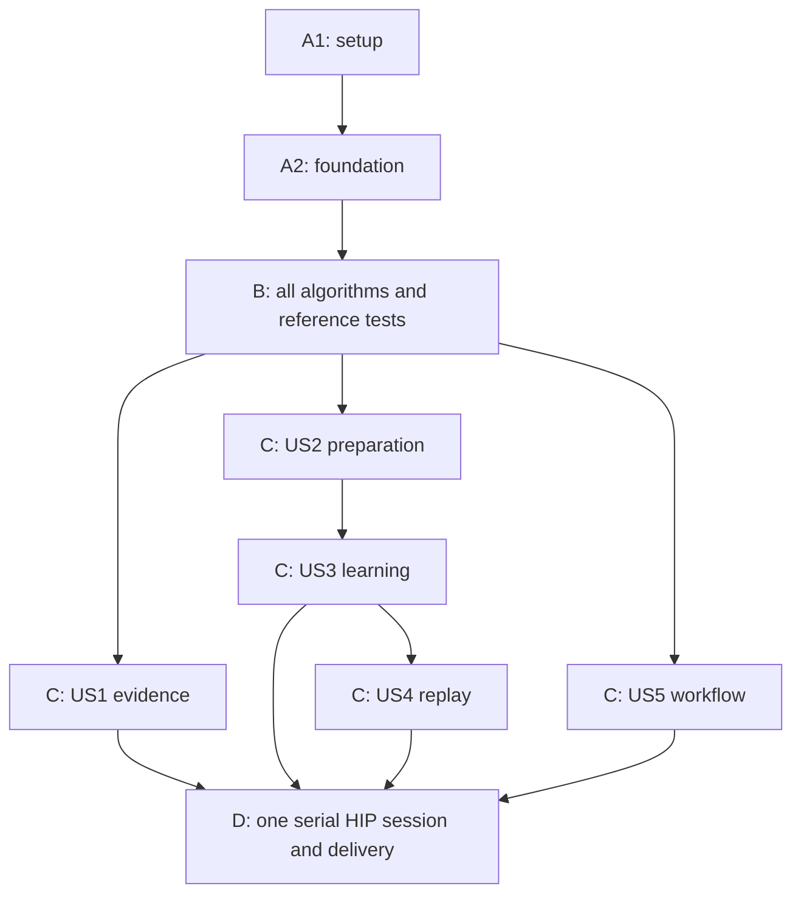

# Tasks: Controlled Generalization Experiments

**Input**: [spec.md](spec.md), [plan.md](plan.md), [research.md](research.md), [data-model.md](data-model.md), [contracts/](contracts/), [quickstart.md](quickstart.md).

**Branch**: `011-controlled-generalization` | **Generated**: 2026-10-30

**Scope**: Generate implementation work only. Checking these tasks requires actual implementation/evidence; none is completed by generating this document. The research campaign E0/P0/P1/P2/P3/P4 is a subsequent operator workflow, not an extra implementation phase or an automatically started experiment.

**Tests**: Explicitly required by specification NFR-001/005 and the constitution. Write independent reference/counterexample tests before the corresponding algorithm, observe the intended failure, then implement. Container/HIP execution occurs only at its declared gate.

## Current status — 2026-11-01 UTC

Acceptance-015 independently verifies as software FAIL/science UNMEASURED.
CPU qualification passed 1187 tests plus77 subtests; HIP passed27 tests. One
retained evaluator reported NonQuiescentWorker; the other completed. Later cases
were unstarted. The operator authorized a temporary selective diagnostic helper
instead of another full qualification cycle. T114 below owns that helper; it
does not close the final hardware gates or change production acceptance rules.

Latest evidence, 2026-11-01 Pacific: resume-matrix-001 verifies. All three new
continuations and the earlier resumed endpoint match exactly; only the original
uninterrupted endpoint differs. Stage elapsed total219.628s. No production cause
is established. T118 adds one fresh-start matrix; T064–T067 remain open.

Latest evidence, 2026-11-01 Pacific: fresh-001 verifies (176.265s). Fresh A,
B and pause/resume equal the original uninterrupted endpoint. New and old paused
states and all initial state comparisons also equal. The old resumed endpoint
still differs. Value equality alone does not establish equivalent representations
or historical process/backend conditions; T119 adds CPU-only inspection of existing
files. No new HIP run is justified before reading that available evidence.

Latest evidence, 2026-11-01 Pacific: layout-001 verifies (15.233s). Old/new
pause weights, optimizer, replay and all RNG serialized hashes are identical;
values/layout/storage aliasing/order match. Only elapsed-time/history/pins differ.
No production source/build/host-script changes occurred after diagnostic-001's
helper commit5ac9d72, and the learner image is unchanged. A later learner fix does
not explain the fresh passing result. T120 adds controls plus per-update tracing;
no causal defect or hardware-gate closure is claimed.

Latest evidence, 2026-11-01 Pacific: trace-001 verifies (243.718s). Old/new
controls differ and each equals its traced counterpart. Matching restored
batch/weights/optimizer/RNG hashes first diverge at forward logits in overall
update2, before optimizer mutation. Old now equals original, new equals the old
resumed endpoint: association with checkpoint age reverses. T121 tests one
explicit diagnostic backend configuration; no causal production fix is claimed.

Latest evidence, 2026-11-01 Pacific: blas-001 verifies (274.884s). Original-policy
controls still differ; both modified continuations and their full observed phase
traces match exactly, including buffers/modes, and reproduce the original full
endpoint. This supports a candidate combined mitigation, not a proven individual
cause. T122 tests fresh full versus paused/resumed execution without tensor tracing.
Production policy and final T064–T067 gates remain unchanged.

Latest evidence, 2026-11-01 Pacific: blas-fresh-001 verifies (200.294s), but
fresh repeat equality passes and fresh full/resume equality fails in weights and
optimizer. The combined BLAS policy is insufficient and must not be promoted.
T123 adds module-level input/output observations to the existing controlled trace;
no new numerical policy is proposed and T064–T067 remain open.

Latest evidence, 2026-11-01 Pacific: layers-001 verifies (251.158s). Controls
still differ, but both traced endpoints and all202 module events match. One traced
endpoint differs from its control, so synchronized module tracing has an observer
effect and cannot localize the original divergence. T124 defers module CPU reads
until forward completion; no production fix or gate closure is claimed.

Latest evidence, 2026-11-01 Pacific: deferred-001 verifies (291.009s). The
first differing module is encoder.s1_magnitude.mlp.3 (Linear): input hashes match,
output hashes differ, and the preceding Linear/GELU/Dropout events match. Controls
agree but traced runs differ, with one observer effect; this localizes a measured
operation without proving the underlying kernel cause. T125 isolates its operands.
T064–T067 remain open; no production change or tolerance relaxation is justified.

Latest evidence, 2026-11-01 Pacific: linear-001 verifies (337.703s). Both captured
operand sets match; all64 evaluations per capture are stable across tested offsets.
Native/flattened Linear match the observed output; separate-bias variants are
stable but round differently. Controls still differ and capture changes an endpoint,
so the original divergence is not reproduced in the isolated loop. T126 replays
saved operands across fresh GPU processes with zero model/training work.

Latest evidence, 2026-11-01 Pacific: processes-001 verifies. Identical captured
operands produce varying native/flattened Linear hashes across fresh processes
under original and earlier rocBLAS settings; hipBLASLt solution indices vary.
The explicit no-Lt arm and separate-bias variants match across all three processes.
This is a reproduced operation-level distinction, with a candidate full-path
mitigation. T127 requests no-Lt in the untraced fresh matrix; T064–T067 remain open.

Latest evidence, 2026-11-01 Pacific: no-lt-fresh-001 verifies (219.284s). Both
fresh uninterrupted endpoints and the uninstrumented pause/resume endpoint match
exactly in all six components. Historical numerical endpoints differ, as expected
for the changed computation path. T128 installs the measured startup policy and
binds it to qualification/checkpoint compatibility; T129 supplies one fresh final
acceptance invocation. Only actual hardware gates T064–T067 remain unchecked.

### Production numerical policy repair

- [X] T128 Promote the measured no-Lt prospective execution policy through one
  stdlib descriptor and startup environment. Verify actual accepted preference and
  flags on CUDA learners; bind the policy identity into full-state compatibility,
  qualification runtime facts and device evidence. Apply it to the prospective
  qualification suite and explicit prospective roles without changing historical
  default commands. Test startup, both engines, receipt/checkpoint invalidation,
  schema handling and CPU paths; preserve strict equality and old evidence.
- [X] T129 Record no-lt-fresh-001 evidence, update contracts/dispositions and provide
  a consolidated rebuild/input-freeze/fresh qualification/final-acceptance command.
  Run local gates, commit/push logical changes and leave actual HIP gates open.

T128/T129 validation:387 generalization/container tests pass,1 Wasmtime-dependent
model test skips and1 GPU test is deselected; final targeted policy/container/reuse
checks pass35 tests. Standard-library-only host imports pass under python3 -S.
The current disposition identity was refreshed and all68 original mappings verify.
Supplemental historical handoff tests pass21 and fail3 on missing local Wasmtime;
phase13 input tests cannot collect for that same dependency. Those native checks
remain for the pinned qualification image, not represented as passes. No local HIP
or real image build ran, and CI was not awaited. New source requires a rebuild and
fresh original qualification; previous producer reuse is not authorized.

### Temporary diagnostic iteration (operator authorized 2026-10-31 Pacific)

- [X] T127 Reconcile processes-001's cross-process Linear reproduction and
  stable no-Lt arm. Share explicit addmm-Lt bypass configuration with the existing
  uninstrumented fresh matrix, preserve earlier policy semantics and accurate
  intervention labels, test pre-import setup and stage propagation, and publish
  one fresh full/resume command. No production promotion before measured validation.

T127 validation:101 local helper tests pass after the intended unsupported-policy
failure. Tests verify addmm bypass variables before backend selection, untraced
fresh stage propagation/routing, earlier policy compatibility and effect labeling.
No production inventory changed; no local HIP or CI wait. Full fresh repeat/resume
under this explicit policy is the remaining operator measurement.

- [X] T126 Reconcile linear-001's stable isolated evaluations and add a temporary
  stdlib-host saved-operand replay runner: verify private capture hashes before
  loading, isolate three fresh processes per experimental configuration, compare
  cross-process variant hashes, preserve bounded cleanup/failure archives and
  forbid operand export. Exercise both Engine constructors and corruption/binding
  rejection. No model loading/training, production fix or feature qualification.

T126 validation:99 local helper tests pass after four intended failures. Tests cover
fresh-process schedule/classification, captured hash corruption, both real Engine
constructors, cleanup failure and private-operand exclusion from failure archives.
Production inventory is unchanged; no local HIP or CI wait. Actual cross-process
replay is one operator command, nine isolated GPU processes, zero training updates.

- [X] T125 Record deferred-001's first unequal Linear output from equal inputs.
  Add a bounded operand-level probe of that exact layer to the existing helper:
  capture input/weight/bias/output privately, compare native Linear, flattened
  Linear and separate bias formulations across repeated/aligned allocations,
  report exact statistics and preserve operands for future reuse. No tolerance or
  production change; upstream reports are hypotheses, not diagnoses of this run.

T125 validation:93 local helper tests pass after the initial missing-function
counterexample. Tests cover captured operand shape/type checks, exact small-integer
controls, numerical metadata, fixed repeat counts, stage propagation, actual target
hook capture/cleanup and private tensor retention. CPU alignment variation during
probe development motivated separate within-layout and across-layout statistics;
it is not evidence of the HIP cause. No production inventory changed, no local HIP
ran and CI was not awaited. Actual operation-level reproduction remains pending.

- [X] T124 Reconcile layers-001's observer effect and add deferred module capture
  to the same temporary trace. Clone observed tensors on their current device,
  defer CPU fingerprinting until forward completion, enforce memory/node/event
  bounds and hook cleanup, preserve controls and disclose allocation/timing effects.
  Test immutable capture and absence of CPU reads during capture. No production
  backend change or claim that synchronized trace agreement resolves the failure.

T124 validation:90 local helper tests pass after five intended failing tests.
Tests cover immutable device-side capture,1 GiB memory rejection, no CPU reads
inside the observed original forward, unchanged CPU update/RNG, and hook cleanup
on failure in immediate/deferred modes. The same four-branch/eight-update schedule
remains. No production inventory changed, no local HIP ran and CI was not awaited.
Actual deferred-capture observer effects remain an operator measurement.

- [X] T123 Record blas-fresh-001 as failed exact resume, reject promotion of the
  combined BLAS candidate, and extend the existing trace with bounded module
  input/output fingerprints during the first continuation forward. Compare the
  earliest differing module and whether its inputs match; preserve controls,
  hook cleanup, stdlib host operation, private-value exclusions and failure export.
  No speculative production fixes or numerical tolerance changes.

T123 validation:86 local helper tests pass after three intended failing tests.
CPU update/RNG preservation covers module tracing enabled/disabled; hook cleanup
on forward failure, earliest-module input/output classification, stage propagation
and bounded trace reads are tested. The same original-policy controls and eight
updates remain; observation overhead is an explicit intervention. No production
source inventory changed, no local HIP executed and CI was not awaited.

- [X] T122 Reconcile blas-001's candidate mitigation and extend the existing
  fresh matrix with an explicit uninstrumented diagnostic policy. Apply the
  same requested BLAS configuration to both fresh full runs, the pause and its
  continuation; verify bootstrap scope and policy/result labeling, retain exact
  comparisons, separately hash dependencies and preserve diagnostic-only status.
  No production policy or historical qualification change before this measurement.

T122 validation:82 local helper tests pass after two intended failing tests.
Bootstrap tests prove BLAS configuration is applied while torch_update remains
untouched and observer code is absent. Stage propagation and policy labeling are
covered. No production inventoried file changed; no local HIP or CI wait. Actual
uninstrumented full/resume behavior remains the operator execution gate.

- [X] T121 Reconcile trace-001 and add an explicit `--policy rocblas` temporary
  experiment: original-policy controls plus paired traced continuations with
  hipBLAS preference, Tensile selection and atomics-disabled handle defaults.
  Verify accepted preference, record actual requests/preferences, model buffers
  and module modes, correct environment metadata and label policy effects apart
  from observer effects. Use ROCm7.2.1/PyTorch2.9 primary documentation and preserve
  exact equality, original compatibility and diagnostic-only status.80 local tests
  pass after two intended failures; production source inventory is unchanged.
  Real HIP intervention effectiveness remains an operator measurement.

- [X] T120 Record layout-001's identical serialized numerical states and add a
  disposable paired continuation trace with old/new uninstrumented controls.
  Hash inputs, restored state, forward logits, raw/clipped gradients and post-update
  state on the installed learner path; record bounded execution facts, compare all
  endpoints and tracing effects, and package one diagnostic archive. Preserve
  canonical qualification, mounts, deadlines, exact equality and failure handling.
  No speculative production/backend changes; trace readbacks are an explicit
  timing intervention and cannot close feature qualification.

T120 validation:77 local helper tests pass after three intended failing tests.
A real CPU optimizer update and RNG are unchanged by the observer; hook scope,
phase comparison, incomplete traces, frozen checkpoint routing, both engines'
read-only CPU comparison mounts and mandatory partial-trace export are tested.
The diagnostic uses eight updates across four canonical learner invocations.
Production qualification inventory is unchanged; no local HIP or CI wait.
Actual instrumentation effects and divergence remain operator measurements.

- [X] T119 Reconcile fresh-matrix evidence without declaring the historical
  mismatch repaired. Extend the temporary CPU inspector to compare old/new saved
  pause tensor layouts, storage aliasing, container order/types and serialized
  component identities alongside exact values. Bind an optional fresh matrix to
  its original diagnostic/images/checkpoint; reject invalid or escaped inputs,
  preserve read-only mounts and package bounded metadata without private values.
  Test equal-value representation differences before implementation. No HIP work,
  production policy changes or inferred backend diagnosis.

T119 validation:64 temporary-helper tests pass; four intended pre-implementation
failures observed. Tests cover equal values with unequal strides, shared versus
independent tensor storage, dictionary order, actual serialized checkpoints,
source/image/result binding, path escape rejection and both engines' CPU-only
read-only matrix mounts. No production inventoried file changed; no local HIP or
CI wait. Historical failure and T064–T067 remain open.

- [X] T118 Extend the temporary matrix with a fresh-start mode: independent A/B
  fresh learners, a fresh one-update pause and its continuation, exact final,
  initial and old/new pause comparisons. Keep canonical frozen training and
  qualification checks, record checkpoint provenance in the public archive,
  exercise failures and both engine command constructors, and reconcile matrix-001.
  No production/equality changes or claim of a diagnosed cause; final HIP gates
  remain open. Commit and push before handing off one bounded operator command.

T118 local validation:57 temporary-helper tests pass, including actual serialized
initial/pause states, corruption/missing-branch handling, both engines' read-only
comparison mounts and public checkpoint provenance. Five intended failures were
observed before implementation. Changed paths do not intersect the production
source inventory; installed code/images remain unchanged. The fresh matrix uses
nine updates across four learner calls. No local HIP run or CI wait.

- [X] T117 Add a temporary `validation/probe_resume.py` diagnostic matrix and
  colocated tests: two independent continuations from the identical saved paused
  checkpoint, a third continuation split across one extra checkpoint/restart,
  and exact CPU comparisons against each other and the original saved endpoints.
  Reuse canonical qualification compatibility, frozen learner configuration,
  replay admission/restore and production training; skip broad suites, search
  and evaluation. Continue independent branches after ordinary failures, block
  invalid dependencies, preserve cleanup/deadline/storage bounds and package
  controls plus numerical statistics in one diagnostic-only archive. No tolerance
  changes, backend guesses or production-source changes.

T117 local validation:48 temporary-helper tests pass. Inspection-002 confirms
there is no retained uninterrupted snapshot at the paused update count, so the
read-only evidence cannot localize divergence further. The matrix performs six
additional updates across four bounded invocations using the existing paused
state. Actual matrix measurements remain an operator HIP gate; no local HIP run
or completed feature acceptance is claimed.

- [X] T116 Extend the temporary CPU inspector with comparison of every retained
  uninterrupted snapshot at the paused run's completed-update count, considering
  weights/optimizer/RNG while disclosing next-batch prefetch/debit differences.
  Add aggregate tensor statistics including omitted detail rows and regression
  tests for boundary matches, divergence before resume and missing snapshots.
  Record inspection-001: initial weights, RNG, data, replay and ledger match;
  final weights/optimizer differ. Production cause remains unconfirmed; preserve
  exact comparison and avoid speculative backend or tolerance changes.

- [X] T115 Add `validation/inspect_resume.py` and colocated tests to inspect
  diagnostic-001's existing full/paused/resumed checkpoints in an isolated CPU
  container. Report exact per-component mismatches and bounded tensor difference
  statistics, without exporting tensors, weakening equality, changing installed
  code or rerunning training. Record diagnostic-001's verified progress and retain
  T064–T067 as open. The uploaded archive lacks private state, so a production
  correction must wait for component-level evidence rather than guess a cause.

T115 local validation:32 temporary-helper tests passed, including actual serialized
state comparison, corruption rejection and both engines' read-only CPU command
construction. The source inventory remains identical to acceptance-015. Diagnostic-001
passed every selected item except exact retained-model replay resume equality;
all stages totaled726.993s. Component-level private state is absent from the ZIP,
so identifying and fixing the mismatch remains blocked on the saved-state inspection.

- [X] T114 Implement and test `validation/diagnose_hip.py` and colocated
  `validation/test_diagnose_hip.py`: exact existing qualification/prepared-input
  consumption, selectable independent canonical cases, tiny real native and HIP
  resume probes, traced retained-model reproduction, external deadlines, cleanup
  containment, bounded diagnostic-only export, and one copy-pastable invocation.
  Keep helper/test bytes outside the existing qualification source inventory;
  record their hashes separately. No source-inventory rule changes or fabricated
  qualification. Changed production code still requires fresh qualification.

T114 local validation:76 tests passed, including23 helper tests, real subprocess
outcome handling, Docker/Podman command construction, cleanup interruption,
nonquiescent trace preservation and bounded archive exclusion. No local native
container or HIP run was executed. The helper's production inventory comparison
matches acceptance-015 exactly; no rebuild is needed for this helper-only change.

Latest operator update, 2026-10-31 Pacific: acceptance-014 passed qualification,
retained evaluation and refresh, then the parameterized small-model learner hit
its24-second process-work deadline during checkpoint persistence. Replay/resume
was not reached. The final FAIL archive independently verifies. T113 gives both
small-model cases and their proofs persistence headroom; the current serial
ceiling is395 minutes (6h35). T064–T067 remain open for changed-source validation.
Earlier status paragraphs below preserve their historical scopes.

Latest update after acceptance-013 (2026-10-31 Pacific): CPU/native and HIP
qualification passed, including actual installed full-state resume. Both paired
learners completed; continued-SFT post-training evaluation then timed out during
process completion. The final negative archive independently verifies. T111/T112
repair evaluation timing and enlarge acceptance-only envelopes to375 minutes
(6h15). T064–T067 remain pending for the changed source; records below are historical.

Latest operator update (2026-10-31 Pacific): acceptance-012 stopped at CPU
qualification after pytest exhausted the container's 2 GiB `/tmp` tmpfs. No HIP
qualification or feature cases ran. T110 repairs private disk-backed test scratch
and its containment/evidence integration; see [HIP evidence](validation/hip-acceptance.md).
The 335-minute acceptance ceiling is unchanged. The audit completion record below
remains historical; T064–T067 are still pending fresh successful hardware evidence.

T001–T063, T068–T102 and the audit repairs T103–T109 are implemented for their
recorded scopes. T103–T109 cover watchdog lifetime, final workflow publication,
bounded diagnostics, deadline accounting, private runtime configuration, full
checkpoint storage reservations and combined regression coverage. Changes are
published to the existing `011-controlled-generalization` PR #62.

The combined local selection passed 412 tests and 6 subtests. One real-model
check explicitly skipped because `wasmtime` is unavailable locally; one actual
HIP test was deselected. The existing HIP qualification test now also exercises
the installed generalization learner and exact full-state resume, within the same
operator invocation. Local fixture results are not hardware evidence.

Acceptance-011's original archive independently passes inventory/hash validation.
Its CPU/native and HIP qualification records passed, while replay-resume failed
at the 180-second deadline during checkpoint persistence. T106 uses the observed
save durations to raise the acceptance-only envelope to 335 minutes (5h35),
including cleanup, packaging and margin; token/model/seed/research budgets remain
unchanged. This ceiling is not an expected runtime.

T064–T067 remain open for fresh build/input authority, real-input preflight,
complete feature acceptance and independent canonical verification on the changed
source. Earlier qualification does not transfer to these changes. No local HIP
command or research campaign was run, and CI completion was not awaited. See
[operational repairs](validation/operational-repairs.md),
[HIP evidence](validation/hip-acceptance.md) and
[historical local checks](validation/local-checks.md). The original audit is
preserved in [the failure audit](validation/hip-failure-audit.md).

## Format and organization

Tasks use `- [ ] Tnnn [P?] [USn?] description with exact paths`. Paths are repository-relative; proposed files/directories are created by their owning tasks. `[P]` permits concurrent work only within the documented dependency wave on distinct files. It does not authorize parallel GPU learners or HIP runs.

The task skill's default separate implementation phase per story is adapted to the user's explicit single-algorithm-phase requirement. Setup/foundation map to plan A; **one contiguous phase B contains every complex algorithm and its reference tests**, grouped by story. Phase C contains story-specific routine integration only. Final phase D performs consolidated validation and delivery. An algorithm defect discovered in C/D returns to B and invalidates affected evidence; it cannot become an integration workaround.

## Phase A1 — Setup

**Goal**: Establish prospective contracts and fixture scaffolding without changing historical behavior or implementing algorithms.

- [X] T001 Create the policy package skeleton and public interface stubs in `src/oeis_learn/generalization/__init__.py` and `src/oeis_learn/generalization/interfaces.py`, using the entity/method boundaries in `specs/011-controlled-generalization/data-model.md`; retain existing container dependencies.
- [X] T002 [P] Translate the proposed authority formats into strict schema resources in `src/oeis_learn/generalization/schemas/`, covering preparation, study, cohort, refresh, checkpoint, replay, qualification and evidence versions from `specs/011-controlled-generalization/contracts/artifacts.md`; reject unknown authority fields and incompatible versions in the declared schemas.
- [X] T003 [P] Add mechanically generated fixture inventories and independently computed expected outcomes in `tests/fixtures/generalization/`, covering role isolation, active/inactive control flow, exact grounding, unequal families, censoring, replay and interruption; do not derive expected answers with production algorithms.
- [X] T004 Record the stable algorithm interfaces, independent counterexamples and phase-B handoff/exit criteria in `specs/011-controlled-generalization/contracts/algorithm-handoff.md`, mapping every nontrivial policy to its owner below before stronger-model handoff.

## Phase A2 — Foundational contracts

**Goal**: Make role/mount, CLI and test expectations reviewable before any story algorithm is implemented.

- [X] T005 Define the role-specific file/mount declarations in `src/oeis_learn/generalization/role_contracts.py`: learner has training/replay only, generator/fitter has visible inputs only, selection has selection supervision only, and assessment scores frozen selections; assessment target programs and protected family/stratum labels cannot reach learner/generator.
- [X] T006 [P] Define read-only request/result types and terminal status constants in `src/oeis_learn/generalization/interfaces.py`, including distinct software/scientific statuses, original qualification producer references and separate full-state versus weights-only checkpoint types; do not implement compatibility or state-transition algorithms yet.
- [X] T007 [P] Create contract test cases in `tests/contract/test_generalization_authority.py` and `tests/contract/test_generalization_roles.py` for strict formats and forbidden cross-role payloads, referencing the schemas and mount declarations; write expectations before phase-B validators.
- [X] T008 Add unimplemented prospective command handlers and routing stubs in `src/oeis_learn/pipeline_validation/generalization_cli.py` for the endpoints in `specs/011-controlled-generalization/contracts/cli.md`; handlers must fail explicitly until wired and must not alter existing pilot defaults.

**Exit**: T001–T008 are reviewed. No complex algorithm is hidden in schemas, stubs or fixture generation. All expected outcomes and public interfaces are available for B.

## Phase B — All complex algorithms and reference tests

**Model handoff**: This entire phase is the single stronger-model work unit. Complete T009–T044 before routine integration. Tasks below may have independent test-authoring waves, but remain one phase with one algorithm exit review.

### Shared policies (blocking all story integration)

- [X] T009 [P] Add independent authority, preparation-transition and path/provenance counterexamples in `tests/unit/test_generalization_contracts.py`, including mutable authority, fabricated identities and hidden evaluation payload rejection; establish the failing expectations for T011.
- [X] T010 [P] Add hand-computed token/resource ledger tests in `tests/unit/test_generalization_budgets.py`, covering replay-shortened targets, boundary undershoot, interrupted debits, exhaustion and insufficient checkpoint storage; establish the failing expectations for T012.
- [X] T011 Implement canonical identity, strict format/provenance validation and preparation-to-new-frozen-study transitions in `src/oeis_learn/generalization/contracts.py`; use existing sealing, preserve immutable authority and reject unknown fields, forbidden imported training ancestry and a shortfall producing trainable study output.
- [X] T012 Implement exact cumulative budget and update-boundary accounting in `src/oeis_learn/generalization/budgets.py`: charge actual nonpadding target tokens after replay substitution including encoded EOS, exclude BOS/input/PAD, preserve a pending batch or pre-sampling RNG/cursor, bound cap undershoot by one prospective batch and never replenish resumed budgets.

### US1 — Explain evidence and extend evaluation (P1)

**Goal**: Reconcile fixed-denominator outcomes and distinguish proposal, fitter, conditioning and search contributions without new training.

**Independent test**: A tiny recorded bundle with unequal family sizes, unresolved rows and missing private weights produces exact expected bounds and explicit unavailable status. A shared-bank fixture reuses identical proposals with each target's own visible prefix.

- [X] T013 [P] [US1] Add hand-computed row/macro/paired uncertainty and oracle-union counterexamples in `tests/unit/test_generalization_metrics.py`; require fixed family roster and distinguish completion bounds from statistical confidence.
- [X] T014 [P] [US1] Add proposal-bank/control/cost invariants in `tests/unit/test_generalization_proposals.py`, including recipient-independent generation, charged invalid/duplicate draws and a mixed portfolio sharing one total attempt/time cap.
- [X] T015 [US1] Implement summaries and conservative paired/oracle coverage calculations in `src/oeis_learn/generalization/metrics.py`: for N,S,U use lower=S/N, upper=(S+U)/N and completion=(N-U)/N; average all frozen nonempty families, preserve missing outcomes, and label oracle union as scorer-only coverage.
- [X] T016 [US1] Implement prompt-independent ordered bank construction/reuse and visible-only portfolio policies in `src/oeis_learn/generalization/proposals.py`, freezing model/intervention/seeds, eight charged attempts and 60 seconds per target; record cold and amortized costs separately.
- [X] T017 [US1] Implement parsed proposal signatures, parameter counts, duplicate grouping and first-error/post-fit identity joins in `src/oeis_learn/generalization/diagnostics.py`, preserving failed attempts and unavailable historical fields; target-relative diagnostics run only after frozen assessment selection.
- [X] T018 [US1] Implement offline evidence reconciliation and best/latest checkpoint-roster compatibility policy in `src/oeis_learn/generalization/evidence.py`, rejecting incompatible denominators/source identities and never reconstructing unavailable weights; expose actual exact-fit status/reason and measured queue/service/cleanup fields.

### US2 — Broader frozen benchmark (P1)

**Goal**: Construct a separate challenge with measured coverage and honest shortfalls while preserving historical manifests.

**Independent test**: Deterministic mechanical fixture preparation either satisfies every quota/isolation condition or emits the precise shortfall, with no trainable study or silent fallback.

- [X] T019 [P] [US2] Add deterministic quota/coverage counterexamples in `tests/unit/test_generalization_cohorts.py`, including inactive branches, zero-iteration loops, later stages, values above 64 bits, longer programs and insufficient independent families.
- [X] T020 [P] [US2] Add duplicate/prefix/shift and future-shard leakage counterexamples in `tests/unit/test_generalization_exclusions.py`, covering training, selection and assessment role boundaries and finite-fingerprint limitations.
- [X] T021 [US2] Implement deterministic quota-aware selection and explicit shortfall outcomes in `src/oeis_learn/generalization/cohorts.py`, defaulting to 128 rows per selection/assessment parameter/structural cell, feasible marginal quotas and at least two loop-active plus two branch-active families per structural cell; never redistribute quotas silently.
- [X] T022 [US2] Implement independent execution-coverage observation and frozen stage/length/magnitude/composition summaries in `src/oeis_learn/generalization/coverage.py`; distinguish executed control flow from syntax and disclose distribution differences rather than claim universal compositional isolation.
- [X] T023 [US2] Implement frozen source/group/window exclusion policies in `src/oeis_learn/generalization/exclusions.py`, reusing bounded exact materialization/window checks while isolating structural families and numeric variants according to their holdout types; finite fingerprints must not claim semantic proof.
- [X] T024 [US2] Implement role-projected cohort publication decisions in `src/oeis_learn/generalization/cohorts.py`, emitting opaque visible prompts only to generators and scorer-only target/label manifests; generate new resolved study identity only after all coverage/exclusion commitments pass.

### US3 — Isolated learning interventions and checkpoint selection (P1)

**Goal**: Define reproducible refresh, paired targets, complete resume and preregistered selection/progression.

**Independent test**: A bounded CPU fixture compares static/refreshed inputs and target forms, then interruption/resume yields the same next batches, ledger and checkpoint choices within the declared device contract.

- [X] T025 [P] [US3] Add fixed-support refresh and paired-target safety counterexamples in `tests/unit/test_generalization_refresh_targets.py`, including support expansion via the legacy counter, changed numeric law, loop-carried control dependence, nonlinear repeated multipliers, explicit sharing and more than eight parameters.
- [X] T026 [P] [US3] Add milestone/selection/resume/progression counterexamples in `tests/unit/test_generalization_selection_state.py`, including unequal families, below-95% completion, ties, interrupted pending batches, weights-only restore and assessment influencing an advancement choice.
- [X] T027 [US3] Implement fixed structural descriptors plus independent bounded numeric-variant generation in `src/oeis_learn/generalization/refresh.py` and the opt-in descriptor API in `src/oeis_learn/data/bigint_programs.py`; preserve historical counter semantics and the frozen sampling law, and fail exhaustion without recycling or adding families.
- [X] T028 [US3] Implement exact paired-target grounding and supported-subset/sharing policy in `src/oeis_learn/generalization/targets.py`, reusing codecs and native `crates/oeis_synthesis_core/src/parameters.rs`, `dependence.rs` and `fit.rs`; verify final behavior independently, retain unsupported rows and protect control-sensitive literals without tying equal values accidentally.
- [X] T029 [US3] Implement eligible-checkpoint ordering in `src/oeis_learn/generalization/selection.py`: at least 95% completion on each selection split, greatest structural macro confirmed yield, then parameter macro confirmed yield, then earlier exposure, then stable identity; no eligible checkpoint yields inconclusive/baseline retention, and assessment never ranks candidates.
- [X] T030 [US3] Implement versioned full-state validation and restore transitions in `src/oeis_learn/generalization/state.py`, covering weights, optimizer, scheduler, Python/NumPy/Torch/device RNG, shard cursor/pending batch, replay, checkpoint history/pins and consumed ledger; reject weights-only or incompatible restores.
- [X] T031 [US3] Implement milestone/best/latest/selected pinning and atomic update-boundary commit/prune policy in `src/oeis_learn/generalization/checkpoints.py` and the policy methods of `src/oeis_learn/fresh/bigint_state.py`; preflight required storage and never prune required milestones to conceal a capacity shortfall.
- [X] T032 [US3] Implement frozen comparison/progression and conservative promotion decisions in `src/oeis_learn/generalization/experiments.py`: named E0/P0/P1/P2/P3/P4, three paired seeds for confirmation, mean structural gain at least 5 points, no negative observed seed difference, parameter decline at most 5 points and >=95% completion per primary cell; unresolved bounds that cannot establish the rule yield inconclusive, and adaptive assessment exposure requires fresh confirmation.

### US5 — Qualification, bounded execution and evidence policies (P1)

**Goal**: Establish safe cross-command reuse and complete/partial evidence semantics before orchestration.

**Independent test**: Fake producers/consumers accept only intact compatible original PASS evidence; changing any authoritative source/image/device/contract fact rejects reuse. Every injected failure has a precise terminal status and bounded recovery artifact plan.

- [X] T033 [P] [US5] Add independent qualification/source-closure counterexamples in `tests/unit/test_generalization_qualification.py`, covering changed/unmapped source, image, HIP runtime/device, precision, resources, suite coverage, tampered payload and a REUSED-only producer chain.
- [X] T034 [P] [US5] Add ledger/bundle/preflight failure counterexamples in `tests/unit/test_generalization_recovery.py`, including missing mandatory stages, oversized payloads, insufficient reservations, CPU-only HIP claims, interrupted export and conflicting study identities.
- [X] T035 [US5] Implement qualification-specific identity/coverage matching in `src/oeis_learn/generalization/qualification.py`, with exact current source/build/image/device/runtime/precision/resource/security equality and intact original PASS producers; preserve full study identity separately and require completed feature acceptance before research runs.
- [X] T036 [US5] Implement bounded workflow transition/restart/recovery policy in `src/oeis_learn/generalization/recovery.py`, retaining immutable terminal receipts, fresh output roots, precise repeat reasons and full-state learner-resume requirements; preserve PASS=0, FAIL=1, BLOCKED/PARTIAL/INCONCLUSIVE=3, INTERRUPTED=130.
- [X] T037 [US5] Implement complete/partial bundle reconciliation and redaction policy in `src/oeis_learn/generalization/bundles.py`, verifying payload size/hash, mandatory original qualification evidence, summaries, omissions and distinct software/scientific statuses; exclude private state and sealed truth without silently dropping required results.
- [X] T038 [US5] Implement effective resource/preflight reservation decisions in `src/oeis_learn/generalization/resources.py`, enforcing the contract's 64 GiB study root, 32 GiB checkpoints, 8 GiB shards, 4 GiB raw evidence/logs, 512 MiB sharing cap and <=100-line/1 MiB log tails; reserve acceptance stages at 45/140/10/75/20 minutes plus 10-minute margin within five hours (cold-start budget amendment T091), and never authorize automatic research work with leftover time.

### US4 — Bounded verified replay (P2)

**Goal**: Admit only independently verified shorter training alternatives and sample tasks fairly within explicit limits.

**Independent test**: Known prefix-only failures, forbidden sources, duplicates and fabricated verification are rejected; adding alternatives to one task does not multiply its probability, and empty replay/snapshot restore remain valid.

- [X] T039 [P] [US4] Add full-horizon admission/provenance counterexamples in `tests/unit/test_generalization_replay_admission.py`, including production/reference disagreement, invalid grounding, forbidden selection/assessment/OEIS ancestry and false admitted flags.
- [X] T040 [P] [US4] Add independent task-weight/cap/eviction/restore examples in `tests/unit/test_generalization_replay_sampling.py`, including empty admission and state cursor restoration.
- [X] T041 [US4] Implement training-only exact replay admission policy in `src/oeis_learn/generalization/replay_admission.py`, verifying all 100 training terms against the mechanical oracle and independent execution, strictly shorter frozen-length targets, source/token consistency, original/final source, assignment and origin checkpoint; keep original mechanical targets available.
- [X] T042 [US4] Implement versioned task-first replay/eviction/snapshot policy in `src/oeis_learn/generalization/replay_policy.py`, enforcing at most two alternatives/task, 4,096 globally and 25% replay examples/update, deterministic oldest-admission/identity eviction and explicit source-versus-finite-behavior duplicate scope; do not reinterpret historical replay state.
- [X] T043 [US4] Implement one-round search/distillation and paired-control budget policy in `src/oeis_learn/generalization/replay_round.py`, limiting search to 256 training tasks, eight attempts and 60 seconds/task plus four aggregate hours, then 4M extra target tokens/two learner hours per arm with 1M/2M/4M checkpoints; keep search cost explicit and empty yield terminal without weaker verification.

### Phase-B exit gate

- [X] T044 Run and reconcile all algorithm reference/differential tests from T009–T043, complete the ownership/invariant matrix in `specs/011-controlled-generalization/contracts/algorithm-handoff.md`, and record the stronger-model exit review in `specs/011-controlled-generalization/validation/algorithm-review.md`; every nontrivial policy must be tested and callable through stable interfaces before C starts.

## Phase C — Routine story integration

Only adapters, registration, I/O and end-to-end wiring belong here. All decisions call phase-B policies. Do not design new algorithms while connecting them.

### US1 integration — Independent recorded/retained-weight evaluation

- [X] T045 [US1] Add fixture workflow tests in `tests/integration/test_generalization_evidence.py` for recorded evidence, absent private weights, best/latest identities, matched raw/rescue/control budgets and shared-bank application using phase-B outputs.
- [X] T046 [P] [US1] Wire collect/evaluate operations to existing diagnostics/native generation in `src/oeis_learn/pipeline_validation/generalization_evaluation.py`, loading exact selected checkpoint hashes and separating visible generation, selection supervision and authorized assessment mounts.
- [X] T047 [P] [US1] Wire read-only aggregation/report operations in `src/oeis_learn/pipeline_validation/generalization_reporting.py`, exporting per-attempt/family/seed results, fitting phase telemetry, measured queue/service/cleanup costs and unavailable fields through the phase-B reconciliation policies.

### US2 integration — Prepared benchmark and isolation

- [X] T048 [US2] Add preparation/publication integration cases in `tests/integration/test_generalization_preparation.py`, proving deterministic manifests, active coverage, shortfall termination, forbidden mount access and no trainable study on failure.
- [X] T049 [US2] Connect bounded exact materialization, native/reference admission and immutable shard publication in `src/oeis_learn/pipeline_validation/generalization_preparation.py`; use separate preparation authority and emit resolved `study.json` under operator outputs only.
- [X] T050 [US2] Wire explicit role-specific files/mounts in `src/oeis_learn/pipeline_validation/generalization_roles.py`, keeping assessment continuations/target programs/protected labels out of learner/generator payloads rather than filtering a shared file by convention.

### US3 integration — Learning, checkpointing and named pilots

- [X] T051 [US3] Add bounded paired-training/interruption integration scenarios in `tests/integration/test_generalization_training.py`, checking static/refresh exposure, both target formats, uninterrupted-versus-resumed next batches/state and retained milestone hashes.
- [X] T052 [US3] Wire prospective training arms/seeds to the existing model and native execution adapters in `src/oeis_learn/pipeline_validation/generalization_training.py` and the new-profile route in `src/oeis_learn/fresh/bigint_worker.py`; call refresh/target/token policies and use actual post-substitution targets for charging.
- [X] T053 [US3] Connect atomic state persistence and pinned artifacts to the existing checkpoint store in `src/oeis_learn/fresh/bigint_state.py`, routing prospective resume through T030–T031 while preserving historical state/profile behavior.
- [X] T054 [US3] Add frozen prospective recipe templates under `configs/foundation/pipeline_studies/` for E0, P0, P1-screen/confirm, P2, P3 and P4, reflecting `specs/011-controlled-generalization/contracts/experiments.md`; validate single changing factors, recipe-specific milestones, separate selection/assessment identities and exact cap/seed lists without executing the campaigns.
- [X] T055 [US3] Add opt-in `--arms uniform` and qualification routing to `src/oeis_learn/pipeline_validation/followup_study.py` and its existing host entrypoint, with regression coverage in `tests/unit/test_pilot_followup.py`; keep the default three historical arms/selection semantics and report missing seed16 instead of fabricating confirmation.

### US5 integration — Canonical endpoints and serial helper

- [X] T056 [US5] Add fake-adapter end-to-end cases in `tests/integration/test_generalization_acceptance.py`, checking one qualification execution across consumers, stale receipt rejection, new-root restart, report failure recovery and verified partial archives; use synthetic fixtures before real hardware.
- [X] T057 [US5] Register all prospective preflight/qualify/prepare/evaluate/train/replay/report/verify-bundle/acceptance endpoints in `src/oeis_learn/pipeline_validation/generalization_cli.py` and `scripts/foundation_local.py`, retaining confined relative paths, parser conventions and existing command behavior.
- [X] T058 [US5] Connect canonical producer/consumer receipt and current image/HIP inspection I/O in `src/oeis_learn/pipeline_validation/runner.py`, `src/oeis_learn/pipeline_validation/adapters.py` and `src/oeis_learn/pipeline_validation/reuse.py` to T035–T038 policies; pass original producer references through prospective endpoints without weakening historical study bindings or accepting REUSED-only evidence.
- [X] T059 [US5] Create the stdlib-only serial subprocess helper `scripts/generalization_hip_serial.py`, forwarding preflight→qualify→prepare→five bounded acceptance cases→report→verify-bundle, with dry-run and verified `--reuse-run`, reserved final packaging time and no unchecked skip/start-step or automatic full research runs.
- [X] T060 [US5] Register new CPU/native/HIP test selections in `src/oeis_learn/container_validation.py`, include new modules/helper/authoritative contracts in `src/oeis_learn/experiments/source_snapshot.py`, and update Dockerfile/package inclusion only where required; verify changed/unmapped authority invalidates qualification while prospective recipe identities remain independently hashed.

### US4 integration — Training-only replay round

- [X] T061 [US4] Add complete one-round/paired-control integration cases in `tests/integration/test_generalization_replay.py`, exercising production/reference admission, empty yield, task-first sampling, resume and separate current-policy/cumulative-discovery accounting.
- [X] T062 [US4] Wire prospective replay policy/admission and the canonical replay endpoint in `src/oeis_learn/fresh/replay.py`, `src/oeis_learn/fresh/bigint_worker.py` and `src/oeis_learn/pipeline_validation/generalization_replay.py`; preserve historical replay behavior and explicitly reject unregistered replay/representation interactions.

**Exit**: All story integration fixtures pass through canonical production paths. The new public commands become runnable only after these registrations. Every story's independent criterion above is exercised without running a full research campaign. Freeze source, helper, authority and image inputs for D.

## Phase D — Consolidated validation, polish and delivery

- [X] T063 Run the appropriate local/qualification-container reference, contract and integration regressions, including historical v3/v4 behavior and new suites registered in `src/oeis_learn/container_validation.py`, and write the exact selection/results to `specs/011-controlled-generalization/validation/local-checks.md`; return algorithm defects to B before hardware.
- [ ] T064 Prebuild and inspect the pinned qualification/GPU targets using `Dockerfile` and committed locks; record immutable images, whole source/build closure, hardware/resource observations and helper hash in the operator's `run-state/generalization/acceptance-inputs.json` without altering host drivers or source during the session.
- [ ] T065 Dry-run and preflight `scripts/generalization_hip_serial.py` with the reduced acceptance manifest under `run-state/generalization/`, verify all stage reservations fit the 395-minute ceiling including recovery (T113 supersedes earlier allocations), and stop before costly work if quotas/artifacts/resources are infeasible.
- [ ] T066 Execute exactly one normal serial HIP acceptance invocation via `scripts/generalization_hip_serial.py`, writing a fresh `run-state/generalization/acceptance-001/` plus its sibling archive; prove actual checkpoint load and finite HIP parameter updates, refresh, both target forms, verified replay and full-state resume, with qualification executed once per required scope.
- [ ] T067 Independently verify the complete/partial archive with the canonical `generalization verify-bundle` endpoint and existing bundle checks in `src/oeis_learn/pipeline_validation/bundle.py`, reconciling all payload hashes, stage/attempt/family totals, omissions, costs and software/scientific statuses; preserve private states and sealed truth outside sharing output.
- [X] T068 Record actual acceptance results and any minimal justified rerun/invalidated producer in `specs/011-controlled-generalization/validation/hip-acceptance.md`; a failed session remains failed and requires targeted repair/requalification, never an undocumented skip or a false PASS.
- [X] T069 Update `specs/011-controlled-generalization/quickstart.md` and the relevant usage section in `README.md` with implemented commands, verified restart instructions and the E0→P0→P1 research sequence, clearly distinguishing delivered capability from unexecuted research outcomes.
- [X] T070 Audit requirement/story/task coverage and the single-algorithm/single-normal-HIP constraints in `specs/011-controlled-generalization/checklists/implementation.md`, commit the completed implementation/evidence incrementally and make the final PR description reflect actual behavior and validation; do not start E0/P0/P1 automatically.

## Dependencies and execution order

Shared B contracts/metrics/qualification may be tested with pure fixtures before any full story exists. Tests precede their corresponding implementation within each story. T009/T010 establish failing independent tests before T011/T012 implement shared policies; T013/T014 then gate T015–T018; T019/T020 gate T021–T024; T025/T026 gate T027–T032; T033/T034 gate T035–T038; T039/T040 gate T041–T043. T044 gates **all** C work.

C story groups can use fixture adapters independently; US3's real prepared-data path depends on US2, and US4's real learner path depends on US3. US5's helper can be wired to stubbed case contracts before final US4 registration, but the complete session waits for all C tasks. T057–T058 supply the common CLI/qualification routing for public execution of each story. T063–T065 gate T066; failures reopen B/C as appropriate before a justified new invocation. No research campaign is a dependency of software acceptance.

## Parallel opportunities and examples

Only `[P]` tasks are candidates, after their stated prerequisites. All marked tasks use disjoint files in their wave; maintain a single owner for shared interfaces/source files. Example scheduling:

| Story / wave | Parallel tasks | Prerequisite |
| --- | --- | --- |
| Shared scaffold | T002 schemas and T003 golden fixtures | T001 interface sketch |
| Shared contract tests | T006 type declarations and T007 contract expectations | T005 role declarations; coordinate frozen interface names |
| Shared algorithm verification | T009 authority tests and T010 budget tests | A contracts and failing stub expectations; T011/T012 follow |
| US1 algorithms | T013 metric tests and T014 bank tests | Shared B contracts |
| US1 integration | T046 evaluation adapter and T047 reporting adapter | T044 and T045 fixture contract |
| US2 algorithms | T019 cohort tests and T020 exclusion tests | Shared B contracts |
| US3 algorithms | T025 refresh/target tests and T026 state/selection tests | Shared B contracts and fixture identities |
| US5 algorithms | T033 qualification tests and T034 recovery tests | Shared B contracts |
| US4 algorithms | T039 admission tests and T040 sampler tests | Shared B contracts and training-only fixture roster |

These examples do not spawn agents or select a model automatically. The operator may assign B to the stronger model as one handoff. C/D may use a routine implementation model after B's exit review.

## Independent story acceptance and suggested MVP

| Story | Independently demonstrable increment | Tasks owned by story |
| --- | --- | --- |
| US1 (P1) | Reconcile recorded evidence and evaluate available retained weights with matched controls/shared bank; no new training. | T013–T018, T045–T047 (9) |
| US2 (P1) | Deterministic challenge preparation with active coverage, isolation and explicit shortfall. | T019–T024, T048–T050 (9) |
| US3 (P1) | Isolated bounded training/target comparisons, complete resume, pinned checkpoints and named first-pilot recipes. | T025–T032, T051–T055 (13) |
| US5 (P1) | Fake-adapter serial workflow with valid reuse/recovery, followed by shared final real-HIP acceptance. | T033–T038, T056–T060 (11), plus shared D gate |
| US4 (P2) | Training-only verified replay round with task-balanced sampling and explicit extra cost. | T039–T043, T061–T062 (7) |

**Suggested MVP demonstration**: US1's evidence/evaluation extension, after A and the complete B handoff, plus T057–T058's shared public routing. Recorded/fake-device fixtures can demonstrate it before real hardware; real HIP readiness is claimed only after D. This MVP is a review milestone, not permission to omit US2/US3/US4/US5 from the requested implementation scope.

**Incremental delivery**: Commit after each task/logical group. Finish A; complete/review B as one stronger-model phase; integrate independent story adapters, then full data/learner/replay paths; run one consolidated D session; package evidence and stop. Operator-authorized research subsequently follows E0 evaluation, P0's two extra uniform seeds, P1 static/refresh, then isolated P2/P3/P4, using the contracts' progression and fresh-assessment rules.

## Requirement coverage

| Requirements | Owning tasks |
| --- | --- |
| FR-001–004 | T002, T005, T007, T009–T012, T023–T024, T028, T041, T050 |
| FR-005–011 | T013–T018, T045–T047, T057, T067 |
| FR-012–016 | T019–T024, T048–T050, T054 |
| FR-017–024 | T025–T032, T051–T055 |
| FR-025–029 | T039–T043, T061–T062 |
| FR-030–032, FR-035–036 | T026, T029, T032, T054–T055, T069 |
| FR-033–034 | T034, T036–T038, T047, T056–T060, T067–T070 |
| NFR-001–002, SC-008 | T004, all T009–T044, T070; no algorithm implementation in A/C/D |
| NFR-003–005, SC-006–007 | T033–T038, T056–T060, T063–T068 |
| NFR-006–008 | T001, T009–T012, T030–T031, T038, T050, T053, T055, T060, T063–T070 |
| SC-001–005, SC-009 | Independent criteria above, T013–T043 reference cases and T045–T062 integration fixtures |

## Generation validation

70 sequential tasks, initially generated unchecked; Phases A/B T001–T044 are now complete (44 checked, 26 pending); 49 story-labeled and 21 shared/setup/final tasks. Story totals: US1=9, US2=9, US3=13, US4=7, US5=11. Eighteen tasks are marked `[P]` in explicitly bounded waves. All tasks have file paths; all story tasks carry `[USn]`. Mandatory tests are included because the spec and constitution request them. Extension hooks were checked before and after generation; no `.specify/extensions.yml` is present. Generating this file completes no implementation, test or hardware task.

## Phase A completion

T001–T008 are implemented. See [phase-a.md](validation/phase-a.md) for actual contract/regression, deterministic-fixture and packaging evidence, plus the container/HIP limitations. Phase B T009–T044 is implemented; see [algorithm-review.md](validation/algorithm-review.md) for policy review and local evidence. Phase C remains pending.

## Integration prerequisite failure

Phase C started but is blocked at reporting/evidence integration. T037 and T044
are reopened: a hash-valid bundle with fabricated family totals passes verification.
The regression is `test_offline_complete_bundle_and_stale_summary[True]` in
`tests/unit/test_generalization_recovery.py`. T045–T047 have draft callback adapters
and two passing tests, but remain unchecked because production native/model wiring
and complete report reconciliation are unfinished. No C/D completion is claimed.
See [local-checks.md](validation/local-checks.md).

## Reconciliation repair

The integration prerequisite failure above is resolved by strict frozen-roster,
per-attempt reconciliation. T037/T044 are checked again following 131 passing tests
and 4 subtests; see the latest algorithm-review entry. Phase C tasks remain unchecked.

## Phase C continuation: preparation and recipe increment

T054 now has seven sealed E0/P0/P1-screen/P1-confirm/P2/P3/P4 templates with fixed
seeds, budgets, milestones, single changing factors, isolated scoring roles and
explicit unresolved preparation inputs. They are not runnable studies. T048–T050
have tested bounded per-cell publication and mount-resolution adapters; their full
end-to-end registration is pending. T060 has CPU test/source closure registration;
feature-specific HIP selections still require actual integration. These partial
tasks remain unchecked.

## Full-state/update/replay continuation

Implemented callable full-state persistence, pending-batch update and bounded native
replay/restore adapters with four new integration fixture tests. T051–T053 and
T061–T062 remain unchecked because end-to-end production routing is still pending.
Current local selection: 140 passed, 4 subtests passed. No HIP command executed.

## Preparation and role-isolation integration closure

T049/T050 are complete at the adapter boundary. The installed preparation role uses
bounded native execution, independent reference admission and immutable publication;
its fixture reproduces the same resolved study as the direct production adapter.
All seven roles enforce exact input channels, read-only inputs, disjoint output and
rejection of undeclared/overlapping mounts. Exact file projections omit unnamed
files. Preparation/role tests: 28 passed. Native callbacks and the container launcher
are replaced in these fixtures; this does not assert native/container qualification.
Public preparation endpoint registration remains tracked separately by T057.

## Current implementation gate (2026-10-31)

T011/T044 are reopened by the retained-initializer authority counterexample in
`tests/unit/test_generalization_contracts.py`. P4 must freeze its common retained
literal initializer, but preparation/study model contracts currently allow only
`initialization: random`; the study validator accepts a P4 declaration with no
retained initializer. See `validation/algorithm-review.md` for the required Phase-B
repair. Remaining C integration is gated; no runtime-only initializer override may
stand in for frozen study authority.

T060 is complete: CPU/native/HIP selections, installed resources and source closure
were audited; owning modules, helper, tests and authoritative contracts invalidate
reuse when changed, while prospective recipe JSON stays independently hashed.
The registration tests pass. This registers HIP tests but does not execute them.

Additional committed C work exposes verified retained weight descriptors, computes
loss/behavior selection on one candidate roster, adds frozen authorized assessment
scoring, isolates replay proposals from training audits, durably records search
reservations, and checks replay tasks against prepared training shards. T046, T052,
T053, T061 and T062 remain unchecked because their complete canonical workflows are
not yet wired. D documentation/check coverage is updated without claiming hardware
validation or a complete implementation.

### Retained initializer gate restored

T011/T044 are complete again. Version 2 study/preparation contracts freeze a common
retained initializer; version 1 retains its random-only meaning. The original
P4 counterexample and independent lineage/selection/producer/tamper cases pass.
The combined regression selection passes 262 tests plus 9 subtests, with the GPU
test deselected. Continue C/D; the earlier initializer blocker is superseded.

### T053 checkpoint selection persistence complete

Sanitized best/selected decision identities persist with all retained generations
in a fresh atomic full-state store. The installed learner pin-selection operation
receives no selection supervision. Resumed training preserves descriptor identities,
selection state and pins, and matches uninterrupted CPU weights exactly. The focused
training/scoring suite passes 16 tests. Public command routing remains T057.

## Canonical integration completion — 2026-10-31

All Phase C tasks T045–T062 are implemented. Canonical routes connect frozen
preparation views, exact retained evaluation/assessment, training/resume/selection
pins and original initializer publication, paired replay/current-policy evaluation,
original qualification consumption, and the five-case serial acceptance session.
Complete and partial software acceptance archives independently verify original
case proofs and preserve workflow failure. The helper forwards immutable images,
reserves final packaging, and copies the verified archive to the session sibling.
CPU/fixture tests include real tensor updates and complete state comparison; they
do not establish container/native/HIP qualification. Current evidence and remaining
environment gates are recorded at the top of validation/local-checks.md.

## Reconstructed convergence work — 2026-10-31

The earlier conversational T071–T079 completion report and commit IDs are not
supported by Git objects. The exact former task wording is unavailable. The tasks
below are a new, explicit reconstruction from spec/plan requirements, starting at
verified remote commit `6e63421e2d8ef137d01d1d701f9fb0205b012059`. They do not claim
recovery of the earlier implementation. Existing T063–T068 evidence gates stay open.

### Reopened Phase B — policy repairs and independent counterexamples

- [X] T071 Require comparable frozen selection rosters and retain unsupported target rows safely in `generalization/selection.py`, `targets.py` and their independent unit tests (FR-019/022/023).
- [X] T072 Bind the complete runtime execution choices and resolved recipe to new study/preparation versions in `generalization/execution.py`, `contracts.py`, `schemas/` and contract tests; prevent sidecar resealing from changing a frozen experiment (FR-001/021, NFR-008).
- [X] T073 Enforce named experiment/acceptance-case policies, evaluation-only E0, matched paired batches, fixed refresh mixtures and bounded acceptance scope in `generalization/execution.py` and counterexamples (FR-005/017/018/021, NFR-005).
- [X] T074 Define verified weights-only legacy import policy in `generalization/legacy.py` with tampering/lineage tests. Preserve original uniform provenance and historical best-loss meaning; never invent a full-state resume or selection-designated initializer (FR-002/005/022/024).

### Phase C — reconstruction integration

- [X] T075 Wire the reviewed execution/target policies into preparation/runtime/selection and add regression cases in existing integration tests. Preserve historical formats for inspection; new executable inputs use the bound versions.
- [X] T076 Implement stdlib input assembly and legacy-import commands in `scripts/generalization_inputs.py` and `pipeline_validation/generalization_inputs.py`, with complete input hash checks, fresh destinations, examples and host-isolation tests.
- [X] T077 Wire strict four-child acceptance assembly and case dispatch, preserving one qualification and the existing serial canonical endpoint sequence; test dry-run and fail-closed missing inputs before any engine launch.

### Phase D — local validation and truthful delivery

- [X] T078 Register added tests/source/package files and run the available reference, contract, integration, host-portability and historical regressions. Record actual results and unavailable native/container/HIP gates.
- [X] T079 Update contracts, quickstart and recovery evidence; verify each new commit exists and provide a transferable Git bundle plus concrete next steps. No HIP or research run is part of reconstruction.

## Phase 2: Convergence

Targeted launch-path review after successful operator uniform import. Four HIGH
partial gaps trace to FR-022/024/034, NFR-003/005/007 and US5/AC1. The imported
weights remain nonresumable; a new measured selection may designate them as an
initializer. Hardware evidence tasks T063–T068 retain their original gates.
All algorithm-bearing work below reopens the existing Phase B; C/D wait for its
reference/counterexample tests. No additional research or HIP execution authorized.

### Reopened Phase B — remaining launch policies

- [X] T080 Verify freshly selected legacy weights-only initializer provenance and a frozen acceptance-only deferred initializer transition in `generalization/initializers.py`, `contracts.py`, `execution.py`, schemas and independent tests, per FR-022/024, NFR-003 and US5/AC1 (partial).
- [X] T081 Define bounded deterministic mechanical acceptance input construction and explicitly labeled, independently verified replay diagnostic proposals without requiring learning gain, preserving research behavior, budgets and role isolation in pure generalization policies and reference tests, per FR-002/004/034, NFR-005/007 and SC-006 (partial).

### Phase C — canonical launch integration

- [X] T082 Wire retained evaluation's actual selection into initializer publication and resolve the frozen replay dependency inside the existing serial session; bind original producer evidence and preserve reuse/failure packaging in `pipeline_validation/generalization_*`, per FR-022/024/033, NFR-003/004/007 and US5/AC1 (partial).
- [X] T083 Add a stdlib setup command consuming the verified uniform import, inspecting explicit built image tags and assembling all real reduced inputs/session without hand-written receipts; document build/setup/dry-run/run commands, per NFR-005/006/007 and SC-006 (partial).

### Phase D — available validation and delivery

- [X] T084 Exercise setup through serial canonical fixture execution, tampered dependency/research rejection, finite CPU update/resume, native/container checks where available and packaging/source registration; publish exact results and leave actual HIP tasks open, per NFR-002/005/008 and SC-004/006/007 (partial).

### Phase C/D — operator qualification failure repair

- [X] T085 Repair qualification image-inspection directory ownership in `pipeline_validation/generalization_qualification_io.py`; retain bounded original failure reasons in serial recovery logs, reproduce the defect with the real runner/inspector and test failure propagation, then record acceptance-002 evidence and required requalification (US5/AC3, NFR-004/007, SC-007). Container/HIP gates T063–T068 remain open.

### Phase C/D — automatic timeout diagnostics

- [X] T086 Include bounded, explicitly allowed preflight/validation/inspection control records and log excerpts in normal and recovery archives, with truncation/omission inventory and no private input/state traversal; test timeout capture, normal packaging, size caps and symlink exclusion (FR-033, NFR-007, SC-007). Preserve the acceptance-003 failure and unresolved timeout cause.

### Phase C/D — qualification regression diagnostics

- [X] T087 Capture the canonical CPU/HIP nested environment and regression records, stdout/stderr and whole bounded JUnit reports in normal/recovery diagnostics; test both suite paths and oversize XML omission. Record acceptance-004 original failures without attributing uncaptured test details or claiming HIP execution (FR-033, NFR-007, SC-007).

- [X] T088 Add flushed image-inspection phase markers and periodic Python stack dumps without changing external deadlines, isolation or integrity gates; execute the emitted program in CPU subprocess regressions for passing and tampered source/guest cases (NFR-007, SC-007).

### Phase C/D — container-local setup fixtures

- [X] T089 Make synthetic setup/CLI fixtures declare simulated available disk independently of pytest's small tmpfs; retain unchanged production storage guards and test low-space rejection in CLI and session loading. Reproduce acceptance-004's three test failures, run available regressions and publish the repair without claiming new container/HIP qualification (NFR-005/008, SC-004/007).

### Phase C/D — startup timeout localization

- [X] T090 Capture bounded Podman startup debug output for runtime validation and image inspection, timestamp Python/validation milestones, and enable pre-import periodic preflight stack dumps. Test emitted commands, success/failure/timeout propagation and recovery capture without changing deadlines, isolation or qualification rules; preserve acceptance-005's unresolved timeout evidence (NFR-006/007/008, SC-007).

### Phase C/D — bounded cold-start allowance

- [X] T091 Increase initial runtime/image inspection and recovery image deadlines after acceptance-006 localized the delay before Python startup; update all enclosing reservations, the existing T038 budget parameters, plan and contracts consistently. Keep the reservation algorithm, learner/research work, isolation and qualification gates unchanged. Test the full worst-case schedule, protected packaging/margin, child/parent budget nesting and failure packaging; preserve prior evidence and publish the change (NFR-003/006/007/008, SC-006/007).

### Phase C/D — terminal failure diagnostics and operator evidence

- [X] T092 Capture top-level case results, original public case proofs and report/verifier role terminal records before bulky logs; add a stdlib-only export of existing bounded diagnostics to a fresh verified archive without executing containers or mutating prior runs. Test recovery capture, read-only export and overwrite rejection, record acceptance-007's actual CPU/native/HIP results and missing failure details, and publish the repair (FR-033/034, NFR-007/008, SC-007).

### Reopened Phase B — qualification build evidence sharing

- [X] T093 Correct the public evidence policy to admit only canonical pinned build inputs and their archive envelope; retain private/state/truth exclusions and immutable qualification references. Reproduce acceptance-007's packaging error with real build filenames, verify complete and partial archives and reject unrelated/private files (FR-033, NFR-004/007, SC-007).

### Phase C/D — bounded image reclamation

- [X] T094 Reserve up to30 seconds for image-inspection process/container cleanup inside the existing inspection deadline; retain fail-closed behavior, accurate cleanup accounting and bounded process termination. Capture consumer inspection records in diagnostics and test shared deadline propagation and slow/failed removal (NFR-006/007, SC-007).

### Phase C — replay initializer host/container boundary

- [X] T095 Move resolved replay initializer schema/provenance validation into the existing installed preparation role and reuse its validated plan; keep the host stdlib-only, publish bootstrap evidence only after validation passes and avoid a duplicate role launch. Reproduce host dependency failure with schema calls forbidden outside the role and test invalid initializer rejection (AGENTS host portability, NFR-003/006/008, FR-022/024).

### Phase C/D — shared cleanup deadline starvation

- [X] T096 Bound default container-client graceful termination within the existing shared cleanup deadline, leaving time for engine removal; preserve controller-only grace and explicit overrides. Reproduce starvation with a real SIGTERM-resistant subprocess, test acknowledged reclamation and retain failed operator evidence without claiming fresh HIP qualification (NFR-006/007/008, SC-007).

### Phase C/D — nested role failure capture

- [X] T097 Collect nested acceptance role supervision through bounded metadata discovery with a four-file allowlist, skipping input/state/cache payloads and symlinks. Map private control locations to public diagnostic paths, test normal/recovery/existing-run archives and discovery limits, and independently reconcile acceptance-008 without rerunning HIP or inferring its uncaptured original failure (FR-033, NFR-007/008, SC-007).

### Phase C/D — retained-model acceptance timeout repair

- [X] T098 Increase the frozen P4 acceptance learner/evaluation allowances after the actual retained-model learner exceeded30 seconds; reallocate existing qualification margin to replay/resume while preserving the five-hour serial ceiling, cleanup/reporting reserves, token/model/seed limits and research budgets. Test generated inputs, nested reservations and pre-execution rejection; preserve acceptance-008 original evidence (NFR-003/006/007/008, SC-006/007).

### Phase C/D — learner timeout progress diagnostics

- [X] T099 Capture pre-import startup/periodic stack diagnostics and bounded learner phase markers through existing nested controls, with real subprocess regression and no changes to model updates, checkpoints or deadlines (FR-033, NFR-007/008, SC-007).

### Phase C/D — diagnostic stack-walk mitigation

- [X] T100 Replace scheduled cross-thread traceback dumps with timestamp-only heartbeats in role and image-inspection bootstraps after acceptance-009 exited139 during its first dump. Preserve external deadlines, phase markers, isolation and failure evidence; test pass/error/hang and frame churn with stack walking forbidden, document causal uncertainty and publish the repair (FR-033, NFR-007/008, SC-007).

### Phase C/D — negative role outcome diagnostics

- [X] T101 Capture bounded status/reason/error projections from nested role results, including negative application outcomes transported with exit0; exclude source/tensor/entry payloads and retain original hash plus explicit projection status. Emit negative role outcomes to existing bounded stderr and test normal/recovery/existing-run packaging, malformed/oversized results and message limits. Reconcile acceptance-010 and provide an existing-run export for its missing error before proposing another HIP run (FR-033, NFR-007/008, SC-007).

### Phase C — replay audit and learner runtime routing

- [X] T102 Run isolated replay admission in the same frozen image as training/restoration, with GPU access disabled for the audit and unchanged training-only mounts. Reproduce CPU/GPU worker identity divergence through the real admission/restore interfaces, cover research and diagnostic proposals plus paired full-state resume, and retain rejection of changed runtime/reference/evidence. Report bounded mismatch field names without exporting payloads, reconcile acceptance-010 supplemental evidence, and publish one consolidated fresh acceptance command (FR-024/026/027/029/033, NFR-003/004/007/008, SC-006/007). This changes routine role routing and error reporting only; Phase-B admission and exact restore semantics remain unchanged.

## Phase 3: Convergence

Targeted HIP failure-class audit, 2026-11-01. This is not complete feature convergence or new hardware evidence. Seven findings are detailed in `validation/hip-failure-audit.md`; original completed tasks and historical receipts remain unchanged. Complete local repairs and their combined fault matrix before proposing another operator invocation. Any nontrivial budget/lifecycle policy work belongs in one reopened Phase-B algorithm group, followed by routine C integration and D validation; do not scatter algorithm decisions across those later groups.

- [X] T103 **CRITICAL — F5:** Make `pipeline_validation/disk.py` watchdog shutdown and signal ownership safe when accounting outlives the context's join deadline. Prevent a stopped/previous watchdog from signalling under a restored or successor handler, retain bounded cleanup and active breach propagation, and test delayed scans, nested/successive guards, interruption and late failure without sending unsafe test signals. Per Constitution III, NFR-006/007 and SC-007 (contradicts).
- [X] T104 **F1:** Repair `scripts/generalization_hip_serial.py` finalization so missing/malformed/contradictory verifier results and report/verification failures always preserve the final workflow outcome in a verified, explicitly partial export. Bind success to the canonical verifier contract and actual exit status; distinguish valid negative-scope verification from infrastructure failure. Preserve immutable original receipts while recording final packaging/verification results; test failure after a PASS archive exists, malformed/empty/missing summaries and interrupted finalization. Per FR-033/034, NFR-007 and SC-007 (contradicts).
- [X] T105 **F2:** Close diagnostic inventory gaps in `generalization_diagnostics.py` for outer stage process/disk records, fresh qualification current-image/device inspections, qualification authority validation, bundle-verifier inspection and nested role disk observations. Use bounded public projections where controls contain commands/private paths; explicitly inventory omissions and test normal/recovery/existing-run export across each canonical failure boundary without exposing source, truth, credentials or tensor payloads. Per FR-033, NFR-007 and SC-007 (partial).
- [X] T106 **F3:** Charge setup/checkpoint/input-projection time to the existing enclosing deadlines in `generalization_training.py`, `generalization_roles.py` and their callers. Recheck the remaining allowance after expensive persistence/copy operations before launching a new update/role, preserve the pending batch/debit and exact resume state, and test virtual-clock slow saves/copies plus interrupted/resumed accounting. Retain external deadlines and frozen token/research budgets; place any changed accounting algorithm in the single reopened Phase-B group. Per FR-024, NFR-006 and plan update-boundary resume/containment decisions (partial).
- [X] T107 **F4:** Align generalization production-role scratch/cache and thread controls with the effective qualified runtime through existing private writable output mounts. Make `container_runtime.private_runtime_environment` support the actual `/output/<role>` destination rather than hard-coding `/work/output`, preserve role isolation and disk accounting, and test real Engine command construction, path mapping, permissions, read-only inputs and qualification compatibility. Do not treat this configuration mismatch as a proven cause of a prior GPU failure. Per NFR-004/006/008 and plan portable role integration (partial).
- [X] T108 **F6:** Extend measured storage preflight to cover peak live artifacts for the full replay/resume acceptance graph: paired, paused and resumed learners; retained states; proof inputs; temporary projection copies; and persistent auxiliary inputs. Share the explicit accounting policy with runtime enforcement and reject insufficient space before costly work; test a retained-model-size metadata fixture and exact-fit/over-cap transitions without allocating multi-GB tensors. Keep policy design in the single reopened Phase-B group, followed by routine integration; do not raise caps or prune required checkpoints without evidence. Per FR-024, NFR-006/007 and plan bounded checkpoint/acceptance decisions (partial).
- [X] T109 **F7:** Add a combined cross-boundary regression matrix for the repaired failures using canonical orchestration and real command construction with recorded external process boundaries, including errors after successful child exit and post-training evaluation/proof/resume/export. Extend or relocate the bounded existing HIP coverage to exercise the installed generalization learner/full-state resume path within the same serial operator invocation; retain explicit device assertions and avoid duplicate qualification or a new manual probe. Explain the narrower scope of the existing finite-update smoke test, run local gates first, and leave actual hardware results pending until observed. Per NFR-003/005, SC-006/007 and plan C fixture workflow/D representative resume validation (partial).

### Phase C/D — qualification test scratch containment

- [X] T110 Repair `container_validation.py` pytest scratch routing after acceptance-012 exhausted the 2 GiB `/tmp` tmpfs. Put every validation suite's fixture tree under its existing private writable output mount, release successful-test scratch with pytest's supported retention policy and retain failed fixtures. Integrate private runtime scratch with command inventories and symlink-safe disk accounting so pytest aliases do not become false resource failures or evidence. Keep scratch excluded from public receipts/bundles but included in disk accounting, without increasing tmpfs/storage caps or dropping tests. Reproduce the command-contract defect for both engines and every suite, test real pytest retention, reconcile original 012 evidence, and commit/push before another consolidated run (NFR-003/004/005/006/007/008, SC-007).

### Reopened Phase B — evaluation clock containment

- [X] T111 Charge installed generator initialization, native setup and retained-model loading to one enclosing computation allowance; reserve process startup/exit inside the existing role envelope without borrowing container cleanup time. Reject exhausted scopes before generation. Add virtual-clock counterexamples and real command boundary checks, preserve original portfolio semantics and fail-closed process success (NFR-006/007, SC-007).

### Phase C/D — acceptance evaluation envelopes and 013 evidence

- [X] T112 Freeze enlarged acceptance-only evaluation envelopes and enclosing case/session reservations after acceptance-013 completed both learners but timed out after generator result publication. Check all remaining proof/resume envelopes, original archive/terminal verification, and combined regressions; preserve original evidence, scientific limits and research budgets, and publish one consolidated fresh-run command (NFR-003/005/006/007/008, SC-006/007).

### Phase C/D — small-model persistence envelopes

- [X] T113 Raise generated refresh/target-format acceptance learners from30 to180 seconds and both acceptance proof envelopes to180 seconds after acceptance-014 expired during a parameterized checkpoint write. Account for both proofs in case feasibility; enlarge both small-model cases to25 minutes within a395-minute serial ceiling, preserving all scientific/model/token/storage limits and research recipes. Test generated inputs, nested worst-case reservations, protected recovery margin and proof allocation; audit the remaining preparation/search/evaluation/report/verification/cleanup limits against recorded evidence, independently reconcile 014 evidence, then commit and push one consolidated fresh-run guide (NFR-003/005/006/007/008, SC-007).
