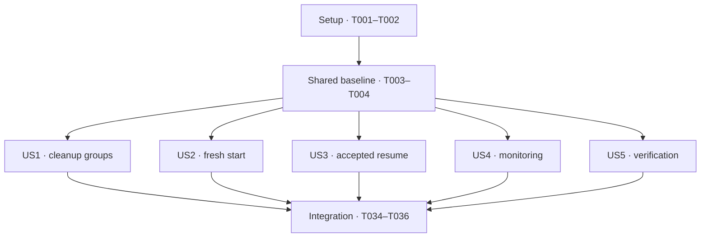

# Tasks — Remove Unused Repository Content

Work on `014-repository-cleanup`, stacked on PR #72. The audited runtime baseline is `a2618bbd`. Paths below are relative to the repository root. [Specification](spec.md) · [Plan](plan.md) · [Research](research.md) · [Validation guide](quickstart.md) · [Acceptance contract](contracts/cleanup-acceptance.md)

Use one reversible commit per removal group. The two report-only groups can proceed under their own consumer and provenance checks. Compare each group against its immediate parent and run the four operator checks on the combined cleanup. If a required private input or device is unavailable, or an affected compatibility check fails, hold that group. Keep private artifacts in the operator workspace and put observations in the PR review record. Tasks marked `[P]` can run in parallel using separate worktrees or fixture directories.

## Phase 1 — Setup

- [ ] T001 Follow section 1 of `specs/014-repository-cleanup/quickstart.md` to confirm the stack base, record the actual implementation parent SHA and prepare isolated parent/candidate worktrees. Put generated outputs and comparison logs outside the trees under test.
- [ ] T002 Start the group review record in the implementation PR using `specs/014-repository-cleanup/data-model.md`. For each candidate record its path or symbol, former purpose, actual consumers, searches performed, disposition, affected check and reversal. **Remove** requires evidence that supported and required future uses survive. **Retain** names a consumer. **Deprecate** names the obsolete portion, the live dependency at risk and when withdrawal can be revisited. **Hold** names a missing fact or check.

## Phase 2 — Shared baseline

- [ ] T003 [P] Inventory the tracked tree with Git. Use the AST, Grimp and Vulture probes in `specs/014-repository-cleanup/quickstart.md` to find leads. Confirm that the filename loader in `src/oeis_learn/pipeline_validation/progressive_handoff.py` and the installed worker selected by `src/oeis_learn/pipeline_validation/progressive_roles.py` are found through their real callers. Save the inventory by area for the wider sweep.
- [ ] T004 [P] Capture the qualification source map from `src/oeis_learn/experiments/source_snapshot.py`. Record which first-group paths the map, `.dockerignore` and `MANIFEST.in` include. Keep the Git revision, installed resources, native build inputs and image identity distinct. Link the baseline packaging and donor results in `specs/014-repository-cleanup/research.md` to the groups they affect.

## Phase 3 — US1 · Remove obsolete content with confidence (P1, MVP)

**Independent test.** Remove one report group in isolation, reproduce its surviving consumer on the parent and candidate, then reverse that group in a disposable checkout. The outputs and supported claims agree, and the reversal restores the original tracked paths and blobs.

- [ ] T005 [P] [US1] Trace exact paths, hashes, globs and incoming references for `reports/hpo_sweep_results.json` and `reports/hpo_sweep_results.md`. In a temporary working directory, call `export_hpo_reports` in `scripts/run_hpo_sweep.py` with fixed small inputs. Record the default destinations, JSON fields and Markdown sections, allowing for generated timestamps. Confirm the launcher still defaults to `configs/hpo_search_space.yaml`.
- [ ] T006 [P] [US1] Trace consumers and citations of `reports/real_data_e2e_report.md`. Baseline the temporary report writer in `tests/integration/test_real_data_e2e.py` and the scoped-proof and legacy-label cases in `tests/unit/test_foundation_symbolic.py`. Confirm a legacy `PROVEN` label yields `UNVERIFIED_LEGACY_LABEL`.
- [ ] T007 [US1] After T005, trial removal of only `reports/hpo_sweep_results.json` and `reports/hpo_sweep_results.md` (30,217 baseline bytes). Repeat T005 from the candidate, check the qualification map and image exclusions, and test a reversal on a disposable copy. Commit the pair if its checks pass. Preserve the launcher, its YAML and the target of `--apply-best`.
- [ ] T008 [US1] After T006, trial removal of only `reports/real_data_e2e_report.md` (1,005 baseline bytes). Repeat T006 on the candidate and confirm the integration still writes its own report and the proof checks retain their scope. Check the source map and image exclusions, test a reversal on a disposable copy, and commit this group separately if it passes.
- [ ] T009 [P] [US1] Sweep Python symbols, scripts and tools following imports, exports, CLI aliases, subprocesses, registry names and saved proof versions. Start with `src/oeis_learn/rl/elite_buffer.py`, `scripts/inventory_synthesis_retirement.py` and `tools/research_timing_diagnostics/collect.py`. Carry forward the holds on `_populate_canonical_defaults` and `scripts/run_hpo_sweep.py` with its default YAML. Record the qualified donor rejection for each and the live canary caller in `src/oeis_learn/cli/train_run011.py`.
- [ ] T010 [P] [US1] Trace config defaults, documented invocations and concrete future uses of `configs/train_tier2.yaml`. Check package patterns against `tests/contract/test_progressive_packaging.py`. Record the separate operator and installed consumers for `configs/foundation/progressive/diagnostics.json` and `src/oeis_learn/generalization/policies/progressive-diagnostics.json` and retain both paths.
- [ ] T011 [P] [US1] Review tracked runs and reports against directory readers and current claims. For `runs/001_baseline_cold_start/reports/summary.md`, trace the citation in `specs/002-synthesis-bootstrapping-and-soundness/research.md` and the example in `runs/README.md`. Exercise `RunManager.list_runs()` with `tests/unit/test_run_manager.py` and preserve `runs/001_baseline_cold_start/metadata.json`. Record what evidence would survive removal of the narrative.
- [ ] T012 [P] [US1] Trace operator instructions and duplicated guidance from `README.md`, `USAGE.md`, `docs/foundation.md` and earlier specs. Check tooling consumers through `.specify/integration.json`, `.agents/skills/speckit-tasks/SKILL.md` and `.pi/prompts/speckit.tasks.md`. For each proposed deletion, name the surviving instructions, trace inbound links and exercise the supported command or pinned Git retrieval.
- [ ] T013 [P] [US1] Review tests, fixtures, sample data, CI and build assets against their consumers. Trace partition registration in `.github/workflows/foundation.yml`, native identity in `crates/oeis_wasm_evaluator/build.rs`, image inputs in `Dockerfile` and `docker/dev/build-native.sh`, and benchmark readers of `data/benchmarks/trustworthy_synthesis_v1.json`. Record exclusive versus shared tests, including positive and negative controls for numerical semantics and independent acceptance.
- [ ] T014 [US1] For each additional removal supported by the evidence from T009–T013, prepare a disposable trial commit with its exclusive assets, tests and incoming references using `specs/014-repository-cleanup/data-model.md`. For an obsolete portion entangled with a live path, put the reason, replacement if any, and reconsideration condition in the surviving guide or review record. Preserve authenticated bytes. Summarize every area from T003, including those with no removal candidates.
- [ ] T015 [US1] For each T014 trial that changes qualification-source keys, run the donor procedure in `specs/014-repository-cleanup/quickstart.md`. Validate round009 `7332f0be` against clean qualified `77667e67` (89 accepted changes), then apply only the group patch in its own Git root. Require the observed keys and change types to match the independently exported parent/tip before validation. Record both map digests and the candidate-specific result alongside the reporter before/after result. Hold a failure, skipped patch or untestable transition.
- [ ] T016 [US1] For each additional trial, repeat the affected checks from `specs/014-repository-cleanup/contracts/cleanup-acceptance.md` against its parent and candidate. Include installed resources, native conformance, prospective qualification or operator instructions where affected. Integrate only passing groups, each with its evidence and separate rollback commit or procedure.

## Phase 4 — US2 · Start a fresh campaign (P1)

**Independent test.** In a clean workspace, valid inputs reach the first eligible `capability-census` dispatch on a bounded fixture. A missing prerequisite or altered acceptance starts zero research tasks. Exercise installed and workstation entry points.

- [ ] T017 [P] [US2] Exercise registration and preparation using `tests/unit/test_progressive_research_inputs.py` and `tests/unit/test_progressive_freeze.py`. Trace the spec 012 D starting checkpoint and B control to `pac-012-bcd-r1-002` as described in `specs/013-progressive-mathematical-discovery/validation/research-inputs.md`. Compare frozen inputs, donor/panel provenance and private exposure boundaries. Exercise a missing sidecar.
- [ ] T018 [P] [US2] Exercise the installed `oeis-learn` console and `pipeline --workspace` outside the checkout, plus Docker and Podman command paths through `scripts/foundation_run.py`. Verify `discovery` subcommands and corpus config selection with `tests/contract/test_progressive_cli.py`. For packaging-sensitive groups, compare direct and sdist-rebuilt wheels via `scripts/foundation/test_wheel.sh`. Identify the baseline 1,332/1,331 discrepancy for the spec 005 CLI contract separately from any new drift.
- [ ] T019 [US2] After T017, run the bounded fresh-launch path from `scripts/discovery_hip_handoff.py` through freeze and acceptance to the first declared role and inputs. Use `tests/unit/test_progressive_research_census.py` for the incomplete and altered-acceptance cases. Assert zero dispatches on rejection and stop the valid fixture after its first dispatch. Check donor, streamlined and expanded-budget options still select their frozen configuration.
- [ ] T020 [US2] For affected installation, native or device paths, verify the `qualification` and `gpu` targets in `Dockerfile` and the four qualification partitions and their merged inventory in `scripts/qualify_progressive_foundation.py` and `.github/workflows/foundation.yml`. Record CPU/native receipts and any required actual HIP qualification separately. Keep the physical check open where the requisite workstation evidence is unavailable.

## Phase 5 — US3 · Resume saved work and reach the next decision (P1)

**Independent test.** On an isolated accepted copy, count 47 original outputs and four full-state checkpoints, record the comparison once and observe `trial-00-propose` as next. Both attempts stop at the handoff. A separate fixture dispatches one proposal and exercises the subsequent decisions.

- [ ] T021 [P] [US3] Trace saved preparation-owner versions through `src/oeis_learn/pipeline_validation/progressive_research_launch.py`. Verify the round021 predecessor case and the 019, 020, 022, 023, 024 and 025 successor routes against their fixtures, including `tests/unit/test_round019_successor.py` and `tests/unit/test_progressive_round025_successor.py`. Resolve the qualified checkout at `77667e67`, recovery helper at `9030a2bc` and publication adapter at `f09d5471`. Compare ownership, leases, byte/inode allowances and prior charges.
- [ ] T022 [P] [US3] Run `specs/013-progressive-mathematical-discovery/validation/test_round027_publication_recovery.py` explicitly. Interrupt the output commit and task transition and retry. Check one settled elapsed-only publication and the original ledger prefix. On separate fixture copies exercise an active owner, altered checkpoint/producer and unfinished reservation. Confirm recovery stops at the failed prerequisite.
- [ ] T023 [US3] With the genuine terminal publisher receipts, run only the guarded rehearsal in `specs/014-repository-cleanup/quickstart.md` on an isolated qualified copy. Authenticate all 47 outputs and four checkpoints. Block engine access and intercept `run-research` before dispatch. Across two attempts require one comparison output and transition, one `diversity-comparison/publish/97` charge, `INCOMPLETE / RETAIN_BASELINE`, and `trial-00-propose` next. Check zero new research invocations, trial reservations or GPU calls. If only pre-publication state is available, record the diagnostic result and leave the receipt-backed check open.
- [ ] T024 [P] [US3] On a separate bounded CPU fixture with a fresh ledger, dispatch one ordinal-zero `propose-trial` through `src/oeis_learn/pipeline_validation/progressive_role.py`. Check durable proposal and sampler history with Optuna 4.5.0 in `tests/unit/test_progressive_trials.py`. Use `tests/unit/test_progressive_streamlined.py` and `tests/unit/test_progressive_trial_specifications.py` to compare the 352- and 376-task rosters, pruning and protected controls, 12 learning trials, four sizing trials scored only at 4M, and same-seed confirmation from 12.5M to 25M cumulative tokens.
- [ ] T025 [P] [US3] Exercise `assess --selection` on a locked-selection fixture in `tests/contract/test_progressive_assessment.py`. Require matching checkpoint and acceptance, one-way assessment exposure and rejection of subsequent adaptive resume. Check that other roles cannot read the assessment inputs.

## Phase 6 — US4 · Monitor without taking ownership (P1)

**Independent test.** One-shot and interval displays agree with the selected records. Observing an owned, idle or interrupted session changes zero inputs, transitions, reservations or charges. The terminal watcher waits or reports the recorded terminal condition.

- [ ] T026 [P] [US4] Run `specs/013-progressive-mathematical-discovery/validation/research-progress.py` with `--root`, `--round` and `--once` on copied preparation, interrupted and active-screening states. Compare gates, counts, heartbeat and last recoverable checkpoint with the underlying records. Include missing or malformed status in a separate fixture and compare its display with the parent. Capture paths and hashes before and after.
- [ ] T027 [P] [US4] Exercise the waiting and terminal branches of `specs/013-progressive-mathematical-discovery/validation/report-round027.py` on a separate fixture. Check idle and locked sessions, the stopped original invocation and interruption without a terminal result. Release the fixture owner and supply a terminal result. Confirm the watcher can collect in its reporting directory and starts zero tasks.
- [ ] T028 [US4] Repeat T026 using the interval procedure in `specs/014-repository-cleanup/quickstart.md`. Capture several displays, stop the reader and compare file hashes, task transitions, lease ownership, reservations and charges against the starting copy. Keep the monitor output outside the selected round.

## Phase 7 — US5 · Independently verify a terminal report (P1)

**Independent test.** The candidate verifier reproduces the entire saved receipt and accounting for an immutable earlier ZIP. A separate candidate publication round trip preserves the original claim scope and costs at campaign scale, including incomplete and altered-evidence cases.

- [ ] T029 [P] [US5] Repeat the archive-only procedure with `src/oeis_learn/generalization/progressive/verify.py` from the installed candidate and the immutable original round027 ZIP. Pin SHA-256 `d24c9ad72551e927cb63b2b77b18f31ea585733b767990d14c4eddf764626c9e`. Keep the writer, producers and expectations outside the reader workspace. Compare the entire receipt, `INCOMPLETE` status and decision, exactly `["primary_comparison"]`, all 352 accounting rows and per-task/per-arm totals. Recheck the ZIP hash.
- [ ] T030 [P] [US5] Run the candidate collector, writer and archive-only reader using `tests/integration/test_progressive_reporting.py` and `tests/contract/test_progressive_bundle.py`. Cover COMPLETE, PARTIAL and FAILED inputs. Check original ownership and charges, missing evidence and altered-producer rejection, and inspect expanded exports for the private-fixture marker. Compare candidate verification, search completion and scientific verdict separately.
- [ ] T031 [P] [US5] Follow the diagnostics ZIP extraction in `specs/014-repository-cleanup/quickstart.md`. Extract the execution-0000 role results beneath `$receipt_root/run-state/discovery/013-research-round-027` and authenticate all eight against the sealed replay. Save four rows with generator and matching score byte lengths and SHA-256s for static/refreshed arms and seeds 20261016 and 20261017.
- [ ] T032 [P] [US5] Exercise the package boundary in `src/oeis_learn/generalization/progressive/report.py` on the small compressed fixture from the guide. Sum all encoded entries including the manifest to obtain `N`. Build and verify at `N`, then require both writer and reader to reject at `N-1`. The baseline ZIP was 3,735 bytes on disk with `N` equal to 6,681. Record the input-table precheck separately.
- [ ] T033 [US5] After T031, run collection, publication and offline verification on one full-size original or representative fixture via `src/oeis_learn/pipeline_validation/progressive_report_collect.py` and the frozen cap used by `specs/013-progressive-mathematical-discovery/validation/report-round027.py`. Include roughly 49 MB of calibration, all four 45.5–52.2 MB generators **plus their scores**, and roughly 290,000 journal events. Record actual event count, calibration and journal bytes, original producer bytes, encoded-entry sum and final ZIP bytes. Compare receipts, accounting and scoped verdicts. Label synthetic lengths, hashes and compressibility separately. Keep this task open until the combined run has evidence.

## Phase 8 — Integration and rollback

- [ ] T034 Check surviving operator links, package paths, CI test nodes and pinned Git retrievals on the combined candidate against `specs/014-repository-cleanup/spec.md`. In a disposable checkout reverse each accepted group independently, verify its original paths/blobs and affected behavior, then confirm the other groups still work.
- [ ] T035 Run the bounded selections in `specs/014-repository-cleanup/quickstart.md` on the combined cleanup. Record fresh start, resume, monitor and report outcomes against the parent, including any retained revision-specific receipt, skip or unverified private/device check. The planning run passed 107 with Optuna installed. One independent environment passed 104 and lacked Optuna for the three sampler cases.
- [ ] T036 Reconcile the final diff with `specs/014-repository-cleanup/data-model.md`. Report each group’s parent, commit, disposition, files/bytes or symbols removed, changed links, evidence and reversal. Record unresolved groups with the missing input or reconsideration condition. Run `git diff --check` against the stack base and report FR-001–FR-009 and SC-001–SC-006 coverage using `specs/014-repository-cleanup/spec.md`.

## Dependencies and parallel execution

The shared baseline supports all five stories. US2–US5 can prepare and exercise separate fixtures while US1 trials deletions. Tie final observations to the actual combined candidate. A group can ship when its own affected checks pass. Record outstanding evidence for wider acceptance explicitly.

| Story | Spec coverage | Parallel example | Follow-through |
| --- | --- | --- | --- |
| US1 | FR-001–FR-004, SC-001, SC-006 | T005 and T006 baseline different reports. T009–T013 investigate different areas in separate review notes. | T007 follows T005 and T008 follows T006. For each additional group, T014 precedes the applicable T015 check and T016. |
| US2 | FR-005, FR-007, SC-002, SC-006 | T017 checks registered inputs while T018 exercises installed commands. | T019 needs prepared inputs. T020 uses the matching image and device evidence for affected groups. |
| US3 | FR-006, FR-007, FR-008, SC-002, SC-003 | T021 and T022 check historical dispatch and interrupted publication. T024 and T025 use independent proposal and assessment fixtures. | T023 uses the pinned source and genuine receipts after the recovery controls have been checked. |
| US4 | FR-008, SC-002, SC-004 | T026 reads progress while T027 exercises the terminal watcher on another copy. | T028 compares the interval reader with the T026 snapshots. |
| US5 | FR-009, SC-002, SC-005 | T029 reads the old ZIP, T030 exercises the current reporter, T031 extracts receipt targets and T032 checks the small budget boundary in separate workspaces. | T033 uses T031’s measurements for the combined full-size run. |

## Implementation strategy

**First delivery (MVP).** Complete T001–T004, then carry either report group through its own before/after and rollback checks. If both pass, the two commits remove three tracked files totaling 31,222 baseline bytes. The wider sweep and the private recovery, full-scale publication and physical HIP checks can proceed independently of this report-only delivery.

**Later groups.** Deliver additional supported removals one group at a time. Update an incoming reference alongside its owner, preserve shared controls, and withhold a group when a required consumer or source transition remains unresolved. Use the final phase to verify the combined result and report the remaining evidence gaps.
