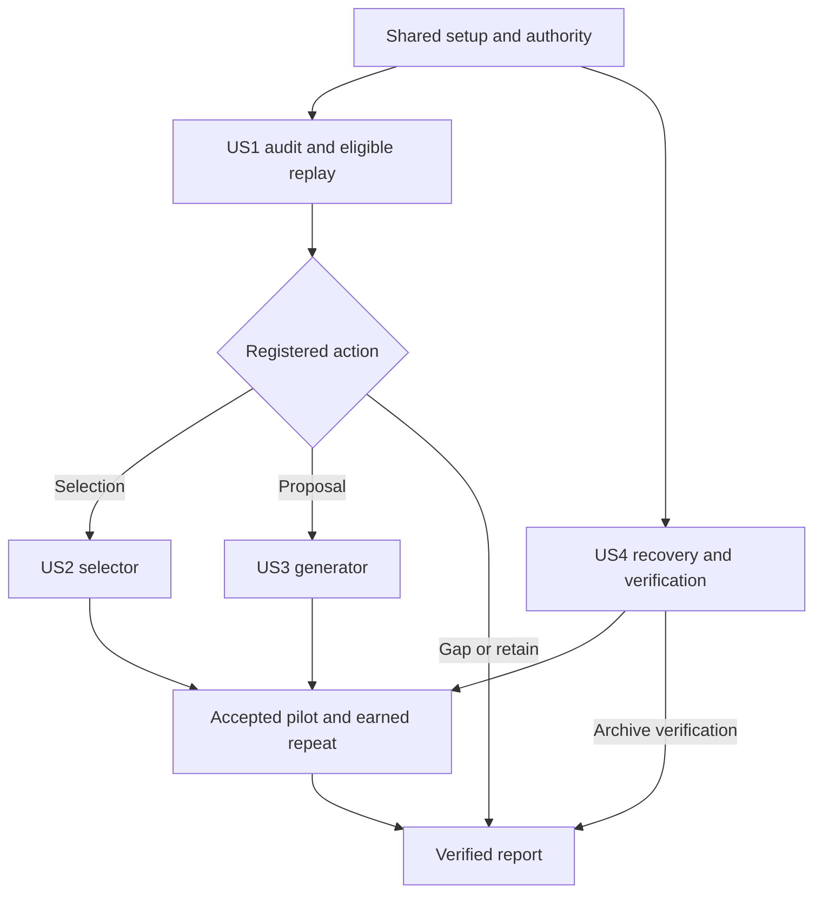

# Round028 tasks — learning to select and generate sequence programs

Work on `015-learned-program-search`, stacked on feature 013. Paths are relative to the repository root. `[P]` identifies tasks that can proceed together at the entry points listed under [Dependencies and parallel work](#dependencies-and-parallel-work). All workstation evidence belongs under the owning private session. A checkbox for physical validation requires its real receipt.

[Implementation handoff and historical results](research.md) · [Evidence file index](research.md#finding-the-evidence-without-the-conversation) · [Specification](spec.md) · [Plan](plan.md) · [Data model](data-model.md) · [Experiment contract](contracts/experiment.md) · [Operations contract](contracts/operations.md) · [Quickstart](quickstart.md)

## Phase 1 — Set up the study

- [X] T001 [P] Add the versioned `learned-program-search/v1` profile in `configs/foundation/progressive/learned-program-search.json`. Encode the diagnostic order, candidate and control policies, looks, seed derivations, spending alternatives and reference profile from the experiment contract. Keep measured workstation values in bound receipts and express the eight-hour shift as a planning target.
- [X] T002 [P] Package the two 015 contracts in a feature-specific namespace in `setup.py`, `MANIFEST.in` and `src/oeis_learn/experiments/source_snapshot.py`. Extend `tests/contract/test_progressive_packaging.py` to check source-tree, sdist and installed-wheel agreement, including the two different files named `experiment.md` in 013 and 015.

## Phase 2 — Establish shared authority and entry points

- [X] T003 [P] Make the candidate source root and original physical state root explicit in `scripts/foundation_local.py`. Build and load the identified candidate, preserve the donor tags, and bind device leasing and engine cleanup to the original `run-state/gpu.lock`. Exercise two distinct source roots contending for that same file in `tests/unit/test_foundation_local.py`.
- [X] T004 [P] Extend the versioned record and role validators in `src/oeis_learn/generalization/progressive/contracts.py` and `src/oeis_learn/pipeline_validation/progressive_outputs.py`. “Every reference binds a relative path under a declared authority root, byte length, content digest and expected producer/record identity.” Check bytes on use, ordered batch manifests, allowed role mounts and parent identity. Reject symlink escapes and mutable aliases into donor evidence.
- [X] T005 Add the pinned launcher at `specs/015-learned-program-search/validation/launch-round028.sh` and wire `discovery round028` through `src/oeis_learn/pipeline_validation/progressive_cli.py` and `src/oeis_learn/pipeline_validation/progressive_commands.py`. Implement the quickstart's full-SHA verification, checked source cache and distinct workspace/archive modes. Keep the donor detached at `77667e67176ae32fa16457d52565bae1dbe41afc`. Give each action only its registered authority.
- [X] T006 Register the new study and its closed request types in `src/oeis_learn/generalization/progressive/campaign.py`, `src/oeis_learn/generalization/progressive/graph.py` and `src/oeis_learn/generalization/progressive/trials.py`. Use the existing RunStore, TrialJournal and BudgetJournal. Give pilot looks a distinct observation record, keep 013 terminal feedback and eligibility intact, and record which conditional nodes were skipped. Only the graph owner can authorize dispatch.

## Phase 3 — US1 · Find where round027 lost answers (P1, first deliverable)

The original workstation result and receipt identities are recorded in [the verified CPU audit](validation/round028-audit.md).

**Goal.** Provide a case-by-case explanation of the historical result and a defensible next action before new training.

**Independent check.** From the pinned donor, trace a case through its prompt, attempted programs, selected source and verdict or first missing record. Reproduce routing from anonymous counts. The original trial decisions and charges must verify after the audit.

- [X] T007 [P] [US1] Add the historical-join fixture in `tests/integration/test_round028_audit.py`. Cover a mismatched checkpoint, missing discarded source, different original/companion rules, a selected success with unfinished work, a control that ran on a larger roster, and a 25M checkpoint scored only on a protected panel. Assert that a private-outcome reader cannot open before registration.
- [X] T008 [P] [US1] Add routing counterexamples in `tests/contract/test_round028_routing.py` for a reproducible fit fault, a passed-over solution, witnessed proposal failure, a supported tie, incomplete evidence, a decision-changing replay and a terminal gap. Check histogram versus private-case bounds, overlapping fit flags, and replay idempotence.
- [X] T009 [US1] Implement the registered historical importer in `src/oeis_learn/pipeline_validation/progressive_round028_audit.py`. “Create and commit under the run owner before granting the audit role access to private outcomes. A different policy has a different identity.” Authenticate the capability cut, original producer/score receipts, follow-up chain and sealed 25M index. Inventory preparation, corrected panels and the 1,296-case calibration by source, exposure, sensitivity and original charges. Reuse matching immutable products by reference.
- [X] T010 [P] [US1] Join all 128 indexed cases in `src/oeis_learn/pipeline_validation/progressive_round028_audit.py` using the pinned readers in `specs/013-progressive-mathematical-discovery/validation/report-round027.py` and `specs/013-progressive-mathematical-discovery/validation/trial00-followup/evidence.py` as read-only references. Cover six 1M looks, trial 00 at 2M, D, random and the conventional methods. Show both scoring rules, paired gains/losses/overlap, all six unfinished trial 05 composition cases, and comparable/incompatible/unavailable dispositions for the two fixed-collection and two refreshed-collection 25M checkpoints. Leave protected confirmation outcomes out of policy selection.
- [X] T011 [P] [US1] Reuse candidate reconstruction in `src/oeis_learn/generalization/selector_audit.py` and visible-input replay in `src/oeis_learn/generalization/selector_fit_replay.py`. Check every admitted source and original tie/selection against its hash. Distinguish late, missing, unfinished and measured-miss outcomes. Verify the actual native identity before a new CPU fit. Replay under the original allowance and check against independent semantics. Record a different fitter or new inference as a separately costed observation.
- [X] T012 [US1] Implement the routing table in `src/oeis_learn/generalization/progressive/program_search_routing.py`. Give each of the 64 trial 05 primary cases one vote. Require a complete bank for a proved selection opportunity and a complete miss plus an independent exact-case witness for the proposal lower bound. Sum the feasible per-case minima/maxima of P minus S, including unknowns. Give a reproducible fault priority. Route to generation when the lower bound on P minus S is positive and witness and training support exist. Route to selection when S is proved and the upper bound on P minus S is nonpositive. On ambiguity allow the one registered, affordable, decision-changing replay in frozen order, then recompute or retain the incumbent.
- [X] T013 [US1] Connect `audit` in `src/oeis_learn/pipeline_validation/progressive_commands.py` to the importer, fit replay and reducer. Commit private case rows, a disclosure-safe histogram, funding/availability flags, fault/replay costs and the terminal or conditional action. Independently recompute the route from that projection in `tests/contract/test_round028_routing.py`. An audit-only terminal result can publish without GPU qualification or a prospective research freeze.
- [X] T014 [US1] Exercise the pinned `audit` action from `specs/015-learned-program-search/quickstart.md` on the actual round027 donor. Record 128/128 dispositions, the 64-case routing denominator, the seven trial measurements and four checkpoint dispositions under `run-state/discovery/015-research-round-028/`. Record missing inputs with their impact. A later compatible launch must verify and reuse this audit and its charges.

## Phase 4 — US2 · Test whether a model can choose better (P1)

**Goal.** Establish how much a learned choice contributes on a fixed bank and whether the gain survives the full cost of search.

**Independent check.** Feed the incumbent, learned and shuffled policies the same eligible programs on fresh families. An independent scorer must reproduce their committed choices' 80-term verdicts and detect a substituted or reordered bank.

- [X] T015 [P] [US2] Extend `tests/unit/test_progressive_research_census.py` for family, composition, duplicate and shifted-window leakage across all historical and new roles, a missing difficulty descriptor, insufficient fresh families and reserved replication membership common to both seeds. Test calibration on families disjoint from training and evaluation.
- [X] T016 [P] [US2] Extend `tests/contract/test_progressive_evaluation.py` and `tests/unit/test_progressive_decisions.py` with identical-bank controls, changed order/source, empty and singleton banks, an ineffective shuffle, unequal costs and unresolved cases that reverse a spending decision. Include a prefix match that fails later and a correct unselected program.
- [X] T017 [P] [US2] Build and freeze the fresh rosters in `src/oeis_learn/pipeline_validation/progressive_research_census.py` and `src/oeis_learn/generalization/progressive/prepared_panels.py`. Carry the full historical exposure closure and only the registered parameter exception. Calibrate difficulty on disjoint witnessed synthetic families using conventional yield/completion, complexity tie-breaks and tertiles, with an unknown band. Use the contract's deterministic family allocation for 32 cases per stratum where supplied. Reserve separate development, replication, retention, future confirmation and final assessment. Report shortages before comparison.
- [X] T018 [P] [US2] Produce private training-only positive/negative pairs in `src/oeis_learn/pipeline_validation/progressive_preparation.py` and `src/oeis_learn/generalization/progressive/training_rows.py`. Independently verify each grounded positive on all 100 indexed terms and each negative on the same 20-term prefix plus a completed suffix disagreement. Count eligible families and rows. An unfinished check supplies no negative label. Enforce strict mechanical provenance and role-specific mounts.
- [X] T019 [US2] Freeze the prospective registration in `src/oeis_learn/generalization/progressive/campaign.py` and `src/oeis_learn/generalization/progressive/baselines.py` before comparative scoring. “Freeze before comparative scoring.” Bind route, source/images, roster/exposure, seeds, resource profile, looks, permissible actions and multiplicity. Choose the historical incumbent by family-macro yield, fewer unresolved, then stable method ID. Use the qualified D fallback on decision-changing ambiguity. Register four alternating strict trial 05 and four template slots when eligible, otherwise the predeclared template-only bank. Keep D evaluation-only.
- [X] T020 [US2] Capture the complete bank at case boundaries in `src/oeis_learn/fresh/bigint_diagnostics.py` and `src/oeis_learn/pipeline_validation/progressive_evaluation.py`. Reuse complete-candidate retention. “Bank stores ordered attempts and all eligible final source bytes, ties and duplicate identities.” Bind origin, seed/ordinal, raw and grounded outputs, fit disposition, admitted finish, policy and debits. Preserve the old producer format for old studies.
- [X] T021 [US2] Fit the CPU ranker in `src/oeis_learn/generalization/program_selector.py` using case-weighted pairwise logistic loss, unit L2 on training-standardized prefix-by-program interactions and the frozen tie key. Use independent training-family streams per learning seed. “CPU ranker stores coefficients, scales, training data cut, fit settings and seed.” Exclude case IDs, hidden terms, OEIS metadata and evaluation labels from predictors.
- [X] T022 [US2] Bind the three choices in `src/oeis_learn/pipeline_validation/progressive_role.py` and `src/oeis_learn/pipeline_validation/progressive_evaluation.py`. Alter only learned conditioning for the within-stratum derangement, preserving recipient indices, true-prefix admission and bank order. “Visible role receives indices and the first 20 values. Scoring role has the subsequent 80 exact indices/values and the verifier profile.” Seal choices before opening that truth. “Reject changed bank, donor, candidate order, late or post-score selection.” Record measured verdict, search closure and retrospective headroom separately. A verified selected solve counts as measured even with an unfinished search. “A genuinely unresolved attempt is unmeasured unless an independently verified selection already settles the case.”
- [X] T023 [US2] Exercise the live end-to-end policy through `src/oeis_learn/pipeline_validation/progressive_roles.py` and `src/oeis_learn/generalization/progressive/baselines.py`. Compare challenger and frozen incumbent with eight attempts, 60 seconds per portfolio, four seconds per fit and 1,024 generated tokens per attempt. Charge generation, fitting and selection inside one allowance per arm. Report model-only, conventional-only and combined results where applicable and keep every case in its denominator.
- [X] T024 [US2] Wire the registered spending rule and formal reducer in `src/oeis_learn/generalization/progressive/decisions.py` and `src/oeis_learn/generalization/progressive/metrics.py`. A selector repeat requires positive end-to-end and same-bank gains and better correct than shuffled yield, comparable cost and acceptable retention. Test favorable/adverse completions before spending. On the common replication panel evaluate both seed pairs. Use equal family weights within each stratum, half each for composition and unseen structure, 10,000 joint family resamples, frozen multiplicity and ≥16 independent groups per primary stratum. Preserve the FR-009 gate and separate parameter/OEIS reporting.
- [X] T025 [US2] Demonstrate the selector story through installed roles in `tests/integration/test_progressive_evaluation.py`. Independently reproduce choices and costs, show where an offline gain disappears once selection consumes search time, and verify retain/replay/repeat outcomes. Confirm that ≥2 percentage points mean gain, both seed effects positive, ≥95% per-arm/seed/primary-stratum measurement, ≤2 points conservative retention loss per seed and a positive adjusted lower bound are all required for the formal gain verdict.

## Phase 5 — US4 · Spend a GPU shift and recover the evidence (P1)

**Goal.** Detect a real shortage before expensive work, recover the latest verified boundary and publish a result the operator can check independently.

**Independent check.** Interrupt a rehearsal after a case batch and partway through a learner update. Repeat the same Git-pinned command, check the remaining legal search time and charges, and verify the share on a machine with the private workspace unmounted. The software rehearsal may use an accepted representative learner. Physical acceptance below uses the actual candidate and relevant role path.

- [X] T026 [P] [US4] Add interruption and tamper cases to `tests/unit/test_progressive_recovery_transactions.py` and `tests/unit/test_progressive_freeze_progress.py`. Cover post-reservation, post-seal/pre-bind, post-commit/pre-boundary, a partial portfolio across boots, and staged freeze publication. Repeat recovery twice and assert one credit per valid logical result and retention of every attempted charge.
- [X] T027 [P] [US4] Extend `tests/integration/test_progressive_reporting.py` for public recomputation from an archive alone. Tamper with source or parent identity, independent-group links, counts and multiplicity. Seed synthetic private indicators in sequences, program bytes and traces, then inspect archive members and supported nested encodings for disclosure.
- [X] T028 [P] [US4] Inventory effective native, per-fit and portfolio, learner, queue, cleanup, telemetry, per-file and aggregate reader (including the historical 512 MiB path), projection, log and ZIP limits along the real path in `src/oeis_learn/pipeline_validation/progressive_research_resources.py`. Emit a guard record with protected harm, owner, units/scope, largest or slowest valid observation, source, margin and exhaustion action. Add or tighten a hard cutoff only for a named critical invariant, workstation resource or agreed scientific comparison. Use observation where it suffices. Correct demonstrated undersizing at its owner. A critical provisional bound needs a generous capacity basis and a named production check.
- [X] T029 [P] [US4] Implement incremental capacity preflight in `src/oeis_learn/generalization/progressive/storage_plan.py` and `src/oeis_learn/pipeline_validation/progressive_preparation_preflight.py`. Map Podman/build storage, candidate shards, full checkpoints, projections, journals, staged/public reports and cleanup overlap to backing filesystems. Credit compatible allocations once, report free/required bytes and inodes, assumptions and exact deficits. Recheck before expensive dispatch. Keep preflight metadata-only and leave reclamation to the operator.
- [X] T030 [P] [US4] Instrument phase telemetry in `src/oeis_learn/pipeline_validation/memory.py` and `src/oeis_learn/pipeline_validation/progressive_workstation_state.py`. Report CPU fit/search, GPU training/decoding, scoring, waiting, lease, busy intervals, coverage/gaps, startup/cleanup, repeated costs and overlaps. Label measurement basis and unavailable counters. Forecast every arm/look/seed with measured cold and warm costs, using lease or labeled elapsed upper estimates when needed. Target at least half the eight-hour post-qualification shift for evaluation and replication. A late heartbeat alone must not terminate a worker.
- [X] T031 [US4] Reconcile durable batches in `src/oeis_learn/pipeline_validation/progressive_outputs.py` using `src/oeis_learn/generalization/progressive/budgets.py` and `src/oeis_learn/generalization/progressive/lifecycle.py`. “Logical key is stable on resume. Physical attempts remain distinct. Credit a valid completed logical unit once.” Reserve, durably seal, bind output and charge, then record the boundary under the owner. Reuse verified candidates, fits, choices and scores. Keep failed debits. Resume a partial portfolio only with provable remaining original draws/time/tokens, otherwise keep it unresolved.
- [X] T032 [US4] Bind and recover the single prospective freeze in `src/oeis_learn/generalization/progressive/freeze_progress.py` and `src/oeis_learn/pipeline_validation/progressive_commands.py`. Reuse saved validated choices and staged publication only for identical registered inputs and source. Require candidate-bound CPU/native qualification, actual HIP parameter update and round028 campaign acceptance via `src/oeis_learn/pipeline_validation/progressive_handoff.py` and `src/oeis_learn/pipeline_validation/progressive_device_acceptance.py`. Reject donor-only authority and verify the immutable image immediately before dispatch.
- [X] T033 [US4] Publish a versioned, privacy-safe aggregate in `src/oeis_learn/generalization/progressive/public_comparisons.py` and `src/oeis_learn/pipeline_validation/progressive_report_collect.py`. Include release-scoped family/component contributions, paired counts, measurement/retention, feasible diagnosis histogram, seeds/links, funding and timing basis, decision and private replay receipt. “The public transport contains no raw sequence or stable private case fingerprint.” Exclude private paths, program bytes, weights and recoverable compressed traces. Preserve the original failure if publication also fails.
- [X] T034 [US4] Implement standalone verification in `src/oeis_learn/generalization/progressive/verify.py` and `src/oeis_learn/generalization/progressive/report_transport.py`. The workstation reopens private choices, checkpoint closure and exact scores. With only the public archive, recompute routing, family-weighted gains, conservative bounds, retention, cost, verdict and action from sufficient statistics. Emit the two scopes separately and reject an unverifiable public claim. Keep old archives readable.
- [X] T035 [US4] Complete `preflight`, `rehearse`, `run`, `status` and both `verify` modes in `src/oeis_learn/pipeline_validation/progressive_commands.py` through the pinned CLI. Resume the earliest eligible boundary, show owner, arm/seed/look, cases or updates, elapsed/remaining authorized work, telemetry coverage and skipped nodes. A second live owner returns promptly. Report numerical deficits before dispatch and distinguish a verified inconclusive science result from a mechanical failure.
- [X] T036 [US4] Wire the installed acceptance scenarios in `src/oeis_learn/pipeline_validation/progressive_acceptance.py` and `tests/integration/test_progressive_handoff.py`. Use disjoint acceptance families, both compressible and poorly compressible producer sets, a controlled shortage on a disposable reservation, delayed telemetry, competing source roots and tampered donors. Drive candidate/fit/score checkpointing and full-state restore through collection, publication and archive-only verification. Reuse compatible receipts and isolate fault injection from the live research ledger.

## Phase 6 — US3 · Train a generator when proposals are the bottleneck (P2)

**Goal.** Test one change to ordinary training at identical exposure, then spend the reserved training seed only if the registered 4M comparison earns it.

**Independent check.** On a generic training fixture, run ordinary and treatment arms from identical weights within a seed, restore through a complete update and reproduce the exposure, logits used for the preference label and paired endpoint. A 30/32 intermediate look can reach the registered endpoint. A branch with zero eligible preference labels records the deficit before GPU dispatch.

- [X] T037 [P] [US3] Add objective tests to `tests/unit/test_progressive_training_policy.py`. Check the first valid divergent token, ambiguous or ungroundable alternatives, zero contribution for ineligible rows, microbatch-invariant normalization and a nonzero expected gradient using independently constructed training examples. Verify ordinary supervision retains its existing result.
- [X] T038 [P] [US3] Extend `tests/integration/test_progressive_recovery_updates.py` for matched random starts, identical batch/row schedules, full-update overshoot, interrupted partial updates and repeated restore. Cover unequal exposure, identical zero-look credit, incomplete intermediate measurement and both seeds evaluated on the same untouched replication panel.
- [X] T039 [US3] Derive the deterministic first-divergence training labels in `src/oeis_learn/generalization/progressive/training_rows.py`, using the verified pairs from T018. Check the actual encoded and grounded decoder targets. Exclude a disfavored token used by a known positive at the same context. Count affected rows, families and positions and measure the training-only gradient before admitting the treatment.
- [X] T040 [US3] Add the versioned auxiliary objective in `src/oeis_learn/rl/sft_trainer.py` and `src/oeis_learn/pipeline_validation/progressive_training.py`. Use one teacher-forced pass on the same positive tokens and updates. Add unit-weight pairwise logistic loss on the first valid positive/negative logits, averaged over all batch rows, to ordinary mean token loss. Preserve the historical objective and count training tokens identically in both arms.
- [X] T041 [US3] Bind paired initialization, data and full-state continuation in `src/oeis_learn/pipeline_validation/progressive_learner.py` and `src/oeis_learn/generalization/progressive/periodic_recovery.py`. Start strict arms from the same eligible random weights per seed, using trial 05's batch 32, constant baseline learning rate, zero weight decay and zero dropout. “Generator checkpoint includes weights, optimizer/scheduler, tokenizer, RNGs, sampler/data position, completed updates, charged tokens/overshoot and predecessor.” Bind objective, ordered data and budget journal to that state. Verify the next update and reject a weights-only restore.
- [X] T042 [US3] Compile the generator pilot's closed requests in `src/oeis_learn/generalization/progressive/graph.py` and `src/oeis_learn/pipeline_validation/progressive_study.py`. Use descriptive 0 and 1M additional-token probes (first frozen case per development family, one attempt), and the full profile at 4M for both arms on development and retention. Reuse the zero-look result only on complete identity equality. Record missing looks. Show that 30/32 measured cases in an intermediate cell can continue to a sound, funded 4M endpoint while preserving the original formal eligibility rules.
- [X] T043 [US3] Integrate the matched treatment-versus-ordinary spending contrast in `src/oeis_learn/generalization/progressive/decisions.py` and exercise it via `tests/integration/test_progressive_lifecycle.py`. Report each arm against the frozen historical incumbent separately. Verify positive, reversed, missing and retention-regression paths, genuine independent training and both seed pairs' results on the common reserved families. A longer confirmation can only be recommended under its own budget and authorization.

T042 now drives both matched training arms through the prospective pilot entry point. The end-to-end fixture exercises 0, 1M and 4M, independent scoring, the incumbent and the zero-look reuse decision. A separate CPU test restores complete learner state, keeps a discarded charge and performs a real update in each arm. The original workstation timing run supplied the measured search costs. T048 recorded the completed 4M result. [Pilot acceptance evidence](validation/round028-pilot.md)

## Phase 7 — Combined validation and conditional workstation execution

The [verified physical panel collection](validation/round028-panel-results.md) completed T017 on the registered donor support. All 576 case reservations and 48 disjoint calibration families are accounted for. T019 still binds the actual seed streams and checks their exposure at scientific admission.

The [verified workstation rehearsal](validation/round028-generator-rehearsal.md) measured a nonzero training-only gradient and paired HIP updates with both full checkpoints restored. The 4M training forecast fits the planned training allocation. The [candidate timing collection](validation/round028-candidate-timing.md) advances T029, T030 and T046 by pricing both registered search profiles with recovered weights and separate scorers. The [verified physical timings](validation/round028-timing-results.md) establish the T046 terminal deficit for the registered comparison. The eight-hour registration ended at that deficit. The production-scale execution and fault-injection requirements remain individually tracked below.

**The original eight-hour registration closed with D retained. The subsequent eleven-hour pilot also retained D.** The workstation committed the final journal entry and returned its private replay receipt for all 40 timed portfolios. The independent reader at `6d4c79adbff84a06bb3d2ddaa196837f4ea59f1b` verified the copied package and reproduced the decision to retain D. The enclosed public ZIP matched the previously verified share byte for byte. The original eight-hour study used zero pilot training tokens. Its child completed one training seed, retained D at the 4M endpoint and kept the final assessment sealed. [Workstation receipt and journal identities](validation/round028-timing-results.md#workstation-receipt-and-public-reports)

For T044, the repaired release passed 340 tests across the existing same-list selector, matched generator, archive, Optuna, installed lifecycle, storage and recovery paths. Five tests require the qualification image. The unselected prospective selector's own acceptance scenario is still tracked in T025.

- [ ] T044 Run the combined source/installed regressions anchored by `tests/contract/test_progressive_packaging.py`, `tests/unit/test_progressive_trial_eligibility.py` and `tests/integration/test_progressive_reporting.py`. Exercise both branch implementations on acceptance fixtures, existing 013 CLI/Optuna feedback, old archive verification and the new `discovery round028 --action verify --archive PATH` entry point without the donor mounted. Record any missing runtime or device evidence separately.
- [X] T045 Replace future command examples in `specs/015-learned-program-search/quickstart.md` with verified release instructions and a resolvable full implementation SHA. Test Git fetch, source extraction, metadata-only preflight, status and repeated invocation from the pinned donor. Provide one start/resume command and the exact command for verifying a copied share. Record the implementation SHA separately from any later documentation commit.
- [ ] T046 On the selected Podman workstation use `specs/015-learned-program-search/validation/launch-round028.sh` to record admission and production measurements for the eligible branch. Qualify the actual images, native semantics and HIP update. Cover cold/slow valid work, a full checkpoint restore, and the larger of intended 028 scale and the historical workload. The historical rehearsal inputs include 209,010,758 bytes of candidate/score producers, a 56,568,256-byte campaign, roughly 49 MB of calibration, a 352-task roster and roughly 290,000 journal events. Record actual bytes/inodes, cold and warm time, lease/occupancy, margins and a revised forecast. Publish a specific deficit if the comparison cannot fit.
- [ ] T047 In the same bound rehearsal through `specs/015-learned-program-search/validation/launch-round028.sh`, inject the T026/T036 interruption windows, including a completed batch, mid-fit, mid-update, and staged freeze publication. Force actual ENOSPC or inode exhaustion inside the disposable allocation and restore it. Repeat the identical command twice, test cross-root ownership, and verify the resulting private and archive receipts. Authenticate reusable cuts and the original elapsed work. A passed exact-registration freeze is consumed once by acceptance and research.
- [X] T048 Complete the registered `run` and `verify` workflow described in `specs/015-learned-program-search/quickstart.md`. If the audit terminates, publish the supported gap or retain decision directly. Otherwise consume the matching qualification, freeze and acceptance receipts, run only the justified feasible pilot and any earned independent repeat, and publish `run-state/discovery/015-research-round-028/share/round028.zip`. Verify counts, bounds, costs, evidence verdict and next action locally and from the copied archive. Record skipped work, keep final assessment sealed and leave 25M confirmation for separate authorization.

### Eleven-hour pilot amendment

Keep the original terminal decision and its accounting as the parent. Register one pilot seed, ordinary and first-divergence training, the frozen D reference, and one resident search role per arm and look. The original timing forecast was 10 h 21 min 37 s, with 38 min 23 s of headroom. The Phase 8 qualification recomputes the forecast for the saved registration. Replication and 25M are separately funded. T019, T031–T035 and the selected-path portions of T046–T047 apply before opening pilot scores. T048 closed after the returned pilot verified against the pre-score qualification. [Verified one-seed result](validation/round028-pilot.md#verified-one-seed-result) The selector is a separate software acceptance story.

T042 and T045 passed their original child-entry-point and Git-launcher checks. The selected pilot published `share/generator-pilot-11h-v2/round028-pilot.zip` alongside the eight-hour study. The remaining release tasks are T044, T046 and T047. Run `collect-release` once on the donor workstation to collect the installed native checks, candidate HIP restore, scale measurements, recovery repetitions and both verification scopes. [Workstation release command](quickstart.md#collect-release-acceptance)

## Dependencies and parallel work

Phase 1 supplies the versioned profile and packaging. Phase 2 supplies an owner, usable CLI and closed record types. After T006, the story tests and software work can use public or synthetic acceptance inputs. Access to original private outcomes requires T009. Access to new comparative scores requires the prospective registration. Actual research also requires the matching candidate qualification, freeze and acceptance.

| Work | Ready together | Dependencies and evidence |
| --- | --- | --- |
| Setup and foundations | T001 with T002. Then T003 with T004. | T005 consumes the verified source and state roots. T006 completes the common study/ownership interface. |
| US1 | T007 with T008. After T009, T010 with T011. | T012 consumes the join and inventory. T013 integrates the route. T014 is the first original-workstation evidence and can finish the audit milestone without either learner. |
| US2 | T015 with T016. After those contracts, T017 with T018. | T019 binds the audit's reference decision and the prospective design. T020–T023 deliver the same-bank and live comparisons. T024–T025 verify spending and formal statistics. Fixture work may precede T014. |
| US4 | T026 with T027. T028, T029 and T030 have distinct code owners and can proceed together. | T031–T034 provide recovery, qualification/freeze and verification to T035. T036 exercises the combined path. The final physical rehearsal uses the selected learner or selector implementation. |
| US3 | T037 with T038. | Reuse the prospective roster, training pairs, reference profile and reducer from T017–T019 and T024. T039–T041 supply the matched update to T042–T043. A live selector pilot or selector result is never a prerequisite for generator training. |
| Integrated release | T044 and T045 establish the tested implementation pin and operator commands. | T046–T047 collect complementary evidence within one applicable rehearsal. T048 consumes it on the scientific branch. An audit-only terminal route can go directly from its verified audit to publication once T033–T035 are available. |

### Delivery and acceptance coverage

The smallest usable release is T001–T014. Its output explains how far the historical evidence goes and identifies the next justified action. Implement the two prospective branches against fixed fixtures, then exercise only the branch selected for real data. A missing donor, inadequate family supply or a real resource shortfall remains a visible disposition. Keep software completion, a measured physical acceptance and a scientific verdict as distinct evidence.

| Specification coverage | Tasks that demonstrate it |
| --- | --- |
| FR-001–FR-003 · SC-001, SC-003 | T007–T014 authenticate the historical denominators, replay and route. |
| FR-004–FR-006 · SC-002 | T015–T023 establish admissible training data, family separation, matched candidates, shuffled conditioning and the full-budget control. |
| FR-007–FR-009 · SC-003, SC-004 | T019, T024–T025 and T037–T043 bind the looks, paired exposures, independent seeds, retention and conservative advancement. |
| FR-010–FR-011 · SC-005 | T002–T006, T009, T026, T031–T032, T041 and T045–T047 cover pinned authority, compatible reuse, durable boundaries and charged recovery. |
| FR-012–FR-014 · SC-006 | T028–T030, T035–T036 and T046–T047 cover preflight, measured limits, the genuine shortage and slow/large valid work. |
| FR-015 · SC-004, SC-005 | T013, T024–T027, T033–T035, T043–T044 and T048 bind the private evidence to a verifiable terminal report. |

## Phase 8: Convergence

- [X] T049 CRITICAL Bind each registered inference seed to the actual stochastic decoder call in `progressive_evaluation.py` and `progressive_pilot_worker.py`. Exercise an installed learner with a different base-recipe seed. Require replay and shared zero-look evidence to identify the effective draws. Qualify a compatible repair or freeze a prospective successor before using fresh scores per Constitution IV, FR-007, FR-010 and T042 (contradicts).
- [X] T050 CRITICAL Make `progressive_round028_pilot.py`, `progressive_round028_panels.py` and `progressive_pilot_recovery.py` recover from an assignment saved before its request directory exists and from a started qualification search or scorer that failed. Verify original inputs and worker termination, retain prior charges, reuse sealed choices and retry twice through the installed entry point per Constitution III, US4/AC1, FR-011 and T026 (contradicts).
- [X] T051 CRITICAL Authenticate the public report’s case and family denominators, per-family sizes and cross-look training lineage against the frozen design in `program_search_pilot.py`. Enforce terminal decisions across looks. Reject resealed archives with merged families, substituted initialization or data streams, or later measurements after a stop. Preserve verification of valid predecessors per Constitution V, FR-008, FR-015, SC-004 and T034 (contradicts).
- [X] T052 CRITICAL Recompute batch clock completeness from every registered case in `progressive_round028_pilot.py`. Verify expected mode, snapshot, attempts and coverage when closing or recovering a search. Test a valid cut-short case accompanied by a contradictory aggregate before any shared credit or spending decision per Constitution IV, FR-006, FR-008 and T043 (contradicts).
- [X] T053 CRITICAL Connect measured CPU replay pricing, dispatch, original-cost retention and rerouting to the normal inconclusive audit in `progressive_round028.py` and `progressive_round028_audit.py`. Exercise one decisive affordable replay, a genuine deficit and a second invocation with the replay already spent per US1/AC3, FR-002, FR-003 and T011–T013 (missing).
- [X] T054 CRITICAL Connect the selected CPU selector branch to the installed `run` path in `progressive_round028.py`. Exercise identical eligible candidates for incumbent, learned and shuffled choices, exact independent scoring, and the registered full-budget comparison on a qualifying fixture per US2/AC2–3, FR-004–FR-006, SC-002 and T020–T025 (missing).
- [X] T055 HIGH Recover or durably close an intermediate pilot look when a training interruption leaves different useful exposures or service clocks are incomplete. Extend `progressive_pilot_recovery.py`, `progressive_round028_pilot.py` and the archive reader to preserve the latest valid full state, lost work, all charges and unmeasured looks. Repeat the same entry point twice and independently verify the resulting continuation or terminal deficit per FR-007, FR-011, FR-015, SC-003 and T038–T042 (partial).
- [X] T056 HIGH Separate the operational search and scoring envelopes from the registered per-case allowances in `progressive_pilot_recovery.py` and `progressive_evaluation.py`. Exercise cold loading, slow valid cases and publication at the full resident roster size through the installed worker. Report measured margins and preserve finite native, fit and portfolio containment per FR-013, FR-014, US4/AC2 and T028/T046 (partial).
- [X] T057 HIGH Reopen the private evidence behind a published pilot in `progressive_round028_pilot.py`. Verify nested choices, producers, exact scores, checkpoint components and the training journal before a repeated private verification or export. Test altered and missing nested files alongside an independently valid copied public report per FR-011, SC-005 and T031/T034 (partial).
- [X] T058 HIGH Calculate the remaining storage peak by role and backing filesystem in `progressive_round028_pilot.py`. Credit each compatible checkpoint, shard and published allocation once. Exercise a near-capacity normal run, a cached role and a real byte or inode deficit, reporting the additional capacity needed per FR-012, US4/AC3 and T029 (partial).
- [X] T059 HIGH Use one role plan for the pilot forecast and dispatch admission in `program_search_timing.py` and `progressive_round028_pilot.py`. Include both zero-token training roles, verified zero-look sharing, sunk charges and the protected remaining endpoint. Test a stage that fits alone when the remaining comparison cannot fit, and return the numerical deficit before dispatch per FR-008, FR-012, SC-003 and T019/T030 (partial).
- [X] T060 HIGH Point the operator quickstart and recovery instructions to one tested, qualified pilot release. Exercise the complete documented entry point from a saved registration through scoring and verify that the controller resolves the intended worker before publishing the run command per FR-010, US4/AC1 and T045 (partial).
- [X] T061 MEDIUM Cover long resident search and training roles in `tracking/pipeline_profile.py` and their pilot summaries. Exercise a role beyond the existing sample cap, preserve bounded storage, and report the measured and uncovered intervals independently of the worker’s service deadline per FR-012, SC-006 and T030 (partial).

T056 and T060 closed when the pinned reader verified the original workstation’s pre-score qualification. Controller and registered worker both resolved to `04e0fd9c30ce64d835c91fb06e5014799bceccee`. The cold search and independent scorer completed all 160 slots, including two selected programs. The signed margin for the slowest case was −0.133643 s under the registered drain rule. The operator start/resume command uses the qualified revision. [Workstation measurements](validation/round028-pilot.md#verified-workstation-qualification) · [Operator quickstart](quickstart.md#start-or-resume-after-qualification)

## Phase 9: Convergence

- [X] T062 CRITICAL Bind the anonymous family allocation, paired initialization and ordered training stream to a separately verifiable pre-score qualification receipt in `progressive_round028_pilot.py` and `program_search_pilot.py`. Verify each reported checkpoint against that lineage. Test a copied report with consistent substitutions across every look, a changed family allocation with identical totals and a valid predecessor archive per Constitution V, FR-008, FR-015, SC-004 and T051 (partial).
- [X] T063 CRITICAL Recover a saved assignment whose request directory was never written when the workstation has rebooted. Reconcile the original identity in `progressive_round028_panels.py` and `progressive_pilot_recovery.py`. Exercise the installed pilot twice from an assignment-only fixture. Verify the inputs, a single dispatch and its charges, and distinguish a role that already started per Constitution III, FR-011, US4/AC1 and T050 (partial).
- [X] T064 CRITICAL Enforce the telemetry record and byte budgets on error writes in `tracking/pipeline_profile.py`. Exercise the running collector with repeated read errors and subsequent recovery over simulated long search and training roles. Verify bounded output, measured and uncovered intervals, and continued worker progress when counters are unavailable per Constitution III, FR-012, SC-006 and T061 (contradicts).
- [X] T065 CRITICAL Combine previously retained and recovered candidates in `program_search_bank.py` and `progressive_round028_replay.py`. Authenticate the complete original admission list and selection tie before rerouting. Exercise a retained solve, a missing candidate recovered as a miss and an original losing choice. Require a selection opportunity on full recovery and an unknown bank while an identity remains missing per FR-002, FR-003, US1/AC2–3, T008, T012 and T053 (contradicts).
- [X] T066 CRITICAL Preserve search completeness when scoring a sealed selector choice in `progressive_round028_selector.py`. Verify all same-bank and full-budget arms with an independently confirmed solve, a wrong continuation and an empty choice, each on open and closed searches. Count an open search with a wrong choice as unresolved in the paired results and spending inputs per FR-006, FR-008, SC-002, US2/AC2–3 and T054 (contradicts).
- [X] T067 HIGH Apply the executable training stream's probe exclusions to the funding decision in `progressive_round028_support.py` and `training_rows.py`. Test a fixture whose only positive/negative pairs use held-out probes and another with an eligible pair. Require the audit and learner to agree on support and the router to withhold generator funding when support is zero per FR-003, FR-004, T012 and T018 (contradicts).
- [X] T068 HIGH Publish the rerouted audit from `progressive_round028_replay.py` as a separately verifiable child of the original audit. Include the original and replay costs, updated case evidence, decision and next action. Verify the same decision through the normal command, repeated private verification and a copied archive after a decisive CPU replay. Confirm a second invocation reuses its receipt per FR-003, FR-015, SC-005, US1/AC3 and T053 (partial).
- [X] T069 HIGH Compute the historical incumbent's yield bounds in `progressive_round028_selector.py` by averaging families within each primary stratum, then weighting composition and unseen structure equally. Preserve the registered tie and ambiguity rules. Test a 32-case-per-stratum roster with unequal family counts where pooling all families reverses the winning method per FR-006, FR-009 and T054 (contradicts).
- [X] T070 HIGH Reconcile settled time, open reservations, verified zero-look sharing and remaining role prices before returning a resumed qualification in `progressive_round028_pilot.py`. Use the dispatch calculation from `program_search_timing.py` and verify it from the copied qualification archive. Exercise an affordable paid resume, an empty reservations directory and a remaining endpoint one microsecond over budget per FR-008, FR-012, US4/AC3, T055 and T059 (contradicts).
- [X] T071 HIGH Calculate retained search and score outputs and simultaneous staging space for the outstanding role roster in `progressive_pilot_capacity.py`. Use applicable measured sizes, group bytes and inodes by backing filesystem, and credit each verified allocation once. Exercise one versus seven remaining score roles near capacity and verify the reported additional bytes or inodes per FR-012, US4/AC3 and T058 (partial).
- [X] T072 HIGH Exercise genuine independent training for both generator seed pairs in the CPU integration fixtures in `test_progressive_recovery_updates.py` and `test_progressive_lifecycle.py`. Use separate random starts and mechanical streams across pairs, matched inputs within each pair and four restored arm checkpoints. Independently score their choices on the same frozen replication families and pass the measured outcomes into the existing reducer per FR-007–FR-009, SC-004, T038 and T043 (partial).
