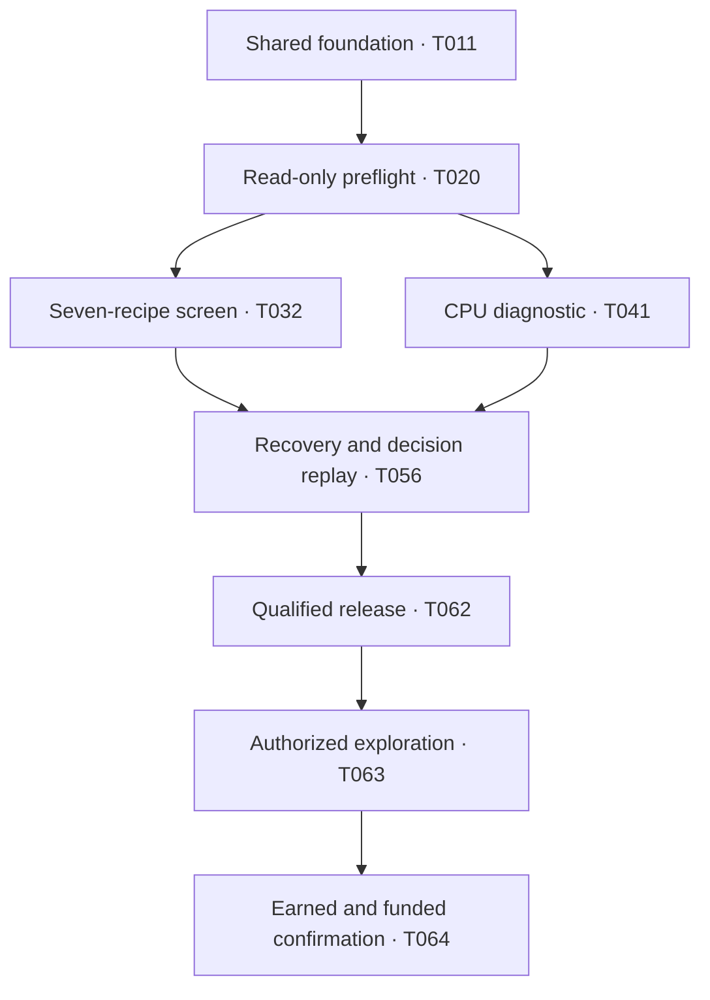

# Tasks — Learning velocity on new sequence families

**Feature** `016-measure-learning-velocity` · **Study** round029 · **Source baseline** `4a13ec34560e7cbeffcd2dad2b24a25b07ee0dd5`

Measure how quickly learners solve previously unseen families per million useful training tokens and per charged workstation hour. Real OEIS transfer is the primary practical decision. Round028 ordinary supplies the reusable training control, 00. D supplies the direct operational comparison. The seven-recipe screen and the CPU search diagnostic each have a decision they can support on their own.

**Design inputs** [Specification and acceptance scenarios](spec.md) · [Implementation plan](plan.md) · [Research decisions](research.md) · [Data model](data-model.md) · [Experiment](contracts/experiment.md) · [CPU search](contracts/search.md) · [Operations](contracts/operations.md) · [Quickstart](quickstart.md)

All file paths in tasks are relative to the repository root. An *After* note lists direct task dependencies. `[P]` marks tasks on distinct files that can run together once their predecessors finish. Write the listed acceptance tests first and observe the intended failure before implementing the behavior. Use disposable fixtures for development. Any dispatch on the study workstation consumes authority for its named scope.

## Phase 1 — Setup

Package the round029 design alongside the installed campaign. The checkpoint is a distribution whose feature lookup distinguishes the historical and current contracts.

- [X] T001 [P] Add a failing packaging regression in `tests/contract/test_progressive_packaging.py` that opens 016’s profile and three contracts by their installed feature namespace and reopens the 013 and 015 versions independently. Check source, extracted sdist and wheel identities.
- [X] T002 [P] Create `configs/foundation/progressive/learning-velocity.json` with the seven recipe rows. Start 00 at ordinary/off/batch 32/decay 0. Rows 01/02/03 enable broader composition, matching or both. Rows 04/05/06 enable batch 16, decay 0.01 or both. Fix the LR multiplier at 1, dropout at zero and all remaining learner settings at ordinary. Register cheap/full profiles, D, looks, branches and claims. Keep prospective hours, donor receipts and measured guard values in run records.
- [X] T003 Package that profile and the 016 contracts in `setup.py` and `MANIFEST.in`. Extend `src/oeis_learn/experiments/source_snapshot.py` to bind runtime code, profile, contracts and schemas under 016’s namespace. Authenticate host-only launcher bytes by Git identity and prospective grants separately. Pass T001. *After T001, T002.*

## Phase 2 — Shared foundations

Give each trial, operation, grant, worker and retry an identity understood by the existing campaign, journal and CLI. The foundation is ready at T011 when a detached caller can address one physical session and old readers still resolve their own contracts.

- [X] T004 [P] Write contract cases in `tests/contract/test_round029_records.py` for altered parents, foreign state roots, negative balances, holdback above grant, a nullable verdict with a reason, and a retry that changes only the physical attempt ID. Require different keys for the two 4M profiles. Check integer microseconds and the four permitted grant scopes. *After T003.*
- [X] T005 [P] Write role and entry-point tests in `tests/contract/test_round029_roles.py` for allowed actions, mutually exclusive workspace/archive modes, immutable registered worker identity, two checkouts contending for one device, and hidden values or witness bytes injected into a visible role. Exercise legacy dispatch too. “Live roles receive the approved visible inputs only.” *After T003.*
- [X] T006 Add `src/oeis_learn/generalization/schemas/progressive-round029.schema.json` and validate it through `src/oeis_learn/generalization/progressive/contracts.py`. Enforce “A stored reference binds format, digest, byte length and allowed owner.” Key operations by study, stage, method/recipe, seed, look, panel, profile, input mode, role and ordinal. Validate the grant’s scope (qualification, CPU, exploration or confirmation), allowed operations, integer microseconds, nonnegative balances and holdback within grant. Require the operator contract’s result fields, including `mechanical_status` and nullable `scientific_verdict`. A missing observation is null with a reason. *After T004, T005.*
- [ ] T007 [P] Bind round029 role IDs, projections, closed request types and installed entry points in `src/oeis_learn/pipeline_validation/progressive_roles.py` and `src/oeis_learn/pipeline_validation/progressive_role.py`. Separate training/teacher, oracle, live search, selection and hidden scoring mounts. Verify that the historical role-policy digest still resolves for old receipts. *After T006.*
- [ ] T008 [P] Register the 029 study, parent/child edges and seven trial identities in `src/oeis_learn/generalization/progressive/campaign.py`, `src/oeis_learn/generalization/progressive/graph.py` and `src/oeis_learn/generalization/progressive/trials.py`. “Seal before the first comparative score.” Journal interim looks and funded/unused branches. Preserve the existing rules for formal trial completion, pruning and Optuna feedback. “A child references a closed or resumable parent.” *After T006.*
- [ ] T009 Create `src/oeis_learn/pipeline_validation/progressive_round029.py` around `RunStore.owner` and `BudgetJournal.reserve/commit/reconcile`. Use the existing 013 lifecycle in `src/oeis_learn/generalization/progressive/lifecycle.py`. Bind the operator-authorized grant digest, phase, parent, physical state root, total integer microseconds and follow-up holdback. Reserve before dispatch. “An operational retry receives a new attempt ID and retains the logical operation ID.” Share the physical `run-state/gpu.lock` across checkouts. “One session owner and one GPU lease.” *After T007, T008.*
- [ ] T010 Expose `discovery round029` in `src/oeis_learn/pipeline_validation/progressive_cli.py` and dispatch via `src/oeis_learn/pipeline_validation/progressive_commands.py`. Route preflight/status as read-only, qualify/cpu/run through scoped authority, and verify to either workspace replay or the copied archive plus pre-score package. Keep help standard-library-only. *After T009.*
- [ ] T011 Create `specs/016-measure-learning-velocity/validation/launch-round029.sh` with `FULL_COMMIT ACTION [AUTHORITY_FILE]`. Verify the detached donor at `77667e67176ae32fa16457d52565bae1dbe41afc`, verify the candidate source cache and pass distinct source/state roots. Reopen the registered worker identity for dispatch or replay. Missing private research evidence must still produce a preflight inventory. Repeating the same command must address the same session. *After T010.*

## Phase 3 — US1 · Decide what can be reused and afforded · P1 · MVP

**Goal.** Before booking the learner, show which ordinary cuts, scores, families and training pairs can support a comparison, what a matched probe and one follow-up cost, and what evidence is missing.

**Independent test.** Give the launcher a matching score, a changed scorer, a changed search profile and a weights-only cut. It must credit the first once, rescore the second, price new inference for the third and identify the state missing for continuation. Removing the 1M clock leaves the intact 4M cut eligible. A shortage reports the affected scope, numerical deficit where measurable and smallest useful next action.

### Acceptance tests

- [ ] T012 [P] [US1] Add preflight acceptance fixtures in `tests/integration/test_round029_preflight.py` for a matching 00 score, changed scorer, changed search profile, weights-only cut, changed seed provenance, and missing 1M clock with an intact 4M cut. Verify single credit, exact reason per layer and zero research/device dispatch. *After T011.*
- [X] T013 [P] [US1] Add supply tests in `tests/unit/test_round029_supply.py` for a shifted duplicate, a composition link bridging two panels, an old unused reservation, unknown OEIS difficulty, regroundable literal, partial-scope UNSAT and a real full-scope negative. Assert the family and pair counts that preflight may publish. *After T011.*
- [ ] T014 [P] [US1] Add cost and capacity tests in `tests/unit/test_round029_capacity.py` for shared checkpoint trees, temporary and published files coexisting, inode-only shortage, a slow drained portfolio, reused initialization and a protected follow-up. Check numerical shortfall, priced smaller batch and an explicitly missing measurement. *After T011.*

### Implementation

- [ ] T015 [P] [US1] Implement donor inventory in `src/oeis_learn/pipeline_validation/progressive_round029.py`. Verify the pinned pilot/qualification and release readers listed in the quickstart. For ordinary 0/1M/4M, first-divergence checkpoints and D, reconcile weights, seed/stream, optimizer/RNG/cursor, costs and exposure. Return score reuse, rescore, new inference, continuation or affected control rerun. “An evaluation-only weight file carries no continuation authority.” “Equality at a lower layer permits only the operations that layer supports.” *After T012–T014.*
- [ ] T016 [P] [US1] Extend `src/oeis_learn/pipeline_validation/progressive_research_inputs.py` and `src/oeis_learn/generalization/progressive/program_search_panels.py` with a 029 census. Group all 81 length-20 windows of each 100-term record, equivalent behavior and structure/composition bridges before allocation. “Components cannot cross protected roles.” Reconcile donor and later exposures, compute the disjoint calibration, teacher/practice, replication, retention and final reservations for commitment at freeze. Freeze one member per family before filling additional slots. “Parameter variants obey their declared exception.” Keep them clustered. Retain unknown OEIS difficulty and report shortages. *After T012–T014.*
- [ ] T017 [P] [US1] Add training-pair supply proofs in `src/oeis_learn/generalization/progressive/training_rows.py`. Choose distinct donors within frozen visible bands, round-trip the actual target and apply its live fitting policy. With zero adjustable coefficients verify a visible disagreement. Otherwise require native UNSAT replay over the full permitted 4,096-bit scope. Count ambiguity, unsupported fits and timeouts separately while retaining all ordinary positive rows. *After T012–T014.*
- [ ] T018 [P] [US1] Extend owner-scoped capacity calculations in `src/oeis_learn/pipeline_validation/progressive_pilot_capacity.py` and `src/oeis_learn/pipeline_validation/progressive_research_resources.py` for the 029 load. Measure both bytes and inodes on each backing mount. Count shared blocks once and account for concurrent scratch, checkpoints, journal and both report forms. Bind each hard limit to owner, harm, units, source revision, comparable valid/projected peak, value, headroom, exhaustion action and named production check. *After T012–T014.*
- [ ] T019 [US1] Price the common probe, initial wave and one reserved follow-up in `src/oeis_learn/generalization/progressive/program_search_costing.py`. Reconcile paid, open and unstarted work, cold/warm/slow/empty cases, control reuse and marginal CPU, auxiliary and full-bank costs. For an essential unmeasured guard, record a provisional value twice the larger of the same-scope valid load and projected peak, and name its T058–T061 production check. Preflight consumes existing receipts. Collect new timings only with a preparation grant on exposed inputs. Record unknowns and expected/tail cost. *After T015–T018.*
- [ ] T020 [US1] Wire the inventory to `preflight` in `src/oeis_learn/pipeline_validation/progressive_round029.py`. Return reusable cuts/scores, authenticated pair and family counts, exclusions, measured or provisional prices, reserve, physical shortfall and the smallest decision-changing private input or funded measurement. “A metadata read acquires no device.” Pass T012–T014 through the normal launcher, including a donor with missing private evidence. Leave durable study state untouched. *After T019.*

**Checkpoint at T020.** The operator can run read-only preflight on the donor and decide whether to fund preparation using the inventory alone. Prices without a valid timing receipt are labeled unmeasured or provisional.

## Phase 4 — US2 · Compare how fast recipes learn · P1

**Goal.** Measure paired gains and losses on new families at shared useful-token and charged-time budgets. The six new 4M arms would consume about 24M useful tokens before overshoot if ordinary is reusable. This is a workload projection. The grant sets the spend.

**Independent test.** Replay the same cases at 0/1M/4M. Four gains and four losses must show eight transitions and zero net change. A six-point gain over 3M useful tokens and 1.5 charged hours must give +2 points/M and +4 points/hour. Check the real OEIS row and retention separately. Substituting an eight-attempt endpoint for the one-attempt curve must fail.

### Acceptance tests

- [ ] T021 [P] [US2] Add `tests/unit/test_round029_training.py` for the seven factor rows, inherited seed-one initialization, stream-order equality within each block, matching-positive normalization, batch 16/32 cursors and a useful-token crossing after a discarded update. Include a zero-eligible-pair batch and a changed seed or checkpoint. *After T011.*
- [ ] T022 [P] [US2] Add `tests/integration/test_round029_probes.py` with identical cases at 0/1M/4M, distinct cheap/full 4M receipts, differing shuffle donors and the true recipient in the fitter/scorer. Cover a selected solve alongside unfinished fitting, a complete empty bank, an interrupted empty bank and attempted eight-to-one-attempt score reuse. *After T011.*
- [X] T023 [P] [US2] Add `tests/unit/test_round029_velocity.py` with four gains and four losses, +6 points over 3M useful tokens and 1.5 charged hours, bounds that reverse a ranking, a shared unresolved zero look, family imbalance, crossing clocks/reboot and a rate outside ±100. Supply expected paired values independently of the production reducer. *After T011.*

### Implementation

- [ ] T024 [P] [US2] Create `src/oeis_learn/generalization/progressive/velocity_trials.py` to bind eligible randomness, recipes and streams separately from the new registration digest. “The ordinary-stream receipt is shared by 00/02/04/05/06 and the broad stream by 01/03 within seed.” A historical mismatch starts an affected comparison with a fresh shared initialization and ordinary control. *After T017, T021–T023.*
- [ ] T025 [P] [US2] Extend `src/oeis_learn/generalization/progressive/generator.py` and `src/oeis_learn/pipeline_validation/progressive_preparation.py` to fill frozen length/difficulty bands with least-used eligible compositions and seeded ties. Preserve familiar slots, independently execute witnesses, bind rejections and sidecars, and verify more distinct compositions per million useful tokens. Audit every seed stream against protected families, bind the frozen spill/shortage rule and close only the unsupported treatment. *After T016, T021–T023.*
- [ ] T026 [P] [US2] Implement optional prefix–program matching in `src/oeis_learn/rl/sft_trainer.py`. Reuse true-prefix logits, add the contracted softplus difference of donor/true mean masked target log probabilities, divide by the full logical batch and retain one clip/optimizer step. “Ambiguous labels contribute zero auxiliary weight.” Calibrate and freeze one λ on training-only ordinary batches using the contracted quarter-loss rule. Log support, finite gradients, extra passes and actual time. *After T017, T021–T023.*
- [ ] T027 [US2] Implement round029 updates in `src/oeis_learn/pipeline_validation/progressive_velocity_worker.py` using `src/oeis_learn/pipeline_validation/progressive_training.py` and `src/oeis_learn/generalization/checkpoints.py`. “Commit only at a complete optimizer update.” Cross looks on useful non-padding positive tokens, independently verify ordered-row lengths, and preserve optimizer/scheduler, all RNGs, cursor, overshoot and all discarded charges. “A child adds exposure to its authenticated parent.” Show donated continuation parity on a disposable next update. *After T024–T026.*
- [ ] T028 [US2] Add a 029 evaluation path in `src/oeis_learn/pipeline_validation/progressive_evaluation.py`. Freeze one case per eligible development family/stratum and one attempt at 0/1M/4M. Target 32 cases per transfer stratum and 32 retention cases at the separate full 4M endpoint, subject to census and price. Give viable recipes, normal D and applicable conventional controls eight attempts, 60 s to issue with drain, 4 s per fit and 1,024 output tokens per attempt. Pair true/shuffled conditioning at the registered opportunity. “The selector can use only visible data.” Enforce 20 indexed terms, one sealed final source and independent exact scoring on the next 80. *After T015, T016, T021–T023.*
- [ ] T029 [P] [US2] Extend `src/oeis_learn/generalization/progressive/program_search_costing.py` to charge the union of same-host/boot half-open intervals and split shared intervals across registered beneficiaries. Retain failed debits, historical production and incremental costs, CPU work, lease, sampled activity and launch-to-decision elapsed time. Report an unavailable rate or bounds where clocks cannot be reconciled. *After T019, T021–T023.*
- [X] T030 [P] [US2] Create `src/oeis_learn/generalization/progressive/velocity_metrics.py` to count joint case transitions for each frozen family, method, look and seed. “One live choice per case and method.” Count exact solve, measured miss and unresolved, carrying scientific completion and search closure as separate fields. “A completed empty portfolio is a measured miss.” “Abandoned work can remain unresolved.” Compute parameter, composition, unseen structure and real OEIS yields with equal family weight within each stratum, half-weighted composition/unseen structure, retention, families gaining their first or losing their last solve, and paired bounds that share one unknown assignment per identical receipt. *After T006, T021–T023.*
- [ ] T031 [US2] Implement common-probe levels, adjacent yield changes per million useful tokens and per charged hour in `src/oeis_learn/generalization/progressive/velocity_metrics.py`. Select only the last verified affordable look within overlap. Report both conditional factor effects, means and interactions (03−02−01+00 and 06−05−04+00). Resample whole linked families jointly across arms/looks with recorded costs. Publish D’s yield level and inference cost. A learning rate requires two verified learner cuts. *After T029, T030.*
- [ ] T032 [US2] Connect explicit profile, worker, scoring and trial-observation records in `src/oeis_learn/pipeline_validation/progressive_round029.py`. On an accepted fixture registration, drive all seven recipes to their registered looks or record an affected disposition. Treat 1M as diagnostic and preserve viable 4M arms even below the formal completion threshold. Emit separate common-probe curves, full endpoints and retention with denominators. Reopen frozen inputs through the installed path and pass T021–T023. *After T020, T027, T028, T031.*

**Checkpoint at T032.** An accepted fixture registration yields a comparable curve or an explicit missing-look disposition for every recipe. Both factorial interactions, uncertainty, costs, direct OEIS performance and retention can be recomputed from the receipts.

## Phase 5 — US3 · Find out where search loses solutions · P2

**Goal.** Determine whether known structures can be grounded from their prefixes, whether legal search proposes a correct program, and whether the live selector chooses it. Measure what true prefix conditioning adds to fixed order and shuffled guidance.

**Independent test.** Supply two legal groundings that agree on the prefix and diverge later, a witnessed complete empty bank, an interrupted bank and a complete bank with a correct unselected program. Require distinct dispositions. Give fixed search a matched gain over D and the guide no added selected solves. Credit fixed search and keep its comparison available. Only a sealed live choice earns a solve.

### Acceptance tests

- [ ] T033 [P] [US3] Add `tests/contract/test_round029_oracle.py` for an offset literal, repeated/shared unknowns, more than eight eligible occurrences, a control-tainted literal, zero unknowns and ambiguous visible fits. Inject private witness bytes into a live request and require rejection. *After T011.*
- [ ] T034 [P] [US3] Add `tests/unit/test_round029_family_search.py` for deterministic legal expansions, duplicate/rejected attempt charges, equal menus and tie order, weighted alternative positive steps, missing shuffle donors and donor-derived partial features. Include the negative-offset alternating affine example from `specs/016-measure-learning-velocity/research.md`. *After T011.*
- [ ] T035 [P] [US3] Add `tests/integration/test_round029_cpu.py` to distinguish a completed empty bank, a partial bank, a correct unselected alternative and an exact choice with unfinished search. Assert matched live allowances, no oracle credit, separately charged teacher/full-bank work, and independent CPU progress when D inference is unfunded. *After T011.*

### Implementation

- [ ] T036 [P] [US3] Implement the privileged known-structure diagnostic in `src/oeis_learn/generalization/progressive/family_search.py`. Authenticate occurrences and parameter sharing, remove every eligible unknown, account for each structural literal and mark unsupported or zero-unknown cases. Reject a projection that leaves a hidden coefficient in a control-tainted literal or exceeds the verified abstraction’s eight eligible occurrences. Ground on the true 20, seal the choice, and score privately. Certify ambiguity with two legal groundings agreeing on the prefix and diverging later. Record exact recovery, witnessed ambiguity, completed failure, timeout or unsupported by family. *After T007, T033–T035.*
- [ ] T037 [US3] Implement the typed construction frontier in `src/oeis_learn/generalization/progressive/family_search.py`. Use registered templates, a canonical hole order, stable deduplication and finite qualified work limits. Compile the alternating rule into one admissible program and fit on all 20 original indices. Charge every expansion/subfit and every emitted complete body, including rejected or duplicate proposals. *After T036.*
- [ ] T038 [US3] Implement the CPU action guide in `src/oeis_learn/generalization/progressive/family_search.py`. Fit a regularized masked linear action scorer from case/family-weighted, independently verified training derivations and alternatives. Leave unexplored actions unlabeled. Freeze scales/ties and recompute every sequence-dependent feature, including partial execution, from the donor for shuffled guidance. *After T037.*
- [ ] T039 [US3] Expose fixed/true-guided/shuffled search through `src/oeis_learn/pipeline_validation/progressive_velocity_worker.py` and normal admission/selection in `src/oeis_learn/fresh/synthesis_policy.py`. Give fixed, true and shuffled ordering the identical menu, selector and total opportunity. Compare with D’s qualified inference or an identical receipt on matched cases. Reuse the true recipient for fitting, admission and scoring. “A missing effective donor marks only its shuffle contrast unavailable.” *After T007, T037, T038.*
- [ ] T040 [P] [US3] Extend 029 capture in `src/oeis_learn/fresh/bigint_diagnostics.py` and audit in `src/oeis_learn/generalization/progressive/program_search_bank.py`. “All live arms seal before private scoring or bank inspection.” Privately replay a separately priced matched sample with all issued ordinals, authenticated sources/aliases, fit status and admission times. Return first correct candidate, selected yield, witnessed proposal failure, verified passed-over solve and incomplete-bank uncertainty. *After T033–T035.*
- [ ] T041 [US3] Wire the `cpu` action in `src/oeis_learn/pipeline_validation/progressive_round029.py`. Require accepted, pre-score-committed authority for the CPU scope on the real path. Run the oracle first, then live methods on matched cases with one end-to-end account each. Publish guide-versus-fixed and true-versus-shuffled effects, costs and D disposition separately from learner curves. Measure serial contention or schedule serially. Pass T033–T035 with no training-screen prerequisite. *After T020, T036, T039, T040.*

**Checkpoint at T041.** The CPU action can deliver a scoped diagnostic from qualified CPU inputs while GPU work is pending. It identifies the earliest verified-correct admission, single selected yield, coverage, incomplete evidence and marginal cost by method.

## Phase 6 — US4 · Spend, resume and decide what the evidence supports · P2

**Goal.** Spend the next authorized hour on the measurement that can change a decision. Support a paired extension, an independent repeat or a verified decision to retain D. Keep all final-assessment families sealed.

**Independent test.** Make the preferred recipe change under admissible resolutions of missing cases and require the smallest eligible discriminator. Interrupt a learner update and publication, then issue the identical command twice. Recover one result, all charges and a decision verifiable from copied archives. A promising one-seed result with no confirmation grant must leave replication pending and report the comparator and marginal cost.

### Acceptance tests

- [ ] T042 [P] [US4] Add decision fixtures in `tests/contract/test_round029_routing.py` for an OEIS-only gain, a structural-only gain, crossing curves, an influential family, missing outcomes that flip ranks, a fitter fault, fixed-order gains, a passed-over solve and retain-D. Verify route precedence, cost, holdback and unfunded child handling. *After T011.*
- [ ] T043 [P] [US4] Add fault-injection tests in `tests/integration/test_round029_resume.py` at validated/staged freeze, mid-update and fit, after choice seal, between debit and commit, and after ZIP installation. Run the identical launcher twice. Require one useful result, preserved discarded charges, original error, original remaining allowance and a replayable final state. *After T011.*
- [ ] T044 [P] [US4] Add `tests/unit/test_round029_confirmation.py` for independent seed lineage, both pairs on one untouched panel, one shared D receipt, direct OEIS and structural contrasts, multiplicity, retention and incomplete support. A one-seed winner or 94.9% completion must never satisfy the formal gain gate. *After T011.*
- [ ] T045 [P] [US4] Add `tests/integration/test_round029_reporting.py` for private row-level versus public joint counts, shared receipt cancellation, copied-bundle verification with the donor unmounted, privacy canaries, and tampered counts, selector, multiplicity or parent. Exercise negative, incomplete and confirmed fixture verdicts. *After T011.*

### Implementation

- [ ] T046 [US4] Implement the registered spending decision in `src/oeis_learn/generalization/progressive/velocity_metrics.py`. Isolate invalid evidence first, test adverse/favorable and leave-one-family-out rankings, and price the smallest measurement that can change the choice. Shortlist a real-OEIS gain over ordinary even with flat structural yield. Use a solely structural gain to price an OEIS measurement. Preserve plausible late learners. Rank eligible affordable routes by direct OEIS evidence at matched cost, then marginal hours and frozen tie ID. Record the observation, uncertainty, comparator, alternative use of the hours, and separately the scientific verdict and spending action. *After T019, T031, T042–T045.*
- [ ] T047 [US4] Dispatch the earned CPU/measurement branches in `src/oeis_learn/pipeline_validation/progressive_round029.py` using `src/oeis_learn/generalization/progressive/program_search_selector.py` for same-bank selection. Require a complete eligible bank and verified passed-over solve for that branch. Issue the smallest affordable preordered case/ordinal prefix that could reverse the decision with remaining allowance. If only fixed order gains or shuffling preserves a gain, credit search or its ordering prior. Route a witnessed proposal failure to structure search and a reproduced fitting fault to qualified repair. Record overlaps, comparator and marginal hours. *After T040, T046.*
- [ ] T048 [US4] Add the registered 4M→8M child in `src/oeis_learn/generalization/progressive/velocity_trials.py` and `src/oeis_learn/pipeline_validation/progressive_velocity_worker.py`. Restore ordinary and finalist from their own complete cuts and bind added stream, schedule, parent exposure and remaining grant. Pair an intervention first introduced at 4M with ordinary from that same parent. Prove subsequent row and weight identity on a disposable continuation. *After T027, T046.*
- [ ] T049 [US4] Build an independently funded confirmation child in `src/oeis_learn/pipeline_validation/progressive_study.py`. Freeze candidate, look, comparisons and K before scores. K counts every eligible candidate × comparator × primary endpoint × look claim. Train a fresh finalist/ordinary pair from independent random initialization and an eligible new ordered stream and evaluate both seed pairs on the same untouched replication and retention panels with normal D. Reuse identical D choices/charges once. Retrain the guide and include fixed/shuffled controls for a registered guide claim. *After T016, T027, T046.*
- [ ] T050 [US4] Use `src/oeis_learn/generalization/progressive/metrics.py` and `src/oeis_learn/generalization/progressive/decisions.py` through the 029 evidence adapter in `src/oeis_learn/generalization/progressive/velocity_metrics.py`. Enforce ≥16 independent groups per primary stratum, ≥2 pp mean gain, positive effects for both seeds, ≥95% completion per arm/seed/primary stratum, ≤2 pp adverse retention loss per seed and positive adjusted lower bound from 10,000 joint whole-family resamples at 0.05/K. For the lower bound treat unresolved candidates as misses and unresolved comparators as possible solves. Apply the registered upper-bound rule to no material gain/regression and report incomplete or inconclusive when appropriate. A training claim compares with ordinary. Adoption requires a replicated direct OEIS gain over D. *After T030, T044, T049.*
- [ ] T051 [US4] Implement funded `qualify` and pre-score publication in `src/oeis_learn/pipeline_validation/progressive_round029.py` using the existing freeze/acceptance path. Exercise each scope using its own registered test worker. Qualify each funded scope on exposed inputs, including preparation and one priced follow-up. A missing D/GPU qualification leaves independently eligible CPU work available. Bind the exact graph, cases, reserves, seed/stream/profile, source, image and device. Produce `round029-qualification.zip` and require the independently retained pre-score commitment before comparative scoring. *After T020, T042, T043.*
- [ ] T052 [US4] Recover from interrupted freeze, learning and evaluation in `src/oeis_learn/pipeline_validation/progressive_round029.py` using `src/oeis_learn/generalization/progressive/freeze_progress.py` and `src/oeis_learn/pipeline_validation/progressive_pilot_recovery.py`. “A retry spends the original remaining allowance.” Reopen the registered worker, retain orphan debits and discarded work, and resume only unissued ordinals with provable remaining opportunity. Score a saved choice directly or record unresolved. Test two owners and two resumes. *After T043, T048, T051.*
- [ ] T053 [US4] Implement read-only `status` and failure diagnostics in `src/oeis_learn/pipeline_validation/progressive_round029.py`. Return current owner, stage, recipe/seed/look, useful/charged tokens, elapsed and remaining work, last durable result, next action and reason. Preserve the first exit/error and numeric byte/inode deficits even if reporting fails. Reprice a smaller resumable batch before pausing an affected branch. *After T009, T046, T052.*
- [ ] T054 [US4] Create `src/oeis_learn/generalization/progressive/velocity_report.py` to bind private replay of grounded choices, bank evidence and charges to public per-family histograms of joint case patterns. Include frozen denominators, cross-stratum links, receipt-equality classes, clocks, costs, guard margins, resampling seed, K and seed effects. Use opaque family labels and omit raw terms, weights, program bytes and private case IDs. “Externally expose only opaque family/component tokens and counts.” Verify aggregates against private rows, including singleton families. *After T030, T040, T045, T046, T050, T051.*
- [ ] T055 [US4] Connect `verify` and staged publication in `src/oeis_learn/pipeline_validation/progressive_round029.py` and `src/oeis_learn/generalization/progressive/velocity_report.py`. Recompute curves, bounds, formal verdict and spending decision from `round029-report.zip` plus the independent pre-score archive/child chain. Recompute the CPU route and cheapest decision-changing measurement too. Scan allowlisted members and nested encodings for private canaries and enforce owner-scoped reader limits. Recover a verified installed ZIP by committing its pending journal entry exactly once. “Mechanical completion and the scientific verdict are independent fields.” *After T045, T052, T054.*
- [ ] T056 [US4] Finish `run` in `src/oeis_learn/pipeline_validation/progressive_round029.py` so one launcher invocation resumes the earliest eligible step through reporting and verification. “Only a predeclared and funded branch can dispatch.” Return a verified retain-D/inconclusive result when appropriate, hold replication for its own grant, and keep final assessment sealed. Pass T042–T045 from authenticated fixture inputs. *After T032, T041, T047–T053, T055.*

**Checkpoint at T056.** The installed launcher can recover a fixture to a privately checked and publicly reproducible decision. An independent confirmation has its own registered child, untouched families and authority.

## Phase 7 — Release qualification and research handoff

### Cross-cutting checks on the candidate workstation

Use separately authorized qualification inputs for T058–T061. Obtain production measurements on the exact installed candidate, with the actual outer supervisor and independent reader. A guard can govern a run only after its owner records its value and basis. If a guard is undersized, fix it at its owning source and requalify the affected path. A timing forecast or a missing heartbeat calls for inspection. Keep the existing scientific allowance on recovery.

- [ ] T057 Register the 029 CPU and release test inventories in `src/oeis_learn/pipeline_validation/progressive_cli.py` and `src/oeis_learn/pipeline_validation/progressive_release_checks.py`. Run the new contracts and historical regression set from source, extracted sdist and an installed wheel outside the checkout. Keep real HIP cases device-marked and verify the historical 028 readers still accept their own packages. *After T056.*
- [ ] T058 Add and exercise the cold/slow/empty portfolio rehearsal via `src/oeis_learn/pipeline_validation/progressive_release_checks.py` under the qualification grant. Measure startup, valid drain, fit exhaustion, nonempty scoring and full-bank cost for both profiles, current search methods and D. Compare with the historical 60.133643 s drained case and 6,142.074 s cold supervisor workload. Update the owning envelope with measured headroom. *After T057.*
- [ ] T059 Exercise real batch-16/32 HIP updates and matching passes via `src/oeis_learn/pipeline_validation/progressive_release_faults.py` and `tests/integration/test_round029_resume.py`. Kill a backward pass, restore, and compare final weights and next row with uninterrupted execution. Compare against the historical 4,852,388,352-byte device peak. Record peak memory, full-state live bytes, lease/activity coverage and charged retries. Measure CPU contention against a serial reference before overlapping work. *After T057.*
- [ ] T060 Exercise peak coexistence and separate disposable byte and inode exhaustion through `src/oeis_learn/pipeline_validation/progressive_pilot_capacity.py` and `tests/unit/test_round029_capacity.py`. Check the observed 1,614,614,528 allocated bytes and 717 inodes for its recorded release scope. Compare journal-local limits with separately owned 1,257,820,683-byte checkpoint trees, actual scratch/temporary peaks and mount reserve. Replenish only the disposable allocation, resume twice, and retain the first error and quantitative deficit. *After T057.*
- [ ] T061 Exercise the largest valid report and cold/warm journal replay in `src/oeis_learn/pipeline_validation/progressive_release_checks.py` and `tests/integration/test_round029_reporting.py`. Pass the historical 48,779,754-byte valid scanner input and larger projected inputs. Exercise both compression extremes and the larger of the projected or historical loads of 461,574,003 expanded bytes across 352 members and 290,000 events across 145,000 committed operations. Apply the same-scope provisional reader floor of 923,148,006 bytes/704 members, increasing it for any larger projected peak. Interrupt installation and final journal publication. Verify one result with the private workspace unmounted and preserve all debits. *After T057.*
- [ ] T062 Validate `specs/016-measure-learning-velocity/quickstart.md` end to end and publish the measured acceptance scope in `specs/016-measure-learning-velocity/validation/round029-release.md`. In the release handoff supply the actual SHA of the already-qualified implementation commit and the Git fetch/extract command. Run preflight, status, a disposable start and two identical resumes from the detached donor, then verify the copied report elsewhere. Publish receipt identities and measured margins. *After T058–T061.*

**Release checkpoint at T062.** The measured release handoff and copied-bundle verification establish the software’s accepted scope. An unfunded exploration or a negative scientific result can be reported independently of release acceptance.

### Conditional research execution

- [ ] T063 With an exploration grant, use `specs/016-measure-learning-velocity/validation/launch-round029.sh` for the authorized screen and CPU branches. Record the frozen roster, holdback, actual looks, costs, bounds, retention and next marginal decision in `specs/016-measure-learning-velocity/validation/round029-research.md`. If work is unfunded, record the priced eligible action and its pending status separately from release acceptance. *After T062.*
- [ ] T064 Only if earned and separately authorized, use `specs/016-measure-learning-velocity/validation/launch-round029.sh` to run the frozen confirmation child. Verify the child’s independent pre-score package and add the ordinary and direct-D contrasts, both seed effects, conservative bounds, costs and verdict to `specs/016-measure-learning-velocity/validation/round029-research.md`. Record a pending or ineligible child if its conditions fail. Final assessment stays sealed for every outcome. *After T063.*

## Dependencies and parallel execution

The arrows show delivery checkpoints. A story can start on fixtures after T011. Its integrated deliverable needs the dependencies on its closing task. T051 can qualify a CPU scope as soon as preflight and the boundary fixtures are ready. Full-profile D inference additionally needs its own accepted device or a matching receipt. Shared controller, role-worker and reducer edits must merge serially. Schedule measurements that use the same device or backing mount serially unless contention itself is being measured.

| Story | Work that can run in parallel | Join |
| --- | --- | --- |
| US1 | T012–T014 cover donor identity, exposure/pair supply and physical capacity in separate tests. After those tests, T015–T018 implement four independent readers. | T019 prices their outputs. T020 publishes the preflight. |
| US2 | After the test and supply prerequisites, T024, T025 and T026 can build recipe/stream identity, composition sampling and matching loss independently. T029 and T030 can build the clock and family reducers together after their prerequisites. | T027 joins the training work. T031 joins both measurement axes. T032 drives the screen. |
| US3 | T033–T035 cover privileged inputs, construction search and the CPU action independently. Then T036 can implement the oracle while T040 implements private bank capture and replay. | T041 joins the oracle, visible-only methods and bank evidence without requiring T032. |
| US4 | T042–T045 can write routing, recovery, confirmation and copied-report fixtures in parallel using the shared schemas. Scope qualification in T051 can use the US1 inventory before either scientific screen reports an outcome. | T056 joins the ready consumers into one start/resume path. |

## Implementation strategy

1. **Deliver the read-only MVP through T020.** Demonstrate exact reuse of one receipt and an actionable shortfall. An absent private artifact can be a valid preflight result.
2. **Deliver the two research paths independently.** Verify the seven-recipe reducer on a known roster and the CPU diagnostic on disjoint, witnessed practice families. Keep early scientific looks and private bank reads in the exploration ledger. Preserve one priced follow-up.
3. **Demonstrate the decision before buying a repeat.** Exercise a direct OEIS gain, a structural-only signal, a ranking reversal, a viable late learner, a search bottleneck and retain-D on fixtures. Verify both favorable and negative reports on a separate checkout.
4. **Qualify the release, then record research outcomes against the relevant grant.** An affordable exploratory result may justify a new independent confirmation child. Only a confirmed direct real-OEIS gain over D supports replacement. A longer study or opening final assessment requires a separate future decision.

## Requirement coverage

| Specification requirements | Implementation and acceptance evidence |
| --- | --- |
| FR-001, FR-002, FR-003 · registration, donor reuse and linked families | T006–T009, T012–T020, T051 · SC-001 |
| FR-004, FR-005, FR-006 · seven recipes, composition and matching | T002, T017, T021, T024–T027, T032, T059 · SC-002 |
| FR-007, FR-008, FR-009 · comparable probes, paired outcomes and velocity | T022–T023, T027–T032, T054–T055 · SC-002 |
| FR-010, FR-011, FR-012 · conditioning, known structures and live search | T028, T033–T041, T047 · SC-003 |
| FR-013, FR-014 · evidence-based spending and independent confirmation | T042, T044, T046–T051, T056, T063–T064 · SC-004 |
| FR-015, FR-016, FR-017 · authority, measured limits and recovery | T009–T011, T014, T018–T020, T043, T051–T053, T055–T056, T058–T062 · SC-005 |
| FR-018 · independent publication and verification | T045, T054–T057, T061–T064 · SC-006 |

## Phase 8: Convergence

- [X] T065 CRITICAL Bind `velocity_metrics.contrast` and its resampling inputs to the frozen panel, family membership and case denominator before scoring. In `tests/unit/test_round029_velocity.py`, use two cases in one family with one gain and one unchanged miss. The complete contrast is +50 points. Reject a missing, extra or reassigned case, or explicitly account for a missing observation as unresolved on its original denominator. Removing the miss must never produce +100 on one case. Per Constitution V, FR-007, FR-008, SC-002 and T030 (contradicts)
- [X] T066 CRITICAL Make the 029 exposure census preserve composition links and protected structure provenance when historical reservations come from `ExposureIndex`. Extend `test_round029_supply.py` with equivalent direct-history and reopened SQLite fixtures. The sources `(add $index (int 500))` and `(add (int 1000) $index)` have different structures and disjoint windows but the same composition. An earlier assessment reservation must exclude the second from replication through either input path. Also exclude a parameter candidate matching a protected historical structure unless both endpoints qualify for the declared exception. Keep old indexes readable and report unavailable provenance when the original evidence cannot establish eligibility. Per FR-003, SC-001, T013 and T016 (contradicts)
- [X] T067 CRITICAL Validate receipt equality in `velocity_metrics.py` against the sealed per-case outcome, including the case, choice and scorer/truth identity, before combining unresolved coefficients. In one two-case family put an unresolved candidate opposite a measured miss on the first case and the reverse on the second. Independent outcomes permit −50 to +50 points. Reject a reused label with incompatible evidence or preserve the independent bounds. Keep exact cancellation for genuinely shared zero-look or D observations on the same case. Per FR-008, SC-002, T023 and T030 (contradicts)
- [ ] T068 Align `progressive-round029.schema.json`, `velocity_records.validate_result` and the launcher so each complete, action-specific wire result validates after all fields have been assembled. Cover actual read-only preflight and status JSON, a structured qualification failure with its original diagnostic, and a long operating-system error that currently falls back to a different result version. Exercise success, blocked and failure variants through the public entry point and validate emitted documents using the packaged schema. Per FR-015, FR-016, FR-017, T004 and T006 (partial)
- [ ] T069 Enforce phase-specific branch eligibility in `velocity_records.validate_grant` and test separately authorized terms in `test_round029_records.py`. A qualification grant listing `qualify` and `confirmation`, or a CPU grant listing `cpu` and `confirmation`, currently validates. Reject those terms before any reservation. Keep prospective registration of a possible child distinct from authorization to run it, and accept a properly bound confirmation grant for that child. Per FR-014, FR-015, T004 and T006 (partial)
- [X] T070 Emit per-family joint transition counts from `velocity_metrics.py` for the registered method, seed and look coordinates. Preserve the frozen size, exact/miss/unresolved outcomes, scientific completion, search closure and shared-outcome classes. Add two singleton families with opposite transitions, then swap which family gained. The aggregate stays equal and the two families' cells must exchange places. Carry these private counts into T054's opaque public representation. Per FR-008, FR-018, SC-002 and T030 (partial)
- [ ] T071 Extend `tests/contract/test_round029_roles.py` through the installed 029 request/projection boundary used by T007. Inject a hidden term and witness bytes into live search/selection input, and change a registered worker identity. Verify rejection before role work starts and include a valid request. Exercise an actual read-only round028 dispatch and resolve its role policy against an independently pinned historical receipt or digest so that an edited registry cannot supply its own expected value. Per FR-001, FR-003, FR-017 and T005 (partial)
- [ ] T072 Add the missing preflight supply assertions in `test_round029_supply.py` and `test_round029_preflight.py` for T020's public inventory. Use three positive rows, two sharing a prefix, with two eligible pairs spanning two families and one excluded donor. Assert eligible rows, distinct families and exclusions as well as panel counts by role and stratum. Run the same read-only entry point with measured zero support and with missing evidence, and require zero versus null with a reason. Per FR-002, FR-003, FR-006, SC-001 and T013 (missing)
- [X] T073 Fix equal-cost selection in `velocity_metrics.affordable_look` and add the independent crossing-clock fixture required by `test_round029_velocity.py`. When initialization and a verified 1M cut have the same cumulative charge, select 1M regardless of input order. Include an unverified later cut, opposite rankings at equal tokens and equal hours, and budgets outside measured overlap. Keep a zero-interval rate unavailable. Per FR-009, SC-002, T023 and T031 (partial)
